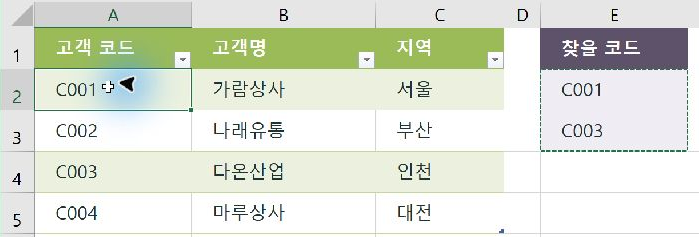
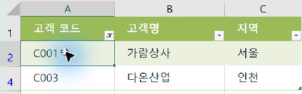
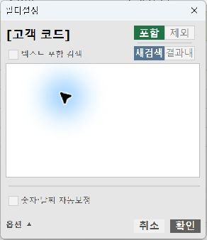

# UnivFilter

고객 코드나 품목 번호를 목록째 복사한 뒤, 찾을 열에서 **Ctrl + Shift + Q**를 누르면 해당 행만 남습니다. Windows용 Excel에서 쓰는 필터 추가 기능입니다.

[최신 버전 다운로드](https://github.com/rfastball/UnivFilter/releases/latest) · [사용 설명서 다운로드 (PDF, 3쪽)](https://github.com/rfastball/UnivFilter/raw/refs/heads/main/output/pdf/UnivFilter-guide-ko.pdf) · [설치](#설치) · [퀵 필터 사용법](#퀵-필터-사용법) · [필터 설정](#필터-설정)

## 설치

파일 탐색기 주소창에 아래 경로를 붙여넣고 **Enter**를 누르면 **XLAM을 넣을 폴더**가 열립니다.

```text
%APPDATA%\Microsoft\AddIns
```

기본 경로는 `C:\Users\<사용자 이름>\AppData\Roaming\Microsoft\AddIns`입니다.

1. 최신 릴리스의 **Assets**에서 ZIP 파일을 받아 압축을 풉니다. 그 안의 **UnivFilter.xlam**을 위 폴더에 복사하면 파일 위치는 `%APPDATA%\Microsoft\AddIns\UnivFilter.xlam`입니다. XLAM을 직접 받았다면 버전 번호가 붙은 파일 하나만 넣으면 됩니다.
2. Excel에서 **파일 → 옵션 → 추가 기능**을 엽니다. 창 아래쪽 **관리**에서 **Excel 추가 기능**을 고르고 **이동**을 누릅니다.
3. **찾아보기**로 방금 복사한 파일을 엽니다. 목록에서 **UnivFilter**에 체크하고 **확인**을 누릅니다.
4. 데이터가 있는 표에서 셀 하나를 우클릭해 **UnivFilter 실행**을 선택합니다. 설정 창에 그 열의 이름이 뜨면 설치가 끝났습니다.

## 퀵 필터 사용법

아래 표에서 고객 코드가 **C001** 또는 **C003**인 행만 찾는 예입니다. Excel 표 대신 일반 범위를 쓴다면 머리글을 포함해 범위를 선택하고 **데이터 → 필터**를 먼저 켭니다.

1. 오른쪽 **찾을 코드**에서 `E2:E3`을 선택해 **Ctrl + C**로 복사합니다. 다른 시트나 메모장에서 복사해도 됩니다. 여러 값은 줄바꿈이나 탭으로 나눕니다. `1,000`처럼 쉼표가 들어간 값은 하나로 읽습니다.
   셀 안에 **Alt + Enter**로 넣은 줄바꿈이 있으면 셀 전체를 복사하세요. 여러 줄짜리 셀도 검색값 하나로 읽습니다. 메모장 등에서 가져온 일반 텍스트는 줄마다 한 값으로 읽으며, 여러 줄을 한 값으로 찾으려면 그 값 전체를 큰따옴표로 감쌉니다.
2. 왼쪽 표에서 **고객 코드** 열의 셀 하나를 클릭합니다. 그림에서는 `A2`입니다.



3. **Ctrl + Shift + Q**를 누르면 **가람상사(C001)**와 **다온산업(C003)**만 남습니다. 전체 목록을 다시 보려면 표 안을 클릭하고 **데이터 → 지우기**를 누릅니다.



퀵 필터는 표에 걸려 있던 필터를 풀고 새로 검색합니다. 다른 열의 필터도 함께 쓰려면 설정 창에서 **결과내**를 고릅니다. 복사한 값이 표에 하나도 없으면 기존 필터와 클립보드는 그대로 둡니다.

## 필터 설정

1. 찾을 열에서 **Ctrl + Shift + U**를 누릅니다. 셀을 우클릭해 **UnivFilter 실행**을 골라도 됩니다.
2. 창 왼쪽 위에서 열 이름을 확인합니다. 예제에서는 **[고객 코드]**입니다. 가운데 흰 칸에 값 목록을 붙여넣습니다.
3. 조건을 고르고 **확인**을 누릅니다. 입력란에 커서가 있으면 **F5**로도 실행할 수 있습니다.



| 검색 조건 | 설정 |
|---|---|
| 목록에 있는 값만 보기 / 목록에 있는 값 숨기기 | **포함** / **제외** |
| 고객 코드가 정확히 `C001`인 행 | **텍스트 포함 검색** 체크 해제 |
| 고객명에 ‘상사’가 들어가는 행 | 고객명 열에서 **텍스트 포함 검색**에 체크하고 `상사` 입력 |
| 기존 필터를 풀고 다시 검색 | **새검색** |
| 다른 열의 필터를 둔 채 현재 열에서 검색 | **결과내** |
| `1000`으로 검색해 `1,000`으로 표시된 값 찾기 | **옵션 → 숫자·날짜 자동보정** 체크 |

자동보정은 처음에는 꺼져 있습니다. 켜 두면 완전일치 검색에서 숫자나 날짜를 찾지 못했을 때 셀의 표시 형식으로 한 번 더 비교합니다. 이 설정은 Excel을 닫을 때까지 퀵 필터에서도 쓰입니다.

**찾지 못한 값**이 일부 있으면 포함 모드에서는 그 값들만 클립보드에 복사합니다. 메모장이나 빈 셀에 붙여넣어 확인할 수 있습니다.

<details>
<summary>표시 형식과 긴 문자열의 제한</summary>

- 실제 값이 달라도 셀에 똑같이 표시되면 함께 선택될 수 있습니다. 숫자·날짜 자동보정에서도 셀 서식에 따라 반올림한 값이 일치할 수 있습니다.
- 한 열에 서로 다른 값이 많으면 **제외** 검색에 시간이 걸릴 수 있습니다.
- 255자를 넘는 값만 찾을 때는 한 번에 두 개까지 검색할 수 있습니다. 세 개 이상이면 오류를 알리고 기존 필터를 그대로 둡니다. 긴 값에 짧은 값이나 빈칸이 섞이면 긴 값은 건너뛰고 경고를 띄웁니다.

</details>

## 개발 및 라이선스

개발용 통합 문서는 `UnivFilter.xlsm`입니다. [개발 안내](AGENTS.md)에 빌드 절차가, [모듈 구조](src/CLAUDE.md)에 VBA 코드 설명이 있습니다.

[MIT License](LICENSE) · Copyright (c) 2026 JM. 재배포할 때는 `LICENSE`의 저작권 및 허가 고지를 함께 포함하세요.
