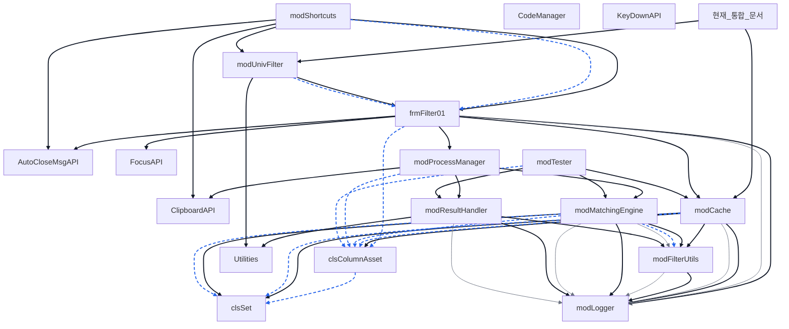

# Project: UnivFilter(v2.6).xlsb
## Overview
- **Export Date:** 2026-06-30 20:10:59
- **Total Modules:** 21
- **Total LoC:** 4381 lines

## Guidelines
- **Role:** You are a senior VBA architect specializing in clean, modular code.
- **Source Respect:** Use the `API Reference` and `Dependency Graph` to avoid redundant logic.
- **Global Sync:** Refer to `Global Definitions` for Enums/Constants before hardcoding.
- **Conventions:** Follow existing naming patterns and modular structure found in the source code.

---

## Architecture
### External Dependencies
- VBA (Visual Basic For Applications)
- Excel (Microsoft Excel 16.0 Object Library)
- stdole (OLE Automation)
- Office (Microsoft Office 16.0 Object Library)
- MSForms (Microsoft Forms 2.0 Object Library)

## [3] ??? Module Dependency Graph
> 프로젝트 내 모듈 및 클래스 간의 참조/호출 관계를 나타내는 구조도입니다.



**Legend:** solid = call/New/module reference, dashed = type declaration, dotted = @depends metadata, thin = enum/constant use.


### Module Inventory
| Module | Type | Lines |
|---|---|---|
| `현재_통합_문서` | Document | 69 |
| `Sheet3` | Document | 0 |
| `Sheet4` | Document | 0 |
| `AutoCloseMsgAPI` | Standard | 22 |
| `ClipboardAPI` | Standard | 134 |
| `clsColumnAsset` | Class | 58 |
| `clsSet` | Class | 203 |
| `CodeManager` | Standard | 262 |
| `FocusAPI` | Standard | 46 |
| `frmFilter01` | UserForm | 577 |
| `KeyDownAPI` | Standard | 20 |
| `modCache` | Standard | 276 |
| `modFilterUtils` | Standard | 800 |
| `modLogger` | Standard | 119 |
| `modMatchingEngine` | Standard | 493 |
| `modProcessManager` | Standard | 116 |
| `modResultHandler` | Standard | 219 |
| `modShortcuts` | Standard | 105 |
| `modTester` | Standard | 371 |
| `modUnivFilter` | Standard | 436 |
| `Utilities` | Standard | 55 |

---

## Global Definitions
> Enums, Constants, and Types used across the project.

- `[clsSet]` Public Enum SetRetMode
- `[frmFilter01]` Public MyFormKey As String          ' 폼 인스턴스 관리를 위한 고유 식별자
- `[frmFilter01]` Public InjectHeaderName As String   ' 선택된 열의 헤더 이름
- `[frmFilter01]` Public InjectRelativeCol As Long    ' 필터 영역 내에서의 상대적 열 번호
- `[KeyDownAPI]` Public Const VK_LBUTTON = &H1
- `[KeyDownAPI]` Public Const VK_RBUTTON = &H2
- `[KeyDownAPI]` Public Const VK_CONTROL = &H11
- `[KeyDownAPI]` Public Const VK_MENU = &H12    ' Alt Key
- `[KeyDownAPI]` Public Const VK_SHIFT = &H10
- `[modFilterUtils]` Public Enum FilterDataType
- `[modLogger]` Public Enum LogLevel
- `[modUnivFilter]` Public G_LastExcludeMode As Boolean     ' 마지막 제외 모드 상태
- `[modUnivFilter]` Public G_LastStackMode As Boolean       ' 마지막 누적 모드 상태
- `[modUnivFilter]` Public G_LastMatchMode As Boolean       ' 마지막 일치 모드 상태
- `[modUnivFilter]` Public G_OpenForms As Collection        ' 폼 중복 실행 방지용 컬렉션

---

## API Reference
> Detailed procedure signatures for each module.

### 현재_통합_문서
- `Private Sub Workbook_Open()`
- `Private Sub Workbook_BeforeClose(Cancel As Boolean)`
- `Private Sub Workbook_AddinInstall()`
- `Private Sub Workbook_AddinUninstall()`
- `Private Sub Workbook_WindowActivate(ByVal Wn As Window)`
- `Private Sub Workbook_WindowDeactivate(ByVal Wn As Window)`
- `Private Sub AppEvents_SheetChange(ByVal Sh As Object, ByVal Target As Range)`
- `Private Sub AppEvents_SheetCalculate(ByVal Sh As Object)`

### Sheet3
- *(No routines)*

### Sheet4
- *(No routines)*

### AutoCloseMsgAPI
- `Public Sub AutoCloseMsgBox_Popup(msg As String, Optional sec As Long = 1, Optional title As String = "알림")`

### ClipboardAPI
- `Public Function SetClipboardText(ByVal text As String) As Boolean`
- `Public Function GetClipboardText() As String`

### clsColumnAsset
- `Public Sub Init(ByVal builtSet As clsSet, _`
- `Public Property Get data() As clsSet`
- `Public Property Get DetectedType() As String`
- `Public Property Get fmt() As String`
- `Public Property Get ID() As String`
- `Public Property Get ColumnType() As String`
- `Public Property Get ColumnFormat() As String`

### clsSet
- `Private Sub Class_Initialize()`
- `Private Sub Class_Terminate()`
- `Public Sub Clear()`
- `Public Sub Add(ByVal vItem As Variant)`
- `Public Sub Remove(ByVal vItem As Variant)`
- `Public Function Contains(ByVal vItem As Variant) As Boolean`
- `Public Property Get Count() As Long`
- `Public Sub LoadFromArray(ByVal vArr As Variant)`
- `Public Function Compare(ByVal otherSet As clsSet, _`
- `Public Function Intersection(ByVal otherSet As clsSet) As clsSet`
- `Public Function Difference(ByVal otherSet As clsSet) As clsSet`
- `Public Function DifferenceInput(ByVal otherSet As clsSet) As clsSet`
- `Public Function Union(ByVal otherSet As clsSet) As clsSet`
- `Public Function ToArray() As Variant`
- `Public Property Get InternalDict() As Object`
- `Public Property Get KeysArray() As Variant`

### CodeManager
- `Sub ImportVBA_From_ImportFolder()`
- `Sub UpdateModuleCode(modName As String, modType As String, content As String)`
- `Function ReadTextFileUTF8(filePath As String) As String`
- `Sub SaveTextAsUTF8(filePath As String, content As String)`
- `Sub ExportAllVBAElements()`
- `Sub ExportAllToTextFiles()`
- `Sub ExportAllToOneTextFile()`

### FocusAPI
- `Public Function FocusWindowByPartialTitle(partialTitle As String) As Boolean`

### frmFilter01
- `Public Property Set InjectBodyRange(ByVal rng As Range)`
- `Log "Property Set InjectBodyRange: " & rng.Address(False, False), lvlDebug`
- `Public Property Get InjectBodyRange() As Range`
- `Public Property Set InjectFilterArea(ByVal rng As Range)`
- `Log "Property Set InjectFilterArea: " & rng.Address(False, False), lvlDebug`
- `Public Property Get InjectFilterArea() As Range`
- `Public Sub RunQuickFilter(ByVal clipText As String)`
- `Public Sub StartInitialization()`
- `Private Sub UserForm_Initialize()`
- `Private Sub UserForm_Activate()`
- `Private Sub UserForm_Terminate()`
- `Private Sub btnApply_Click()`
- `Private Sub btnCancel_Click()`
- `Private Sub UpdateUI()`
- `Private Sub SetLabelStyle(lbl As MSForms.Label, bgCol As Long, fontCol As Long, isBold As Boolean, borderCol As Long)`
- `Public Sub EnforceHybridMode()`
- `Public Sub EnforceRoundingMode()`
- `Public Sub EnforceDateMode()`
- `Private Sub LockControls(sTag As String, sCaption As String)`
- `Public Property Get AssetType() As String`
- `Private Sub ShowHybridGuideMsg()`
- `Private Sub ShowRoundingGuideMsg()`
- `Private Sub ShowDateGuideMsg()`
- `Private Sub lblModeIn_Click():  pIsExcludeMode = False: G_LastExcludeMode = False: UpdateUI: Log "Mode Change: Include", lvlDebug: End Sub`
- `Private Sub lblModeOut_Click(): pIsExcludeMode = True:  G_LastExcludeMode = True:  UpdateUI: Log "Mode Change: Exclude", lvlDebug: End Sub`
- `Private Sub lblReset_Click():   pIsStackMode = False:   G_LastStackMode = False:   UpdateUI: Log "Mode Change: Reset", lvlDebug: End Sub`
- `Private Sub lblStack_Click():   pIsStackMode = True:    G_LastStackMode = True:    UpdateUI: Log "Mode Change: Stack", lvlDebug: End Sub`
- `Private Sub lblMatchSwitch_Click()`
- `Private Sub lblMatchText_Click()`
- `Private Sub lblApply_Click(): Call btnApply_Click: End Sub`
- `Private Sub lblCancel_Click(): Call btnCancel_Click: End Sub`
- `Private Sub UserForm_MouseMove(ByVal Button As Integer, ByVal Shift As Integer, ByVal x As Single, ByVal Y As Single)`
- `Private Sub ResetHoverEffects()`
- `Private Sub lblModeIn_MouseMove(ByVal Button As Integer, ByVal Shift As Integer, ByVal x As Single, ByVal Y As Single)`
- `Private Sub lblModeOut_MouseMove(ByVal Button As Integer, ByVal Shift As Integer, ByVal x As Single, ByVal Y As Single)`
- `Private Sub lblReset_MouseMove(ByVal Button As Integer, ByVal Shift As Integer, ByVal x As Single, ByVal Y As Single)`
- `Private Sub lblStack_MouseMove(ByVal Button As Integer, ByVal Shift As Integer, ByVal x As Single, ByVal Y As Single)`
- `Private Sub lblMatchSwitch_MouseMove(ByVal Button As Integer, ByVal Shift As Integer, ByVal x As Single, ByVal Y As Single)`
- `Private Sub lblMatchText_MouseMove(ByVal Button As Integer, ByVal Shift As Integer, ByVal x As Single, ByVal Y As Single)`
- `Private Sub lblApply_MouseMove(ByVal Button As Integer, ByVal Shift As Integer, ByVal x As Single, ByVal Y As Single)`
- `Private Sub lblCancel_MouseMove(ByVal Button As Integer, ByVal Shift As Integer, ByVal x As Single, ByVal Y As Single)`
- `Private Sub RunGlobalShortcuts(ByVal KeyCode As MSForms.ReturnInteger, ByVal Shift As Integer)`
- `Private Sub txtFilterValues_KeyDown(ByVal KeyCode As MSForms.ReturnInteger, ByVal Shift As Integer)`
- `Private Sub UserForm_KeyDown(ByVal KeyCode As MSForms.ReturnInteger, ByVal Shift As Integer)`

### KeyDownAPI
- `Public Function IsKeyDown(ByVal vKey As Long) As Boolean`

### modCache
- `Public Function GetColumnAsset(ByVal rngCol As Range) As clsColumnAsset`
- `Private Function FlattenArray(ByVal vArr As Variant) As Variant`
- `Private Function CVErrToString(ByVal vErr As Variant) As String`
- `Public Sub InvalidateCache()`
- `Public Sub InvalidateCacheBySheet(ByVal Sh As Object)`
- `Public Sub Debug_DumpCache()`

### modFilterUtils
- `Private Function GetTypeName(eType As FilterDataType) As String`
- `Public Function GetUniqueCleanData(ByVal vInput As Variant, ByVal eType As FilterDataType) As Object`
- `Private Function ConvertToFlatArray(ByVal vInput As Variant) As Variant`
- `Private Function StringToArray(ByVal strRaw As String) As Variant`
- `Private Function RangeToArray(ByVal rngTarget As Range) As Variant`
- `Private Function CleanValue(ByVal vRaw As Variant, ByVal eType As FilterDataType) As Variant`
- `Private Function ExtractNumberAggressive(ByVal sInput As String) As Variant`
- `Public Function GetRepresentativeFormat(ByVal rngData As Range) As String`
- `Public Function GetColumnIdentity(targetCol As Range) As String`
- `Private Function IsDateFmt(ByVal sFmt As String) As Boolean`
- `Public Function GetSafeFormattedText(ByVal vVal As Variant, ByVal sFmt As String) As String`
- `Public Function GetCleanFormat(ByVal rawFmt As String) As String`
- `Public Function GetAccountingFilterString(ByVal vValue As Variant, ByVal sFormat As String) As String`
- `Public Function GetPercentageFilterString(ByVal vValue As Variant, ByVal sFormat As String) As String`

### modLogger
- `Public Sub Log(ByVal Message As String, Optional ByVal Level As LogLevel = lvlInfo)`
- `Private Sub AppendToLogFile(ByVal logContent As String)`
- `Private Sub CheckAndRotateLog(ByVal filePath As String)`

### modMatchingEngine
- `Public Function CalculateCriteria( _`
- `Private Function ExecuteValueStrategy( _`
- `Private Function ExecuteStringStrategy( _`
- `Private Function GetPartialMatch_Smart( _`
- `Private Function GetPartialMatch_Fast( _`
- `Private Function FormatSetToCriteria(targetSet As clsSet, sFmt As String) As Variant`
- `Private Function MapIdentityToEnum(sID As String) As FilterDataType`

### modProcessManager
- `Public Function ExecuteFilterProcess( _`
- `Public Function ProcessMissingData(ByVal vMissing As Variant) As String`

### modResultHandler
- `Public Sub ApplyFilterResult( _`
- `Public Sub GenerateResultReport( _`

### modShortcuts
- `Public Sub UnivFilter_QuickHandler()`
- `Public Sub UnivFilter_UIHandler()`
- `Private Function SetupFormData(ByRef frm As frmFilter01) As Boolean`

### modTester
- `Public Sub Run_SpecValidation()`
- `Private Sub Test_Spec( _`
- `Private Sub Record_Result( _`
- `Private Sub SetupReportSheet()`
- `Private Sub SetupSpecSheet()`
- `Private Function GetSafeNoise(vTarget As Variant) As Variant`

### modUnivFilter
- `Sub ShowUniversalFilter()`
- `Public Sub MoveFormToCursor_API(frm As Object)`
- `Public Sub MoveFormToCell_API(frm As Object, targetCell As Range)`
- `Sub SetupContextMenu()`
- `Sub RemoveContextMenu()`
- `Sub ToggleSearchButtonsInSelection()`
- `Sub DeleteButtonsInSelection()`
- `Sub DeleteAllFilterButtons()`
- `Sub CallFilterFromMenu()`

### Utilities
- `Public Sub OptimizedMode(ByVal enable As Boolean)`

---

## Source Code

### File: `현재_통합_문서`
```vba
' ==========================================================
' [ThisWorkbook] UnivFilter 전역 감시 및 설정
' ==========================================================
Option Explicit

' 엑셀 어플리케이션 전체 이벤트를 받기 위한 변수
Private WithEvents AppEvents As Application

Private Sub Workbook_Open()
    ' 1. 앱 레벨 이벤트 연결 (엑셀 전체 감시 시작)
    Set AppEvents = Application
    
    ' 2. 단축키 바인딩
    Application.OnKey "^+Q", "UnivFilter_QuickHandler"
    Application.OnKey "^+U", "UnivFilter_UIHandler"
    
    SetupContextMenu
End Sub

Private Sub Workbook_BeforeClose(Cancel As Boolean)
    ' 1. 단축키 및 메뉴 해제
    Application.OnKey "^+Q"
    Application.OnKey "^+U"
    RemoveContextMenu
    
    ' 2. 감시 해제 및 메모리 정리
    Set AppEvents = Nothing
    modCache.InvalidateCache ' 종료 시에는 전체 초기화
End Sub

Private Sub Workbook_AddinInstall()
    SetupContextMenu
End Sub

Private Sub Workbook_AddinUninstall()
    RemoveContextMenu
End Sub

Private Sub Workbook_WindowActivate(ByVal Wn As Window)
    SetupContextMenu
End Sub

Private Sub Workbook_WindowDeactivate(ByVal Wn As Window)
    RemoveContextMenu
End Sub

' ==========================================================
' [Core] 전역 데이터 변경 감지 로직
' ==========================================================

' 1. 값 변경 감지 (Cell Value Change)
Private Sub AppEvents_SheetChange(ByVal Sh As Object, ByVal Target As Range)
    ' Add-in 파일 내부의 변경은 무시 (무한 루프 방지)
    If Sh.Parent Is ThisWorkbook Then Exit Sub
    
    ' 변경된 시트(Sh)에 해당하는 캐시만 부분 삭제 요청
    modCache.InvalidateCacheBySheet Sh
End Sub

' 2. 수식 재계산 감지 (Formula Recalculation)
Private Sub AppEvents_SheetCalculate(ByVal Sh As Object)
    ' Add-in 파일 내부의 변경은 무시
    If Sh.Parent Is ThisWorkbook Then Exit Sub
    
    ' 재계산된 시트(Sh)에 해당하는 캐시만 부분 삭제 요청
    modCache.InvalidateCacheBySheet Sh
End Sub


```

### File: `Sheet3`
```vba
' (Empty)
```

### File: `Sheet4`
```vba
' (Empty)
```

### File: `AutoCloseMsgAPI`
```vba
' ==============================================================================
' [외부 API 및 상수 선언]
' ==============================================================================
' 자동 종료 기능이 포함된 Windows 표준 메시지 박스 API
Private Declare PtrSafe Function MessageBoxTimeout Lib "user32" Alias "MessageBoxTimeoutA" ( _
    ByVal hwnd As LongPtr, ByVal lpText As String, ByVal lpCaption As String, _
    ByVal wType As Long, ByVal wLanguageId As Integer, ByVal dwMilliseconds As Long) As Long
    
' 메시지 박스 스타일 상수
Private Const MB_ICONINFO As Long = 64
Private Const MB_TOPMOST As Long = &H40000
Private Const MB_SETFOREGROUND As Long = &H10000

    
' ------------------------------------------------------------------------------
' [Utility] 자동 닫힘 메시지 팝업
' ------------------------------------------------------------------------------
Public Sub AutoCloseMsgBox_Popup(msg As String, Optional sec As Long = 1, Optional title As String = "알림")
    MessageBoxTimeout 0, msg, title, MB_ICONINFO + MB_TOPMOST + MB_SETFOREGROUND, 0, sec * 1000
End Sub
    

```

### File: `ClipboardAPI`
```vba
Option Explicit

' ========================================================================================
' 모듈: ClipboardAPI
' 설명: Windows API를 사용하여 유니코드(Unicode) 텍스트를 클립보드에 읽고 쓰는 기능 제공
' ========================================================================================

' ----------------------------------------------------------------------------------------
' [1] Windows API 선언 (64비트/32비트 호환 PtrSafe 사용)
' ----------------------------------------------------------------------------------------

' 1.1 클립보드 제어 함수
Private Declare PtrSafe Function OpenClipboard Lib "user32" (ByVal hwnd As LongPtr) As Long
Private Declare PtrSafe Function CloseClipboard Lib "user32" () As Long
Private Declare PtrSafe Function EmptyClipboard Lib "user32" () As Long
Private Declare PtrSafe Function GetClipboardData Lib "user32" (ByVal wFormat As Long) As LongPtr
Private Declare PtrSafe Function SetClipboardData Lib "user32" (ByVal wFormat As Long, ByVal hMem As LongPtr) As LongPtr

' 1.2 메모리 관리 함수 (클립보드 데이터는 전역 메모리를 사용해야 함)
Private Declare PtrSafe Function GlobalLock Lib "kernel32" (ByVal hMem As LongPtr) As LongPtr
Private Declare PtrSafe Function GlobalUnlock Lib "kernel32" (ByVal hMem As LongPtr) As Long
Private Declare PtrSafe Function GlobalAlloc Lib "kernel32" (ByVal wFlags As Long, ByVal dwBytes As LongPtr) As LongPtr
Private Declare PtrSafe Function GlobalFree Lib "kernel32" (ByVal hMem As LongPtr) As LongPtr

' 1.3 문자열 처리 함수 (유니코드/WideChar 전용)
Private Declare PtrSafe Function lstrcpyW Lib "kernel32" (ByVal lpString1 As LongPtr, ByVal lpString2 As LongPtr) As LongPtr
Private Declare PtrSafe Function lstrlenW Lib "kernel32" (ByVal lpString As LongPtr) As Long

' ----------------------------------------------------------------------------------------
' [2] 상수 선언
' ----------------------------------------------------------------------------------------
Private Const CF_UNICODETEXT As Long = 13     ' 유니코드 텍스트 포맷 ID
Private Const GMEM_MOVEABLE As Long = &H2     ' 이동 가능한 메모리 (Windows가 힙 내에서 위치 조정 가능)


' ========================================================================================
' 함수명: SetClipboardText
' 설  명: 텍스트 문자열을 클립보드에 복사합니다. (유니코드 지원)
' 반  환: 성공 시 True, 실패 시 False
' ========================================================================================
Public Function SetClipboardText(ByVal text As String) As Boolean
    Dim hMem As LongPtr     ' 할당된 전역 메모리의 핸들
    Dim lpData As LongPtr   ' 메모리의 실제 주소 (포인터)
    Dim nSize As LongPtr    ' 할당할 메모리 크기 (바이트)
    
    ' [단계 1] 클립보드 열기 (다른 앱이 사용 중이면 실패할 수 있음)
    If OpenClipboard(0) = 0 Then Exit Function
    
    ' [단계 2] 클립보드 비우기 (데이터를 쓰기 전에 반드시 비워야 함)
    EmptyClipboard
    
    ' [단계 3] 필요한 메모리 크기 계산
    ' - LenB(Text): 문자열의 바이트 수 (유니코드는 글자당 2바이트)
    ' - +2: 문자열 끝을 알리는 Null 종료 문자(2바이트) 공간 확보
    nSize = LenB(text) + 2
    
    ' [단계 4] 전역 메모리 할당
    ' - GMEM_MOVEABLE: 클립보드 데이터는 반드시 이동 가능해야 함
    hMem = GlobalAlloc(GMEM_MOVEABLE, nSize)
    
    If hMem <> 0 Then
        ' [단계 5] 메모리 잠금 (Lock)
        ' - 핸들을 통해 실제 데이터를 쓸 수 있는 메모리 주소(lpData)를 얻음
        lpData = GlobalLock(hMem)
        
        If lpData <> 0 Then
            ' [단계 6] 문자열 복사
            ' - StrPtr(Text): VBA 문자열 변수의 메모리 주소
            ' - lpData: 방금 할당받은 전역 메모리 주소
            lstrcpyW lpData, StrPtr(text)
            
            ' [단계 7] 메모리 잠금 해제 (Unlock)
            ' - 데이터 복사가 끝났으므로 잠금을 풂
            GlobalUnlock hMem
            
            ' [단계 8] 클립보드에 데이터 등록
            ' - 이제 메모리(hMem)의 소유권은 시스템(클립보드)으로 넘어감
            ' - 성공 시 시스템이 알아서 메모리를 관리하므로 GlobalFree 호출 금지
            If SetClipboardData(CF_UNICODETEXT, hMem) <> 0 Then
                SetClipboardText = True ' 성공 반환
            End If
        Else
            ' 메모리 잠금 실패 시, 할당했던 메모리를 직접 해제해야 함
            GlobalFree hMem
        End If
    End If
    
    ' [단계 9] 클립보드 닫기 (필수: 닫지 않으면 다른 프로그램에서 클립보드 사용 불가)
    CloseClipboard
End Function


' ========================================================================================
' 함수명: GetClipboardText
' 설  명: 클립보드에 있는 텍스트를 가져옵니다. (유니코드 지원)
' 반  환: 클립보드 텍스트 (없으면 빈 문자열)
' ========================================================================================
Public Function GetClipboardText() As String
    Dim hMem As LongPtr     ' 클립보드 데이터 핸들
    Dim lpData As LongPtr   ' 데이터 실제 주소
    Dim nSize As Long       ' 문자열 길이
    Dim strBuffer As String ' 결과를 담을 버퍼
    
    ' [단계 1] 클립보드 열기
    If OpenClipboard(0) = 0 Then Exit Function
    
    ' [단계 2] 유니코드 텍스트 형식의 데이터 핸들 가져오기
    hMem = GetClipboardData(CF_UNICODETEXT)
    
    If hMem <> 0 Then
        ' [단계 3] 메모리 잠금 및 포인터 획득
        lpData = GlobalLock(hMem)
        
        If lpData <> 0 Then
            ' [단계 4] 문자열 길이 계산 (Null 문자 제외한 길이)
            nSize = lstrlenW(lpData)
            
            ' [단계 5] VBA 문자열 버퍼 확보
            strBuffer = String(nSize, vbNullChar)
            
            ' [단계 6] 데이터 복사 (클립보드 -> VBA 변수)
            lstrcpyW StrPtr(strBuffer), lpData
            
            ' [단계 7] 잠금 해제
            GlobalUnlock hMem
        End If
    End If
    
    ' [단계 8] 클립보드 닫기
    CloseClipboard
    
    ' 결과 반환
    GetClipboardText = strBuffer
End Function
```

### File: `clsColumnAsset`
```vba
Option Explicit

' ========================================================
' Class: clsColumnAsset
' 설명: 열(Column) 하나의 자산 단위 (데이터 + 서식)
' ========================================================

Private mSetData As clsSet      ' 최적화된 집합 엔진
Private mFormat As String       ' 엑셀 표시 형식 (예: "#,##0")
Private mID As String           ' 캐시 키 (디버깅용)
Private mDetectedType As String ' [New] 열의 판별된 타입 (NUMBER, STRING, HYBRID 등)


' ========================================================
' [Method] 데이터 주입 (Dependency Injection)
' 설명: modCache에서 만들어진 데이터를 받아 보관만 함
' ========================================================
' ========================================================
' [Method] 데이터 주입 (Init 수정)
' 설명: 기존 인자에 sType을 추가하여 초기화 시점에 타입 정보를 받음
' ========================================================
Public Sub Init(ByVal builtSet As clsSet, _
                ByVal sFormat As String, _
                ByVal sID As String, _
                ByVal sType As String) ' <--- [New] 인자 추가
    Set mSetData = builtSet
    mFormat = sFormat
    mID = sID
    mDetectedType = sType ' [New] 타입 저장
End Sub

' ========================================================
' [Property] 읽기 전용 속성
' ========================================================
Public Property Get data() As clsSet
    Set data = mSetData
End Property
Public Property Get DetectedType() As String
    DetectedType = mDetectedType
End Property
Public Property Get fmt() As String
    fmt = mFormat
End Property

Public Property Get ID() As String
    ID = mID
End Property

' [추가] 외부에서 판별된 타입을 읽어갈 수 있도록 통로 개설
Public Property Get ColumnType() As String
    ColumnType = mDetectedType
End Property

' [추가] 표시 형식도 재활용할 가능성이 높으니 함께 추가하면 좋습니다
Public Property Get ColumnFormat() As String
    ColumnFormat = mFormat
End Property

```

### File: `clsSet`
```vba
Option Explicit

' ========================================================
' Class: clsSet
' 설명: 대용량 데이터 처리를 위한 고속 집합 연산 엔진
' 특징: Flagging 기법 및 Direct Access를 통한 극한의 최적화
' ========================================================

' [Enum] 반환 모드 정의
Public Enum SetRetMode
    srIntersect = 1 ' 교집합 (A ∩ B)
    srDiffMe = 2    ' 내 차집합 (A - B): 미사용 데이터
    srDiffOther = 3 ' 상대 차집합 (B - A): 데이터 없음(오류)
    srAllSplit = 4  ' [0]교집합, [1]내차집합, [2]상대차집합 (배열 반환)
End Enum

Private mDict As Object

Private Sub Class_Initialize()
    Set mDict = CreateObject("Scripting.Dictionary")
End Sub

Private Sub Class_Terminate()
    Set mDict = Nothing
End Sub

' ========================================================
' [Basic] 기본 데이터 관리
' ========================================================

' 초기화 (재사용 시 필수)
Public Sub Clear()
    mDict.RemoveAll
End Sub

' 개별 추가
Public Sub Add(ByVal vItem As Variant)
    If Not IsEmpty(vItem) Then
        If Not mDict.exists(vItem) Then mDict(vItem) = Empty
    End If
End Sub

' 개별 삭제
Public Sub Remove(ByVal vItem As Variant)
    If mDict.exists(vItem) Then mDict.Remove vItem
End Sub

' 존재 여부 확인
Public Function Contains(ByVal vItem As Variant) As Boolean
    Contains = mDict.exists(vItem)
End Function

' 개수 확인
Public Property Get Count() As Long
    Count = mDict.Count
End Property

' [Loader] 1차원 배열 고속 적재
' 최적화: 함수 호출 오버헤드를 줄이기 위해 내부 로직 인라인 처리
Public Sub LoadFromArray(ByVal vArr As Variant)
    Dim i As Long
    Dim vVal As Variant
    
    If Not IsArray(vArr) Then Me.Add vArr: Exit Sub
    
    For i = LBound(vArr) To UBound(vArr)
        vVal = vArr(i)
        ' 빈 값 및 에러 값 방어
        If Not IsEmpty(vVal) And Not IsError(vVal) Then
            mDict(vVal) = Empty
        End If
    Next i
End Sub

' ========================================================
' [Core] 통합 비교 엔진 (Compare)
' 설명: Single-Pass 알고리즘으로 교집합/차집합을 동시 분류
' 최적화: Dictionary 직접 접근으로 함수 호출 비용 제거
' ========================================================
Public Function Compare(ByVal otherSet As clsSet, _
                        Optional ByVal mode As SetRetMode = srAllSplit) As Variant
    
    ' 결과 객체
    Dim setCommon As clsSet, setDiffOther As clsSet, setDiffMe As clsSet
    ' 직접 접근용 변수 (속도 향상 핵심)
    Dim dictCommon As Object, dictDiffOther As Object, dictDiffMe As Object
    
    Dim vKey As Variant, arrOther As Variant
    Dim i As Long
    
    ' 1. 상태 초기화: 기존 마킹(Flag) 제거 (O(N))
    For Each vKey In mDict.Keys
        mDict(vKey) = Empty
    Next vKey
    
    ' 2. 객체 준비 (Lazy Initialization)
    If mode = srIntersect Or mode = srAllSplit Then
        Set setCommon = New clsSet: Set dictCommon = setCommon.InternalDict
    End If
    If mode = srDiffOther Or mode = srAllSplit Then
        Set setDiffOther = New clsSet: Set dictDiffOther = setDiffOther.InternalDict
    End If
    If mode = srDiffMe Or mode = srAllSplit Then
        Set setDiffMe = New clsSet: Set dictDiffMe = setDiffMe.InternalDict
    End If

    ' 3. [Primary Loop] 입력값 순회 -> 교집합 & 상대 차집합 결정
    arrOther = otherSet.KeysArray
    If UBound(arrOther) >= LBound(arrOther) Then
        For i = LBound(arrOther) To UBound(arrOther)
            vKey = arrOther(i)
            
            If mDict.exists(vKey) Then
                ' [매칭 성공] 마킹(True) 및 교집합 등록
                mDict(vKey) = True
                If Not dictCommon Is Nothing Then dictCommon(vKey) = Empty
            Else
                ' [매칭 실패] 상대 차집합 등록
                If Not dictDiffOther Is Nothing Then dictDiffOther(vKey) = Empty
            End If
        Next i
    End If
    
    ' 4. [Secondary Loop] 내 장부 순회 -> 내 차집합(미사용) 결정
    If Not dictDiffMe Is Nothing Then
        For Each vKey In mDict.Keys
            ' 마킹되지 않은(Empty) 항목만 추출
            If IsEmpty(mDict(vKey)) Then dictDiffMe(vKey) = Empty
        Next vKey
    End If
    
    ' 5. 결과 반환
    Select Case mode
        Case srIntersect: Set Compare = setCommon
        Case srDiffOther: Set Compare = setDiffOther
        Case srDiffMe:    Set Compare = setDiffMe
        Case srAllSplit:  Compare = Array(setCommon, setDiffMe, setDiffOther)
    End Select
    
End Function

' ========================================================
' [Operations] 집합 연산 래퍼 & 유틸리티
' ========================================================

' 교집합 (A ∩ B)
Public Function Intersection(ByVal otherSet As clsSet) As clsSet
    Set Intersection = Compare(otherSet, srIntersect)
End Function

' 내 차집합 (A - B, 미사용 데이터)
Public Function Difference(ByVal otherSet As clsSet) As clsSet
    Set Difference = Compare(otherSet, srDiffMe)
End Function

' 상대 차집합 (B - A, 없는 데이터)
Public Function DifferenceInput(ByVal otherSet As clsSet) As clsSet
    Set DifferenceInput = Compare(otherSet, srDiffOther)
End Function

' 합집합 (A ∪ B) - Zero Overhead Version
Public Function Union(ByVal otherSet As clsSet) As clsSet
    Dim newSet As New clsSet
    Dim TargetDict As Object
    Dim vArr As Variant, i As Long
    
    Set TargetDict = newSet.InternalDict
    
    ' 내 데이터 주입 (검증 생략)
    If mDict.Count > 0 Then
        vArr = mDict.Keys
        For i = 0 To UBound(vArr)
            TargetDict(vArr(i)) = Empty
        Next i
    End If
    
    ' 상대 데이터 주입
    If otherSet.Count > 0 Then
        vArr = otherSet.KeysArray
        For i = 0 To UBound(vArr)
            TargetDict(vArr(i)) = Empty
        Next i
    End If
    
    Set Union = newSet
End Function

' 배열로 반환
Public Function ToArray() As Variant
    If mDict.Count = 0 Then ToArray = Array() Else ToArray = mDict.Keys
End Function

' [Internal] 외부 모듈 직접 접근 허용 (최적화용)
Public Property Get InternalDict() As Object
    Set InternalDict = mDict
End Property

' [Internal] 키 배열 직접 접근 허용
Public Property Get KeysArray() As Variant
    If mDict.Count = 0 Then KeysArray = Array() Else KeysArray = mDict.Keys
End Property


```

### File: `CodeManager`
```vba

Option Explicit

' ========================================================
'  [메인] 현재경로\IMPORT 폴더의 .bas, .cls, .frm 파일로 모듈 업데이트
' ========================================================
Sub ImportVBA_From_ImportFolder()
    Dim fso As Object, folder As Object, file As Object
    Dim importPath As String
    Dim fileName As String, codeContent As String
    Dim modName As String, modType As String
    Dim ext As String
    
    ' 1. IMPORT 폴더 경로 설정
    importPath = ThisWorkbook.Path & "\IMPORT\"
    
    ' 2. 폴더 존재 여부 확인
    If Dir(importPath, vbDirectory) = "" Then
        MsgBox "현재 파일 위치에 'IMPORT' 폴더가 없습니다." & vbCrLf & _
               "경로: " & importPath, vbExclamation
        Exit Sub
    End If
    
    Set fso = CreateObject("Scripting.FileSystemObject")
    Set folder = fso.GetFolder(importPath)
    
    ' 3. IMPORT 폴더 내의 파일 순회
    For Each file In folder.Files
        ' 확장자 추출 (소문자로 변환)
        ext = LCase(fso.GetExtensionName(file.Path))
        
        ' 지원하는 확장자: bas(표준), cls(클래스), frm(폼)
        If ext = "bas" Or ext = "cls" Or ext = "frm" Then
            
            ' 파일명에서 확장자를 뺀 순수 이름 추출 (예: Module1.bas -> Module1)
            modName = fso.GetBaseName(file.Path)
            modType = ext
            
            ' 4. 파일 내용 읽기 (UTF-8 가정)
            ' ※ ReadTextFileUTF8 함수는 기존에 가지고 계신 것을 사용한다고 가정합니다.
            codeContent = ReadTextFileUTF8(file.Path)
            
            ' 5. 모듈 업데이트 또는 생성
            ' 폼(frm) 파일의 경우 바이너리(.frx)가 없으면 UI가 깨질 수 있으니 주의하세요.
            UpdateModuleCode modName, modType, codeContent
            
            Debug.Print "Updated: " & modName & " (" & modType & ")"
        End If
    Next file
    
    MsgBox "IMPORT 폴더의 파일(.bas/.cls/.frm)로 코드가 업데이트 되었습니다.", vbInformation
End Sub

' ========================================================
'  [핵심 로직] 모듈을 찾아 코드를 교체 (없으면 생성)
'  (이 부분은 기존 코드와 동일하지만, 혹시 몰라 함께 드립니다)
' ========================================================
Sub UpdateModuleCode(modName As String, modType As String, content As String)
    Dim vbProj As Object
    Dim vbComp As Object
    Dim compType As Integer
    Dim exists As Boolean
    
    Set vbProj = ThisWorkbook.VBProject
    
    ' 1. 기존 모듈 존재 여부 확인
    On Error Resume Next
    Set vbComp = vbProj.VBComponents(modName)
    If Err.Number = 0 Then exists = True Else exists = False
    On Error GoTo 0
    
    ' 2. 모듈이 없으면 새로 생성 (시트 모듈 제외)
    If Not exists Then
        ' 모듈 타입 결정
        Select Case modType
            Case "bas": compType = 1 ' 표준 모듈
            Case "cls": compType = 2 ' 클래스 모듈
            Case "frm": compType = 3 ' 폼
            Case Else: compType = 0  ' 기타
        End Select
        
        If compType > 0 Then
            Set vbComp = vbProj.VBComponents.Add(compType)
            vbComp.Name = modName
        Else
            Debug.Print "Skipped (Invalid Type): " & modName
            Exit Sub
        End If
    End If
    
    ' 3. 코드 교체 (기존 내용 지우고 덮어쓰기)
    If Not vbComp Is Nothing Then
        With vbComp.CodeModule
            ' 내용 전체 삭제 후 새로 쓰기
            If .CountOfLines > 0 Then .DeleteLines 1, .CountOfLines
            .AddFromString content
        End With
    End If
End Sub

' ========================================================
'  [공통 함수] UTF-8 텍스트 파일 읽기
' ========================================================
Function ReadTextFileUTF8(filePath As String) As String
    Dim stream As Object
    Set stream = CreateObject("ADODB.Stream")
    
    With stream
        .Type = 2              ' 텍스트 모드
        .Charset = "UTF-8"     ' UTF-8 설정
        .Open
        .LoadFromFile filePath
        ReadTextFileUTF8 = .ReadText
        .Close
    End With
    
    Set stream = Nothing
End Function

' ========================================================
'  공통 함수: 텍스트 내용을 UTF-8 파일로 저장
' ========================================================
Sub SaveTextAsUTF8(filePath As String, content As String)
    Dim stream As Object
    Set stream = CreateObject("ADODB.Stream")
    With stream
        .Type = 2
        .Charset = "UTF-8"
        .Open
        .WriteText content
        .SaveToFile filePath, 2 ' 덮어쓰기
        .Close
    End With
End Sub

' ========================================================
'  1. 원래 확장자(.bas, .cls 등)를 유지하며 UTF-8로 내보내기
' ========================================================
Sub ExportAllVBAElements()
    Dim vbComp As Object
    Dim savePath As String
    Dim folderName As String
    Dim codeContent As String
    Dim fileExt As String
    
    ' 저장할 폴더 설정
    folderName = "VBA_Export_" & Format(Now, "yyyymmdd_hhmmss")
    savePath = ThisWorkbook.Path & "\" & folderName & "\"
    
    If Dir(savePath, vbDirectory) = "" Then MkDir savePath
    
    For Each vbComp In ThisWorkbook.VBProject.VBComponents
        ' 코드가 있는 경우만 처리
        If vbComp.CodeModule.CountOfLines > 0 Then
            ' 확장자 결정
            Select Case vbComp.Type
                Case 1: fileExt = ".bas" ' 표준 모듈
                Case 2: fileExt = ".cls" ' 클래스 모듈
                Case 3: fileExt = ".frm" ' 폼 (주의: 폼의 디자인/바이너리 정보는 제외되고 코드만 저장됨)
                Case 100: fileExt = ".cls" ' 시트/워크북
                Case Else: fileExt = ".txt"
            End Select
            
            ' 코드 내용 가져오기
            codeContent = vbComp.CodeModule.Lines(1, vbComp.CodeModule.CountOfLines)
            
            ' UTF-8로 저장 (Attribute 정보 등은 제외되고 순수 코드만 저장됩니다)
            SaveTextAsUTF8 savePath & vbComp.Name & fileExt, codeContent
        End If
    Next vbComp
    
    MsgBox "모든 코드가 UTF-8 형식으로 다음 위치에 저장되었습니다:" & vbCrLf & savePath, vbInformation
End Sub

' ========================================================
'  2. 모든 코드를 개별 텍스트 파일(.txt)로 UTF-8 내보내기
' ========================================================
Sub ExportAllToTextFiles()
Dim vbComp As Object
    Dim savePath As String
    Dim folderName As String
    Dim codeContent As String
    Dim typeExt As String   ' 원래의 타입 확장자 (.bas, .cls 등)
    
    ' 저장할 폴더 설정
    folderName = "VBA_Export_" & Format(Now, "yyyymmdd_hhmmss")
    savePath = ThisWorkbook.Path & "\" & folderName & "\"
    
    ' 폴더 생성
    If Dir(savePath, vbDirectory) = "" Then MkDir savePath
    
    For Each vbComp In ThisWorkbook.VBProject.VBComponents
        ' 코드가 있는 경우만 처리
        If vbComp.CodeModule.CountOfLines > 0 Then
            
            ' 1. 원래 확장자(타입) 결정
            Select Case vbComp.Type
                Case 1: typeExt = ".bas"   ' 표준 모듈
                Case 2: typeExt = ".cls"   ' 클래스 모듈
                Case 3: typeExt = ".frm"   ' 폼 (코드만 저장됨)
                Case 100: typeExt = ".cls" ' 시트/ThisWorkbook (이것들도 일종의 클래스입니다)
                Case Else: typeExt = ""    ' 기타
            End Select
            
            ' 코드 내용 가져오기
            codeContent = vbComp.CodeModule.Lines(1, vbComp.CodeModule.CountOfLines)
            
            ' 2. UTF-8로 저장 (파일명 규칙: 모듈명 + 타입확장자 + .txt)
            ' 예: MyMacro.bas.txt, Sheet1.cls.txt, Class1.cls.txt
            SaveTextAsUTF8 savePath & vbComp.Name & typeExt & ".txt", codeContent
            
        End If
    Next vbComp
    
    MsgBox "모든 코드가 [.타입.txt] 형식의 UTF-8 파일로 저장되었습니다:" & vbCrLf & savePath, vbInformation
End Sub
' ========================================================
'  3. 모든 코드를 하나의 텍스트 파일로 통합하여 UTF-8 내보내기
' ========================================================
Sub ExportAllToOneTextFile()
    Dim vbComp As Object
    Dim savePath As String
    Dim stream As Object
    Dim codeText As String
    
    savePath = ThisWorkbook.Path & "\All_VBA_Code.txt"
    
    ' ADODB 스트림 생성 (하나의 파일에 계속 쓰기 위해 루프 밖에서 생성)
    Set stream = CreateObject("ADODB.Stream")
    stream.Type = 2
    stream.Charset = "UTF-8"
    stream.Open
    
    ' 헤더 작성
    stream.WriteText "================================================" & vbCrLf
    stream.WriteText " VBA PROJECT EXPORT - " & Now & vbCrLf
    stream.WriteText " FILE: " & ThisWorkbook.Name & vbCrLf
    stream.WriteText "================================================" & vbCrLf & vbCrLf
    
    ' 모든 구성 요소 순회
    For Each vbComp In ThisWorkbook.VBProject.VBComponents
        If vbComp.CodeModule.CountOfLines > 0 Then
            ' 구분선 및 모듈 정보
            stream.WriteText ">>> MODULE: " & vbComp.Name & " (Type: " & vbComp.Type & ")" & vbCrLf
            stream.WriteText "------------------------------------------------" & vbCrLf
            
            ' 모듈 내 코드 가져오기
            codeText = vbComp.CodeModule.Lines(1, vbComp.CodeModule.CountOfLines)
            stream.WriteText codeText & vbCrLf
            
            ' 푸터
            stream.WriteText vbCrLf & "' --- End of " & vbComp.Name & " ---" & vbCrLf & vbCrLf
        End If
    Next vbComp
    
    ' 파일 저장
    stream.SaveToFile savePath, 2 ' 2 = 덮어쓰기
    stream.Close
    Set stream = Nothing
    
    MsgBox "모든 코드가 하나의 UTF-8 파일로 합쳐졌습니다!" & vbCrLf & savePath, vbInformation
End Sub
```

### File: `FocusAPI`
```vba
' [윈도우 제어: 창 찾기 및 포커스]
Private Declare PtrSafe Function FindWindow Lib "user32" Alias "FindWindowA" (ByVal lpClassName As String, ByVal lpWindowName As String) As LongPtr
Private Declare PtrSafe Function GetWindow Lib "user32" (ByVal hwnd As LongPtr, ByVal wCmd As Long) As LongPtr
Private Declare PtrSafe Function GetWindowText Lib "user32" Alias "GetWindowTextA" (ByVal hwnd As LongPtr, ByVal lpString As String, ByVal cch As Long) As Long
Private Declare PtrSafe Function GetWindowTextLength Lib "user32" Alias "GetWindowTextLengthA" (ByVal hwnd As LongPtr) As Long
Private Declare PtrSafe Function SetForegroundWindow Lib "user32" (ByVal hwnd As LongPtr) As Long
Private Declare PtrSafe Function ShowWindow Lib "user32" (ByVal hwnd As LongPtr, ByVal nCmdShow As Long) As Long
Private Declare PtrSafe Function IsIconic Lib "user32" (ByVal hwnd As LongPtr) As Long

Private Const GW_HWNDNEXT As Long = 2
Private Const SW_RESTORE As Long = 9

' [윈도우 포커스] 제목 일부만 일치해도 창을 찾아 활성화
Public Function FocusWindowByPartialTitle(partialTitle As String) As Boolean
    Dim hwnd As LongPtr
    Dim winTitle As String
    Dim lenTitle As Long
    
    ' 현재 실행 중인 첫 번째 윈도우 핸들
    hwnd = FindWindow(vbNullString, vbNullString)
    
    Do While hwnd <> 0
        lenTitle = GetWindowTextLength(hwnd)
        If lenTitle > 0 Then
            winTitle = String(lenTitle, vbNullChar)
            GetWindowText hwnd, winTitle, lenTitle + 1
            winTitle = Left(winTitle, lenTitle)
            
            ' 부분 일치 검사
            If InStr(1, winTitle, partialTitle, vbTextCompare) > 0 Then
                ' 최소화 상태면 복구
                If IsIconic(hwnd) Then
                    ShowWindow hwnd, SW_RESTORE
                Else
                    SetForegroundWindow hwnd
                End If
                FocusWindowByPartialTitle = True
                Exit Function
            End If
        End If
        hwnd = GetWindow(hwnd, GW_HWNDNEXT)
    Loop
    
    FocusWindowByPartialTitle = False
End Function

```

### File: `frmFilter01`
```vba

Option Explicit

' ==============================================================================
' [내부 변수 선언]
' ==============================================================================
' 폼 상태 제어 플래그
Private pIsExcludeMode As Boolean   ' True: 제외(Exclude), False: 포함(Include)
Private pIsStackMode As Boolean     ' True: 누적(Stack), False: 초기화(Reset)
Private pIsPartialMatch As Boolean  ' True: 부분일치, False: 완전일치

' 외부 호출부(Main)로부터 주입받는 변수
Public MyFormKey As String          ' 폼 인스턴스 관리를 위한 고유 식별자
Public InjectHeaderName As String   ' 선택된 열의 헤더 이름
Public InjectRelativeCol As Long    ' 필터 영역 내에서의 상대적 열 번호

' 내부 데이터 처리 객체 및 범위
Private m_rngBody As Range           ' 데이터 본문 범위 (분석 대상)
Private m_rngFilterArea As Range     ' 필터가 실제로 적용될 영역
Private m_Asset As clsColumnAsset    ' [신규 엔진] 열 속성 및 데이터 집합 관리 객체

' ==============================================================================
' [Data Injection] 외부 데이터 주입 프로퍼티
' ==============================================================================
' 분석용 본문 범위 주입
Public Property Set InjectBodyRange(ByVal rng As Range)
    Set m_rngBody = rng
    ' [LOG] 데이터 주입 확인
    Log "Property Set InjectBodyRange: " & rng.Address(False, False), lvlDebug
End Property

Public Property Get InjectBodyRange() As Range
    Set InjectBodyRange = m_rngBody
End Property

' 필터 적용 대상 범위 주입
Public Property Set InjectFilterArea(ByVal rng As Range)
    Set m_rngFilterArea = rng
    ' [LOG] 필터 영역 주입 확인
    Log "Property Set InjectFilterArea: " & rng.Address(False, False), lvlDebug
End Property

Public Property Get InjectFilterArea() As Range
    Set InjectFilterArea = m_rngFilterArea
End Property


' ----------------------------------------------------------
' 목적: 단축키 퀵모드 실행 (UI 조작 없이 로직만 수행)
' ----------------------------------------------------------
Public Sub RunQuickFilter(ByVal clipText As String)
    Log "RunQuickFilter: 시작", lvlInfo
    
    ' 1. 자산 생성 (내부 메서드 활용)
    Me.StartInitialization
    
    ' 2. 오케스트레이터 직접 호출 (btnApply_Click 우회 -> UI 오버헤드 제거)
    '    퀵 모드는 보통 '완전 일치'를 원하므로 Partial=False로 넘깁니다.
    Dim dictResult As Object
    Set dictResult = modProcessManager.ExecuteFilterProcess( _
                        clipText, _
                        m_Asset, _
                        m_rngFilterArea, _
                        InjectRelativeCol, _
                        False, _
                        False, _
                        False)

    ' 누락 데이터 처리 (제외 모드가 아닐 때만)
    If Not G_LastExcludeMode Then
        Dim sMissingMsg As String
        sMissingMsg = modProcessManager.ProcessMissingData(dictResult("MissingData"))
        
        ' 누락된 게 있을 때만 팝업 (사용자 주의 환기)
        If sMissingMsg <> "" Then
            AutoCloseMsgBox_Popup sMissingMsg, 2, "누락 데이터 알림"
        End If
    End If
End Sub
' ==============================================================================
' [Asset Initialization] 데이터 자산화 및 고속 로드
' ==============================================================================
Public Sub StartInitialization()
    Log "StartInitialization: 데이터 로드 및 분석 시작", lvlInfo

    ' 데이터 범위가 지정되지 않은 경우 즉시 종료
    If m_rngBody Is Nothing Then
        Log "StartInitialization: m_rngBody가 Nothing이므로 중단", lvlWarning
        Exit Sub
    End If
    
' =========================================================
    ' [CORE FIX] 캐시 매니저(modCache)에게 자산 요청
    ' 설명: 이제 데이터 로드, 평탄화(에러 처리 포함), 분석, 캐싱까지
    '       모두 modCache.GetColumnAsset이 알아서 처리합니다.
    ' =========================================================
    Set m_Asset = modCache.GetColumnAsset(m_rngBody)
    
    ' [LOG] 자산 수령 확인
    Log "StartInitialization: 자산 수령 완료 (Type: " & m_Asset.DetectedType & ", Count: " & m_Asset.data.Count & ")", lvlDebug
    
    ' =========================================================
    ' [UI Lock] 데이터 타입에 따른 UI 강제 잠금 분기 처리
    ' =========================================================
    Select Case m_Asset.DetectedType
        ' 1. 데이터 오염/혼합 -> Hybrid 모드 잠금
        Case "HYBRID", "ERROR"
            Log "StartInitialization: 정합성 이슈(" & m_Asset.DetectedType & ") -> Hybrid 잠금 실행", lvlWarning
            Me.EnforceHybridMode
            
        ' 2. 반올림/퍼센트 이슈 -> Rounding 모드 잠금 (NEW)
        Case "ROUNDED", "PERCENT_ROUNDED"
            Log "StartInitialization: 반올림 이슈(" & m_Asset.DetectedType & ") -> Rounding 잠금 실행", lvlWarning
            Me.EnforceRoundingMode
            
        ' 3. 날짜... 완전일치 구현 못하겄다 항복
        Case "DATE"
            Log "StartInitialization: 날짜 이슈(" & m_Asset.DetectedType & ") -> Date 잠금 실행", lvlWarning
            Me.EnforceDateMode
            
        Case Else
            ' 정상 상태: 아무것도 하지 않음 (기본값 유지)
    End Select
End Sub

' ==============================================================================
' [Form Life-Cycle] 폼 생명주기 관리
' ==============================================================================
Private Sub UserForm_Initialize()
    Log "UserForm_Initialize: 폼 로드 시작", lvlInfo
    
    
    ' 버튼 레이아웃 초기화 (Default/Cancel 버튼 설정)
    btnApply.Visible = True: btnApply.Left = 9000: btnApply.Default = True
    btnCancel.Visible = True: btnCancel.Left = 9000: btnCancel.Cancel = True
    
    lblInfo.Caption = "대기 중..."
    txtFilterValues.text = ""
    
    ' 전역 변수에 기록된 사용자의 마지막 작업 상태 복원
    pIsExcludeMode = G_LastExcludeMode
    pIsStackMode = G_LastStackMode
    pIsPartialMatch = False ' 초기 매칭 모드는 완전일치로 고정
    
    Log "UserForm_Initialize: 상태 복원 (Exclude: " & pIsExcludeMode & ", Stack: " & pIsStackMode & ")", lvlDebug
    
    ResetHoverEffects
    UpdateUI
End Sub

Private Sub UserForm_Activate()
    ' 1. [기본 동작] 헤더 이름 표시 (무조건 표시)
    If InjectHeaderName <> "" Then
        Dim displayHeader As String
        displayHeader = IIf(Len(InjectHeaderName) > 10, Left(InjectHeaderName, 8) & "...", InjectHeaderName)
        lblInfo.Caption = "[" & displayHeader & "]"
        lblInfo.ControlTipText = InjectHeaderName
    Else
        lblInfo.Caption = "로드 실패"
    End If
    
    ' 2. [스타일링] 잠금 상태면 헤더 색상만 '경고색'으로 변경 (내용은 유지)
    If lblMatchSwitch.Enabled = False Then
        lblInfo.ForeColor = &H80 ' (주황빛 나는 빨강) - 평소와 다름을 암시
    Else
        lblInfo.ForeColor = &H80000012 ' (기본 검정)
    End If
End Sub

Private Sub UserForm_Terminate()
    Log "UserForm_Terminate: 폼 종료 프로세스 시작", lvlInfo

    ' 폼 종료 시 메모리 누수 방지를 위해 객체 변수 명시적 해제
    On Error Resume Next
    If Not G_OpenForms Is Nothing Then G_OpenForms.Remove MyFormKey
    On Error GoTo 0
    
    Set m_Asset = Nothing
    Set m_rngBody = Nothing
    Set m_rngFilterArea = Nothing
    
    ' 폼이 닫힌 후 워크시트나 다른 폼으로 포커스 복원 (Focus API 활용)
    Dim frm As Object
    For Each frm In VBA.UserForms
        If Not frm Is Me Then
            If frm.Visible Then
                FocusAPI.FocusWindowByPartialTitle frm.Caption
                Exit For
            End If
        End If
    Next frm
End Sub

' ==============================================================================
' [Core Engine] 필터링 적용 로직 (Controller 역할)
' ==============================================================================
Private Sub btnApply_Click()
    Log "btnApply_Click: 적용 버튼 클릭됨", lvlInfo
    On Error GoTo ErrorHandler

    ' 1. 유효성 검사 (View Validation)
    If m_rngBody Is Nothing Or m_rngFilterArea Is Nothing Then
        Log "btnApply_Click: 필수 객체 누락", lvlError
        MsgBox "대상 정보가 누락되었습니다. (Asset 초기화 오류)", vbCritical: Unload Me: Exit Sub
    End If
    
    ' 2. 입력값 수집 (View -> Data)
    Dim sInputTxt As String: sInputTxt = Trim(txtFilterValues.text)
    
    If sInputTxt = "" Then
        AutoCloseMsgBox_Popup "검색할 내용을 입력해주세요!", 1, "알림"
        txtFilterValues.SetFocus
        Exit Sub
    End If

    ' 3. UI 피드백 (Wait State)
    Dim oldCaption As String: oldCaption = lblInfo.Caption
    lblInfo.Caption = "처리 중..."
    Application.Cursor = xlWait
    Me.Repaint
    
    ' ==========================================================================
    ' [PROCESS] 오케스트레이터 호출 (위임)
    ' ==========================================================================
    Dim resultDict As Object
    
    ' 모듈의 함수 호출 (순수 로직 실행)
    Set resultDict = modProcessManager.ExecuteFilterProcess( _
                        sInputTxt, _
                        m_Asset, _
                        m_rngFilterArea, _
                        InjectRelativeCol, _
                        pIsExcludeMode, _
                        pIsStackMode, _
                        pIsPartialMatch)
    
    ' ==========================================================================
    
    Application.Cursor = xlDefault
    lblInfo.Caption = oldCaption
    
    ' 4. 결과 처리 (Process Result Handling)
    If resultDict("IsSuccess") Then
        Log "Process Success: " & resultDict("LogMessage"), lvlInfo
        
        ' 4-1. 누락 데이터 사후 처리 (UI 피드백 포함)
        ' 제외 모드가 아닐 때만 누락 데이터를 체크합니다.
        If Not pIsExcludeMode Then
            Dim sMissingMsg As String
            sMissingMsg = modProcessManager.ProcessMissingData(resultDict("MissingData"))
            
            If sMissingMsg <> "" Then
                ' 누락 발생 시 팝업 (클립보드 복사 여부 포함)
                AutoCloseMsgBox_Popup sMissingMsg, 2
            End If
        End If
        
        Unload Me
    Else
        ' 4-2. 실패 처리
        If resultDict.exists("ErrorNumber") Then
            ' 시스템 에러
             MsgBox "오류 발생: " & resultDict("ErrorMsg"), vbCritical
        Else
            ' 로직 중단 (Nothing 반환 등)
            Log "Process Halted: " & resultDict("ErrorMsg"), lvlWarning
            Unload Me
        End If
    End If

    Exit Sub
    
ErrorHandler:
    Application.Cursor = xlDefault
    ' [UI] 사용자 정의 에러 처리
    If Err.Number = vbObjectError + 1000 Then
        AutoCloseMsgBox_Popup Err.Description, 3, "입력 데이터 확인"
        txtFilterValues.SetFocus
    Else
        MsgBox "Critical Error: " & Err.Description, vbCritical
    End If
End Sub

Private Sub btnCancel_Click()
    Log "btnCancel_Click: 취소 버튼 클릭", lvlInfo
    Unload Me
End Sub

' ==============================================================================
' [UI Logic] 상태 업데이트 및 스타일 제어
' ==============================================================================
Private Sub UpdateUI()
    ' 스타일 상수 정의 (배경색, 텍스트색, 테두리)
    Const COL_BG_IDLE As Long = &HF3F3F3
    Const COL_TXT_IDLE As Long = &H808080
    Const COL_BORDER_IDLE As Long = &HD0D0D0
    
    Const COL_GREEN As Long = &H467321
    Const COL_RED As Long = &HC0
    Const COL_RESET As Long = &H947556
    Const COL_STACK As Long = &H503E2C
    Const COL_MATCH_ON As Long = &H805000
    
    ' [잠금 상태 전용] 회색 스타일
    Const COL_LOCKED_BG As Long = &HE0E0E0      ' 연한 회색 (버튼 배경)
    Const COL_LOCKED_TXT As Long = &H606060     ' 진한 회색 (글자)

    ' 1. 모드 표시 업데이트 (포함/제외)
    If pIsExcludeMode Then
        SetLabelStyle lblModeIn, COL_BG_IDLE, COL_TXT_IDLE, False, COL_BORDER_IDLE
        SetLabelStyle lblModeOut, COL_RED, vbWhite, True, COL_RED
    Else
        SetLabelStyle lblModeIn, COL_GREEN, vbWhite, True, COL_GREEN
        SetLabelStyle lblModeOut, COL_BG_IDLE, COL_TXT_IDLE, False, COL_BORDER_IDLE
    End If
    
    ' 2. 필터 방식 표시 업데이트 (초기화/누적)
    If pIsStackMode Then
        SetLabelStyle lblReset, COL_BG_IDLE, COL_TXT_IDLE, False, COL_BORDER_IDLE
        SetLabelStyle lblStack, COL_STACK, vbWhite, True, COL_STACK
    Else
        SetLabelStyle lblReset, COL_RESET, vbWhite, True, COL_RESET
        SetLabelStyle lblStack, COL_BG_IDLE, COL_TXT_IDLE, False, COL_BORDER_IDLE
    End If

    ' ==========================================================================
    ' 3. 매칭 모드 체크박스 (Tag 기반 스타일링)
    ' ==========================================================================
    With lblMatchSwitch
        ' [잠금 상태 통합 처리]
        ' 태그에 "LOCKED"가 포함되면 (LOCKED, LOCKED_ROUNDING 모두 해당) -> 회색 처리
        If InStr(1, .tag, "LOCKED") > 0 Then
            .Caption = ChrW(&H2714)       ' 체크 표시 (?)
            .BackColor = COL_LOCKED_BG    ' 회색 배경
            .BorderColor = &H808080
            .BorderStyle = fmBorderStyleNone
            
            ' [텍스트 스타일도 잠금 상태로 통일]
            lblMatchText.ForeColor = COL_LOCKED_TXT
            lblMatchText.Font.Bold = True
            
        ' [정상 상태: 활성화]
        ElseIf pIsPartialMatch Then
            .Caption = ChrW(&H2714)
            .BackColor = COL_MATCH_ON
            .ForeColor = vbWhite
            .BorderStyle = fmBorderStyleNone
            
            lblMatchText.ForeColor = &H0  ' 검정
            lblMatchText.Font.Bold = True
            
        ' [정상 상태: 비활성화]
        Else
            .Caption = ""
            .BackColor = COL_BG_IDLE
            .BorderStyle = fmBorderStyleSingle
            .BorderColor = COL_BORDER_IDLE
            
            lblMatchText.ForeColor = COL_TXT_IDLE ' 연한 회색
            lblMatchText.Font.Bold = False
        End If
    End With
End Sub

' 공용 스타일 적용 헬퍼
Private Sub SetLabelStyle(lbl As MSForms.Label, bgCol As Long, fontCol As Long, isBold As Boolean, borderCol As Long)
    With lbl
        .BackColor = bgCol: .ForeColor = fontCol: .Font.Bold = isBold
        .BorderStyle = fmBorderStyleSingle: .BorderColor = borderCol
    End With
End Sub

' ==============================================================================
' [Helper] 외부 제어용 속성 및 메서드 (새로 추가됨)
' ==============================================================================

' 1. [잠금 실행 A] Hybrid/Error 모드 (기존)
Public Sub EnforceHybridMode()
    pIsPartialMatch = True
    
    LockControls "LOCKED", "텍스트 포함 검색"
    
    ' 툴팁 설정
    lblMatchText.ControlTipText = "데이터 형식이 혼재되어 [텍스트 검색]으로 고정됩니다."
End Sub

' 2. [잠금 실행 B] Rounding 모드 (신규)
Public Sub EnforceRoundingMode()
    pIsPartialMatch = True ' 텍스트 포함 검색 모드 활성화 (화면에 보이는 값 기준 검색)
    
    LockControls "LOCKED_ROUNDING", "텍스트 포함 검색"
    
    ' 툴팁 설정 (반올림 관련 안내)
    lblMatchText.ControlTipText = "표시되는 값과 실제 정밀도가 달라 [텍스트 검색]으로 고정됩니다."
End Sub

' 3. [잠금 실행 C] Date 모드 (신규)
Public Sub EnforceDateMode()
    pIsPartialMatch = True ' 텍스트 포함 검색 모드 활성화 (화면에 보이는 값 기준 검색)
    
    LockControls "LOCKED_DATE", "텍스트 포함 검색"
    
    ' 툴팁 설정 (반올림 관련 안내)
    lblMatchText.ControlTipText = "날짜 데이터의 정확한 매칭을 위해 [텍스트 검색]으로 고정됩니다."
End Sub
' [공통] 컨트롤 잠금 처리 헬퍼
Private Sub LockControls(sTag As String, sCaption As String)
    ' 스위치 잠금
    With lblMatchSwitch
        .Enabled = True ' 클릭 이벤트를 위해 True 유지
        .tag = sTag
        .MousePointer = 12 ' No Drop 커서
    End With
    
    ' 텍스트 라벨 잠금
    With lblMatchText
        .Enabled = True
        .tag = sTag
        .MousePointer = 12
        .Caption = sCaption
        .Font.Size = 9
    End With
    
    UpdateUI
End Sub


' 2. [속성 개방] 외부(Shortcuts 모듈 등)에서 자산 타입을 확인할 수 있도록 속성 추가
Public Property Get AssetType() As String
    If m_Asset Is Nothing Then
        AssetType = ""
    Else
        AssetType = m_Asset.ColumnType
    End If
End Property

' [Helper] 잠금 상태 클릭 시 보여줄 안내 팝업
Private Sub ShowHybridGuideMsg()
    ' 상황: 서식이 제각각이거나, 데이터 타입이 섞여 있음
    ' 해결: 무엇이든 좋으니 '하나의 서식'으로 통일하면 됨
    
    AutoCloseMsgBox_Popup "데이터의 서식이 서로 다르거나 형식이 혼재되어" & vbCrLf & _
                          "완전일치 검색을 사용할 수 없습니다." & vbCrLf & vbCrLf & _
                          "Tip: 해당 열의 서식을 하나로 통일하면 해제됩니다." & vbCrLf & _
                          "(예: 전체 텍스트 지정 또는 동일한 표시 형식 적용)", 4, "잠금 알림"
End Sub

' [Helper] Rounding 잠금 알림 (신규)
Private Sub ShowRoundingGuideMsg()
    AutoCloseMsgBox_Popup "반올림 또는 백분율 서식이 적용된 데이터입니다." & vbCrLf & _
                          "화면에 보이는 값과 실제 값이 다를 수 있어" & vbCrLf & _
                          "안전을 위해 [텍스트 포함 검색]으로 고정됩니다." & vbCrLf & vbCrLf & _
                          "Tip: 서식을 '일반'이나 '숫자'로 풀면 해제됩니다.", 4, "서식 잠금 알림"
End Sub
' [Helper] Rounding 잠금 알림 (신규)
Private Sub ShowDateGuideMsg()
    AutoCloseMsgBox_Popup "날짜 및 서식이 포함된 열입니다." & vbCrLf & _
                          "정확한 매칭을 위해 [텍스트 포함 검색]으로 고정됩니다." & vbCrLf & vbCrLf & _
                          "Tip: 화면에 보이는 그대로 입력하시면" & vbCrLf & _
                          "가장 쉽고 빠르게 필터링됩니다!", 4, "데이터 검색 안내"
End Sub

' ==============================================================================
' [Event Handlers] 클릭 및 마우스 인터랙션
' ==============================================================================
Private Sub lblModeIn_Click():  pIsExcludeMode = False: G_LastExcludeMode = False: UpdateUI: Log "Mode Change: Include", lvlDebug: End Sub
Private Sub lblModeOut_Click(): pIsExcludeMode = True:  G_LastExcludeMode = True:  UpdateUI: Log "Mode Change: Exclude", lvlDebug: End Sub
Private Sub lblReset_Click():   pIsStackMode = False:   G_LastStackMode = False:   UpdateUI: Log "Mode Change: Reset", lvlDebug: End Sub
Private Sub lblStack_Click():   pIsStackMode = True:    G_LastStackMode = True:    UpdateUI: Log "Mode Change: Stack", lvlDebug: End Sub

' 매칭 모드 스위치 클릭
Private Sub lblMatchSwitch_Click()
    ' 1. 잠금 상태 확인 (태그로 분기)
    If lblMatchSwitch.tag = "LOCKED" Then
        ShowHybridGuideMsg ' Hybrid/Error 전용 메시지
        Exit Sub
    ElseIf lblMatchSwitch.tag = "LOCKED_ROUNDING" Then
        ShowRoundingGuideMsg ' Rounded 전용 메시지 (NEW)
        Exit Sub
    ElseIf lblMatchSwitch.tag = "LOCKED_DATE" Then
    ShowDateGuideMsg ' DATE 전용 메시지 (NEW)
    Exit Sub
    
    End If
    
    ' 2. 정상 토글 동작
    pIsPartialMatch = Not pIsPartialMatch
    UpdateUI
End Sub

' 매칭 모드 텍스트 라벨 클릭 (스위치와 동일 동작)
Private Sub lblMatchText_Click()
    lblMatchSwitch_Click
End Sub

' 적용/취소 가상 버튼 클릭 처리
Private Sub lblApply_Click(): Call btnApply_Click: End Sub
Private Sub lblCancel_Click(): Call btnCancel_Click: End Sub

' [UI 호버 효과] 마우스가 폼 위를 떠다닐 때 스타일 초기화
Private Sub UserForm_MouseMove(ByVal Button As Integer, ByVal Shift As Integer, ByVal x As Single, ByVal Y As Single)
    ' MouseMove는 로그를 남기지 않음 (로그 폭주 방지)
    ResetHoverEffects
End Sub

' 모든 호버 스타일 초기화 (기본 상태로 복구)
Private Sub ResetHoverEffects()
    lblApply.BackColor = &H606060: lblApply.ForeColor = vbWhite
    lblCancel.BackColor = &H8000000F: lblCancel.ForeColor = &H505050
    UpdateUI
End Sub

' [개별 호버 이벤트] 마우스 오버 시 시각적 반응
Private Sub lblModeIn_MouseMove(ByVal Button As Integer, ByVal Shift As Integer, ByVal x As Single, ByVal Y As Single)
    If pIsExcludeMode Then lblModeIn.BackColor = &HE0E0E0
End Sub
Private Sub lblModeOut_MouseMove(ByVal Button As Integer, ByVal Shift As Integer, ByVal x As Single, ByVal Y As Single)
    If Not pIsExcludeMode Then lblModeOut.BackColor = &HE0E0E0
End Sub
Private Sub lblReset_MouseMove(ByVal Button As Integer, ByVal Shift As Integer, ByVal x As Single, ByVal Y As Single)
    If pIsStackMode Then lblReset.BackColor = &HE0E0E0
End Sub
Private Sub lblStack_MouseMove(ByVal Button As Integer, ByVal Shift As Integer, ByVal x As Single, ByVal Y As Single)
    If Not pIsStackMode Then lblStack.BackColor = &HE0E0E0
End Sub
Private Sub lblMatchSwitch_MouseMove(ByVal Button As Integer, ByVal Shift As Integer, ByVal x As Single, ByVal Y As Single)
    If Not pIsPartialMatch Then lblMatchSwitch.BackColor = &HE0E0E0
End Sub
Private Sub lblMatchText_MouseMove(ByVal Button As Integer, ByVal Shift As Integer, ByVal x As Single, ByVal Y As Single)
    If Not pIsPartialMatch Then lblMatchSwitch.BackColor = &HE0E0E0
End Sub
Private Sub lblApply_MouseMove(ByVal Button As Integer, ByVal Shift As Integer, ByVal x As Single, ByVal Y As Single)
    lblApply.BackColor = &H303030
End Sub
Private Sub lblCancel_MouseMove(ByVal Button As Integer, ByVal Shift As Integer, ByVal x As Single, ByVal Y As Single)
    lblCancel.BackColor = &HE0E0E0
End Sub

' ==============================================================================
' [Shared Logic] 단축키 공용 처리기 (리모컨)
' ==============================================================================
Private Sub RunGlobalShortcuts(ByVal KeyCode As MSForms.ReturnInteger, ByVal Shift As Integer)

    ' -----------------------------------------------------------
    ' 1. [Tab] 부분일치 토글
    ' -----------------------------------------------------------
    If KeyCode = vbKeyTab Then
        If InStr(1, lblMatchSwitch.tag, "LOCKED") = 0 Then
            lblMatchSwitch_Click
        End If
        KeyCode = 0 ' 포커스 이동 방지
        Exit Sub
    End If

    ' -----------------------------------------------------------
    ' 2. [F1 ~ F4] 필터 모드 변경 / [F5] 실행
    ' -----------------------------------------------------------
    Select Case KeyCode
        Case vbKeyF1: pIsExcludeMode = False: UpdateUI: KeyCode = 0
        Case vbKeyF2: pIsExcludeMode = True:  UpdateUI: KeyCode = 0
        Case vbKeyF3: pIsStackMode = False:   UpdateUI: KeyCode = 0
        Case vbKeyF4: pIsStackMode = True:    UpdateUI: KeyCode = 0
        Case vbKeyF5: Call btnApply_Click:              KeyCode = 0
    End Select
    
End Sub

' 1. 텍스트 박스에서 키를 눌렀을 때 (여기가 제일 중요합니다!)
Private Sub txtFilterValues_KeyDown(ByVal KeyCode As MSForms.ReturnInteger, ByVal Shift As Integer)
    Call RunGlobalShortcuts(KeyCode, Shift)
End Sub

' 2. (혹시 모르니) 폼 배경에서 키를 눌렀을 때
Private Sub UserForm_KeyDown(ByVal KeyCode As MSForms.ReturnInteger, ByVal Shift As Integer)
    Call RunGlobalShortcuts(KeyCode, Shift)
End Sub

```

### File: `KeyDownAPI`
```vba
' ==============================================================================
' [Windows API] 키 상태 감지
' ==============================================================================
#If VBA7 Then
    Private Declare PtrSafe Function GetAsyncKeyState Lib "user32" (ByVal vKey As Long) As Integer
#Else
    Private Declare Function GetAsyncKeyState Lib "user32" (ByVal vKey As Long) As Integer
#End If

' 가독성을 위한 가상 키 코드 상수 (필요시 추가)
Public Const VK_LBUTTON = &H1
Public Const VK_RBUTTON = &H2
Public Const VK_CONTROL = &H11
Public Const VK_MENU = &H12    ' Alt Key
Public Const VK_SHIFT = &H10

' [키 상태] 특정 키가 눌려있는지 확인 (GetAsyncKeyState wrapper)
Public Function IsKeyDown(ByVal vKey As Long) As Boolean
    IsKeyDown = (GetAsyncKeyState(vKey) And &H8000) <> 0
End Function
```

### File: `modCache`
```vba
Option Explicit

' ========================================================
' Module: modCache
' 설명: 전역 열 캐시 관리자 및 데이터 전처리 담당
' ========================================================

' 전역 저장소 (매크로 실행 종료 후에도 메모리에 생존)
Private pColCache As Object

' ========================================================
' [Public] 자산 요청 (Get or Create)
' 설명: 캐시가 있으면 즉시 반환, 없으면 시트 읽어서 생성 후 반환
' ========================================================
Public Function GetColumnAsset(ByVal rngCol As Range) As clsColumnAsset
    Dim sKey As String
    Dim newAsset As clsColumnAsset
    Dim newSet As clsSet
    Dim vRaw As Variant
    Dim vFlat As Variant
    Dim sFmt As String
    Dim sType As String ' <--- [New] 타입 정보를 담을 변수 선언
    
    ' [LOG] 요청 시작 알림
    Log "GetColumnAsset: 자산 요청 시작 (" & rngCol.Address(False, False) & ")", lvlDebug
    
    ' 1. 저장소 없으면 생성
    If pColCache Is Nothing Then
        Set pColCache = CreateObject("Scripting.Dictionary")
        Log "GetColumnAsset: 저장소(Dictionary) 초기화됨", lvlDebug
    End If
    
    ' 2. 캐시 키 생성 (파일경로+시트명+주소 -> 고유값)
    sKey = rngCol.Address(External:=True)
    
    ' 3. [HIT] 캐시가 존재하면 즉시 반환
    If pColCache.exists(sKey) Then
        Set GetColumnAsset = pColCache(sKey)
        Log "GetColumnAsset: [CACHE HIT] 기존 자산 반환 - " & sKey, lvlInfo
        Exit Function
    End If
    
    ' 4. [MISS] 캐시 생성 시작 (I/O 발생)
    Log "GetColumnAsset: [CACHE MISS] 신규 자산 생성 시작", lvlInfo
    
    ' (0) [Critical] 데이터 로딩 전, 신분(Type)부터 확인!
    ' modFilterUtils에 있는 판별 함수를 호출합니다.
    ' 여기서 'HYBRID'나 'ERROR'가 나와도 일단 자산에는 기록해두고,
    ' 판단(Stop or Go)은 메인 로직에게 맡깁니다.
    sType = modFilterUtils.GetColumnIdentity(rngCol)
    Log "GetColumnAsset: 컬럼 Identity 판별 -> " & sType, lvlDebug
    
    ' (1) 데이터 읽기
    Dim rTarget As Range
    Dim lLastRow As Long
    Dim lEndRow As Long
    Dim lUsedRow As Long
    
    ' [Robustness] UsedRange 대신 실제 데이터가 있는 마지막 행을 찾아 범위를 설정
    ' [Fix v2] End(xlUp)이 필터링된 상태에서 간혹 보이는 행까지만 인식하는 현상(Edge Case) 방어
    ' UsedRange와 비교하여 더 큰 행 번호를 채택합니다. (데이터 누락 방지 최우선)
    
    ' 1. End(xlUp) 체크
    lEndRow = rngCol.Parent.Cells(rngCol.Parent.Rows.Count, rngCol.Column).End(xlUp).Row
    
    ' 2. UsedRange 체크
    On Error Resume Next
    lUsedRow = rngCol.Parent.UsedRange.Row + rngCol.Parent.UsedRange.Rows.Count - 1
    On Error GoTo 0
    
    ' 3. 더 넓은 범위 채택 (빈 셀을 좀 더 읽더라도 누락보다는 안전함)
    If lUsedRow > lEndRow Then lLastRow = lUsedRow Else lLastRow = lEndRow
    
    Log "GetColumnAsset: [DEBUG] LastRow Check v2 (End: " & lEndRow & ", Used: " & lUsedRow & ") -> Final: " & lLastRow, lvlDebug
    
    If lLastRow < rngCol.Row Then
        Set rTarget = Nothing
    Else
        Set rTarget = rngCol.Parent.Range(rngCol.Parent.Cells(rngCol.Row, rngCol.Column), _
                                          rngCol.Parent.Cells(lLastRow, rngCol.Column))
    End If
    
    If rTarget Is Nothing Then ' 데이터가 아예 없는 경우
        Log "GetColumnAsset: [Warning] 유효 데이터 없음 (Empty Column)", lvlWarning
        vRaw = Array()
        sFmt = "General"
    Else
        Log "GetColumnAsset: 데이터 로드 범위 확정 (" & rTarget.Address(False, False) & ")", lvlDebug
        vRaw = rTarget.Value
        ' 첫 번째 셀의 서식 추출
        On Error Resume Next
        sFmt = rTarget.Cells(1, 1).NumberFormatLocal
        On Error GoTo 0
        Log "GetColumnAsset: 대표 서식 추출 -> " & sFmt, lvlDebug
    End If
    
    ' (2) 2차원 -> 1차원 평탄화 (Flatten)
    vFlat = FlattenArray(vRaw)
    
    ' (3) clsSet 생성 및 적재
    Set newSet = New clsSet
    newSet.LoadFromArray vFlat
    
    ' (4) 자산 객체 포장 (Init 호출 시 sType 전달!)
    Set newAsset = New clsColumnAsset
    ' ---------------------------------------------------------
    ' [수정됨] 인자가 3개에서 4개로 늘어났습니다.
    ' ---------------------------------------------------------
    newAsset.Init newSet, sFmt, sKey, sType
    
    ' (5) 저장소 등록
    pColCache.Add sKey, newAsset
    Log "GetColumnAsset: 캐시 등록 완료 (Key: " & sKey & ")", lvlInfo
    
    ' (6) 반환
    Set GetColumnAsset = newAsset
    
    ' 메모리 정리
    Erase vRaw
    Erase vFlat
End Function

' ========================================================
' [Helper] 2차원 배열 -> 1차원 배열 고속 변환
' ========================================================
Private Function FlattenArray(ByVal vArr As Variant) As Variant
    Dim i As Long
    Dim rMin As Long, rMax As Long
    Dim vRes() As Variant
    Dim vVal As Variant
    
    ' [Case 1] 단일 값(Single Value) 처리
    If Not IsArray(vArr) Then
        Log "FlattenArray: 배열 아님 (단일 값 처리)", lvlDebug
        
        ' 여기도 방역 필수! 단일 값이 에러라면 텍스트로 변환
        If IsError(vArr) Then
            FlattenArray = Array(CVErrToString(vArr))
        Else
            FlattenArray = Array(vArr)
        End If
        Exit Function
    End If
    
    ' [Case 2] 배열(Array) 처리
    rMin = LBound(vArr, 1)
    rMax = UBound(vArr, 1)
    
    ReDim vRes(rMin To rMax)
    
    For i = rMin To rMax
        vVal = vArr(i, 1)
        
        ' 배열 내부 값 방역
        If IsError(vVal) Then
            vRes(i) = CVErrToString(vVal)
        Else
            vRes(i) = vVal
        End If
    Next i
    
    FlattenArray = vRes
End Function

' [Helper] 에러 값을 검색용 텍스트로 변환
Private Function CVErrToString(ByVal vErr As Variant) As String
    Select Case vErr
        Case CVErr(xlErrNA):    CVErrToString = "#N/A"
        Case CVErr(xlErrRef):   CVErrToString = "#REF!"
        Case CVErr(xlErrValue): CVErrToString = "#VALUE!"
        Case CVErr(xlErrDiv0):  CVErrToString = "#DIV/0!"
        Case CVErr(xlErrNum):   CVErrToString = "#NUM!"
        Case CVErr(xlErrName):  CVErrToString = "#NAME?"
        Case CVErr(xlErrNull):  CVErrToString = "#NULL!"
        Case Else:              CVErrToString = "#Error"
    End Select
End Function

' ========================================================
' [Public] 캐시 초기화 (데이터 변경 시 호출)
' ========================================================
Public Sub InvalidateCache()
    If Not pColCache Is Nothing Then
        Log "InvalidateCache: 전역 캐시 삭제 (" & pColCache.Count & " items)", lvlInfo
        pColCache.RemoveAll
        Set pColCache = Nothing
    'Else
        'Log "InvalidateCache: 삭제할 캐시 없음", lvlDebug
    End If
End Sub

' ========================================================
' [New] 부분 캐시 삭제 (정교한 파괴)
' 설명: 전체를 날리지 않고, 변경된 시트(Sh)와 관련된 컬럼만 골라서 제거
' ========================================================
Public Sub InvalidateCacheBySheet(ByVal Sh As Object)
    Dim vKey As Variant
    Dim sTargetPattern As String
    Dim colToDelete As New Collection
    Dim i As Long
    
    ' 1. 저장소 확인
    If pColCache Is Nothing Then Exit Sub
    If pColCache.Count = 0 Then Exit Sub
    
    ' 2. [핵심 수정] 삭제 대상 패턴을 '정확하게' 생성하기
    ' 설명: 우리가 문자열을 조립하지 말고, 해당 시트의 A1 셀 주소를
    '       External 모드로 뽑은 뒤, 뒤쪽 셀 주소($A$1)만 떼어냅니다.
    '       이렇게 하면 띄어쓰기나 작은따옴표(') 처리가 저장할 때와 100% 일치합니다.
    ' 예시:
    '   저장된 키: '[내 파일.xlsx]시트 1'!$A:$A
    '   기존 방식: [내 파일.xlsx]시트 1  <-- 작은따옴표 없어서 매칭 실패!
    '   수정 방식: '[내 파일.xlsx]시트 1'!$A$1  <-- 여기서 ! 앞까지만 추출
    
    On Error Resume Next
    sTargetPattern = Sh.Cells(1, 1).Address(External:=True)
    On Error GoTo 0
    
    ' ! 문자를 기준으로 앞부분(파일+시트명)만 가져옴
    If InStr(1, sTargetPattern, "!") > 0 Then
        sTargetPattern = Left(sTargetPattern, InStr(1, sTargetPattern, "!") - 1)
    End If
    
    ' 디버깅 로그: 내가 지금 뭘 찾으려는지 확인
    'Log "DEBUG: 삭제 패턴 검색 -> " & sTargetPattern, lvlDebug
    
    ' 3. 삭제할 키 수집
    For Each vKey In pColCache.Keys
        ' 이제 패턴이 정확하므로 안심하고 검색
        If InStr(1, vKey, sTargetPattern, vbTextCompare) > 0 Then
            colToDelete.Add vKey
        End If
    Next vKey
    
    ' 4. 삭제 실행 및 결과 로그
    If colToDelete.Count > 0 Then
        For i = 1 To colToDelete.Count
            pColCache.Remove colToDelete(i)
        Next i
        ' 삭제되었다면 확실하게 로그 남기기
        Log "InvalidateCacheBySheet: [Success] " & colToDelete.Count & "건 삭제됨 (" & sTargetPattern & ")", lvlInfo
    Else
        ' 변경 이벤트는 왔는데 매칭되는 키가 없는 경우 (이미 지워졌거나, 해당 시트는 캐시된 적 없음)
         Log "InvalidateCacheBySheet: [Skip] 삭제 대상 없음 (" & sTargetPattern & ")", lvlDebug
    End If
    
    Set colToDelete = Nothing
End Sub


' ========================================================
' [Debug] 현재 캐시 상태 전수 조사 (직접 실행용)
' 설명: 직접실행 창(Ctrl+G)에 현재 메모리에 든 모든 키를 출력합니다.
' ========================================================
Public Sub Debug_DumpCache()
    Dim vKey As Variant
    Dim i As Long
    
    Debug.Print "========== [CACHE DUMP START] =========="
    
    If pColCache Is Nothing Then
        Debug.Print "상태: 저장소(Dictionary)가 초기화되지 않음 (Nothing)"
    ElseIf pColCache.Count = 0 Then
        Debug.Print "상태: 저장소는 있으나 비어있음 (Count: 0)"
    Else
        Debug.Print "총 캐시 개수: " & pColCache.Count
        i = 1
        For Each vKey In pColCache.Keys
            Debug.Print Format(i, "00") & ". Key: " & vKey
            i = i + 1
        Next vKey
    End If
    
    Debug.Print "========== [CACHE DUMP END] ============"
End Sub

```

### File: `modFilterUtils`
```vba
Option Explicit

' ==============================================================================
' [섹션 0] 데이터 타입 열거형 정의 (수정됨)
' ==============================================================================
Public Enum FilterDataType
    ' [기본/미확인]
    fdAuto = 0          ' 초기 상태 또는 분석 실패

    ' [기본 타입]
    fdString = 1        ' 문자열 (STRING)
    fdDate = 3          ' 날짜 (DATE)

    ' [숫자 계열 - 통합]
    fdNumber = 2        ' 숫자 (NUMBER) - 정수/실수 통합
    fdPercent = 4       ' 백분율 (PERCENT) - 정수/실수 통합

    ' [주의 필요 - New]
    fdRounded = 5       ' 숨겨진 소수 (ROUNDED) - 값은 실수이나 서식은 정수
    fdPercentRounded = 6 ' 숨겨진 백분율 (PERCENT_ROUNDED) - 값은 소수%이나 서식은 정수%

    ' [특수 상태]
    fdHybrid = 9        ' 복합 데이터 (HYBRID) - 텍스트 취급 권장
    fdError = 99        ' 에러 데이터 (ERROR)
End Enum

' [도우미] 타입 번호에 따른 이름 반환 (수정됨)
Private Function GetTypeName(eType As FilterDataType) As String
    Select Case eType
        Case fdDate:            GetTypeName = "날짜"
        Case fdNumber:          GetTypeName = "숫자"          ' 통합됨
        Case fdPercent:         GetTypeName = "백분율"        ' 통합됨
        
        Case fdRounded:         GetTypeName = "숫자(숨김)"    ' [New]
        Case fdPercentRounded:  GetTypeName = "백분율(숨김)"  ' [New]
        
        Case fdHybrid:          GetTypeName = "복합(혼용)"
        Case fdError:           GetTypeName = "오류"
        Case Else:              GetTypeName = "텍스트"
    End Select
End Function

' ==============================================================================
' [섹션 1] 메인 데이터 정제 엔진
' ==============================================================================
' ------------------------------------------------------------------------------
' 함수명: GetUniqueCleanData
' 목적: 입력 데이터를 eType에 맞게 정제하고 중복을 제거하여 Dictionary로 반환
' ------------------------------------------------------------------------------
Public Function GetUniqueCleanData(ByVal vInput As Variant, ByVal eType As FilterDataType) As Object
    Dim dict As Object
    Dim vArr As Variant
    Dim i As Long
    Dim vRaw As Variant, vClean As Variant
    Dim bIsValid As Boolean
    
    ' [LOG] 정제 시작
    Log "GetUniqueCleanData: 데이터 정제 시작 (TargetType: " & GetTypeName(eType) & ")", lvlDebug
    
    Set dict = CreateObject("Scripting.Dictionary")
    vArr = ConvertToFlatArray(vInput)
    
    For i = LBound(vArr) To UBound(vArr)
        vRaw = vArr(i)
        
        If Len(Trim(CStr(vRaw))) > 0 Then
            ' 1. 변환 시도 (CleanValue 함수도 업데이트 필요)
            vClean = CleanValue(vRaw, eType)
            
            ' 2. 유효성 검증 (확장된 Enum 반영)
            bIsValid = True
            
            Select Case eType
                ' [숫자 계열] 정수, 실수, 백분율 모두 숫자인지 확인
                Case fdNumber, fdPercent, fdRounded, fdPercentRounded
                    If Not IsNumeric(vClean) Then bIsValid = False
                    
                ' [날짜 계열]
                Case fdDate
                    If Not IsDate(vClean) Then bIsValid = False
                    
                ' [텍스트/기타]
                ' fdString, fdHybrid, fdAuto 등은 기본적으로 True 유지
                Case Else
                    ' 필요시 추가 검증 로직 (예: 길이 제한 등)
            End Select
            
            ' 3. 이중 바스켓 적재 (Double Basket Strategy)
            If bIsValid Then
                ' [성공 바스켓] Key: 정제된 값 / Value: 원본 (시각적 검사용)
                If Not dict.exists(vClean) Then dict(vClean) = vRaw
            Else
                ' [실패 바스켓] Key: 원본 값 / Value: False (플래그)
                If Not dict.exists(vRaw) Then dict(vRaw) = False
                Log "GetUniqueCleanData: 변환 실패 -> 실패 바스켓 적재 (" & vRaw & ")", lvlDebug
            End If
        End If
    Next i
    
    Set GetUniqueCleanData = dict
End Function


' ==============================================================================
' [섹션 2] 데이터 변환 라우터 (Converter & Workers)
' ==============================================================================

' ------------------------------------------------------------------------------
' 함수명: ConvertToFlatArray (Router)
' 목적: 입력된 Variant 데이터의 타입에 맞춰 최적의 배열 변환 워커로 라우팅
' ------------------------------------------------------------------------------
Private Function ConvertToFlatArray(ByVal vInput As Variant) As Variant
    If IsObject(vInput) Then
        ' Excel Range 객체인 경우
        If TypeOf vInput Is Range Then
            Log "ConvertToFlatArray: Range Source Detected", lvlDebug
            ConvertToFlatArray = RangeToArray(vInput)
            Exit Function
        End If
    ElseIf IsArray(vInput) Then
        ' 이미 배열 형태인 경우 그대로 반환
        Log "ConvertToFlatArray: Array Source Detected", lvlDebug
        ConvertToFlatArray = vInput
        Exit Function
    ElseIf VarType(vInput) = vbString Then
        ' 텍스트 박스 등에서 들어온 멀티라인 문자열인 경우
        Log "ConvertToFlatArray: String Source Detected", lvlDebug
        ConvertToFlatArray = StringToArray(CStr(vInput))
        Exit Function
    End If
    
    ' 그 외 단일 값(숫자, 단일 문자열 등)은 1차원 배열로 래핑
    Log "ConvertToFlatArray: Single Value Source Detected", lvlDebug
    ConvertToFlatArray = Array(vInput)
End Function

' [Worker 1] 멀티라인 문자열 -> 배열 변환 (줄바꿈 기준)
' ------------------------------------------------------------------------------
Private Function StringToArray(ByVal strRaw As String) As Variant
    Dim tempVal As String
    Dim arrResult() As String
    Dim vFinal() As Variant
    Dim i As Long, cnt As Long
    
    If Trim(strRaw) = "" Then
        StringToArray = Array(): Exit Function
    End If
    
    ' 줄바꿈 기호(CRLF, CR)를 LF로 통일 후 분리
    tempVal = Replace(Replace(strRaw, vbCrLf, vbLf), vbCr, vbLf)
    arrResult = Split(tempVal, vbLf)
    
    ' 유효 데이터 추출 및 공백 제거
    ReDim vFinal(0 To UBound(arrResult))
    cnt = 0
    For i = LBound(arrResult) To UBound(arrResult)
        tempVal = Trim(arrResult(i))
        If Len(tempVal) > 0 Then
            vFinal(cnt) = tempVal
            cnt = cnt + 1
        End If
    Next i
    
    ' 결과 배열 리사이징
    If cnt > 0 Then
        ReDim Preserve vFinal(0 To cnt - 1)
        StringToArray = vFinal
    Else
        StringToArray = Array()
    End If
End Function

' [Worker 2] 엑셀 범위(Range) -> 배열 변환 (고속 메모리 로드)
' ------------------------------------------------------------------------------
Private Function RangeToArray(ByVal rngTarget As Range) As Variant
    Dim vData As Variant
    Dim vResult() As Variant
    Dim i As Long, j As Long, cnt As Long
    
    If rngTarget Is Nothing Then RangeToArray = Array(): Exit Function
    
    ' 단일 셀 처리 최적화
    If rngTarget.Cells.CountLarge = 1 Then
        ReDim vResult(0 To 0)
        vResult(0) = rngTarget.Value2
        RangeToArray = vResult
        Exit Function
    End If
    
    ' 대량 데이터 처리를 위해 범위를 메모리 배열로 일시 적재
    vData = rngTarget.Value2
    ReDim vResult(0 To rngTarget.Cells.CountLarge - 1)
    
    cnt = 0
    For i = LBound(vData, 1) To UBound(vData, 1)
        For j = LBound(vData, 2) To UBound(vData, 2)
            If Not IsEmpty(vData(i, j)) Then
                vResult(cnt) = vData(i, j)
                cnt = cnt + 1
            End If
        Next j
    Next i
    
    ' 유효 데이터 수에 맞춰 배열 크기 확정
    If cnt > 0 Then
        ReDim Preserve vResult(0 To cnt - 1)
        RangeToArray = vResult
    Else
        RangeToArray = Array()
    End If
End Function

' ==============================================================================
' [섹션 3] 데이터 정규화 알고리즘 (Sanitization)
' ==============================================================================
' ==========================================================
' CleanValue: eType에 따라 '적절히' 정규화된 값 추출
' ==========================================================
Private Function CleanValue(ByVal vRaw As Variant, ByVal eType As FilterDataType) As Variant
    Dim sTemp As String
    
    ' 1. [기본 청소]
    sTemp = CStr(vRaw)
    sTemp = Replace(sTemp, ChrW(160), "")  ' Non-breaking space
    sTemp = Replace(sTemp, ChrW(8361), "") ' \ (Won Sign)
    sTemp = Replace(sTemp, "$", "")        ' $ (Dollar)
    sTemp = Trim(sTemp)
    
    If Len(sTemp) = 0 Then CleanValue = Empty: Exit Function

    Select Case eType
        Case fdDate ' [날짜 타입]
            CleanValue = sTemp '날짜도 문자열로 간주
            
        ' [통합] 일반 숫자 & 숨겨진 숫자(Rounded)
        ' 목표: 화면에 11로 보여도 실제값 10.5를 추출해야 함
        Case fdNumber, fdRounded
            ' 1. 회계 서식 (-) 처리
            If sTemp = "-" Or sTemp = "-\" Or sTemp = "\-" Then
                CleanValue = 0
                Exit Function
            End If
            
            ' 2. 천단위 콤마 제거
            Dim sNumClean As String
            sNumClean = Replace(Replace(sTemp, " ", ""), ",", "")
            
            ' 3. 변환
            If IsNumeric(sNumClean) Then
                CleanValue = CDbl(sNumClean)
            Else
                ' [강력 추출] 숫자와 소수점(.) 보존
                Dim vAggressive As Variant
                vAggressive = ExtractNumberAggressive(sTemp) ' 기존 함수 재사용
                
                If IsNumeric(vAggressive) Then
                    CleanValue = CDbl(vAggressive)
                Else
                    CleanValue = vRaw
                End If
            End If
            
        ' [통합] 백분율 & 숨겨진 백분율
        Case fdPercent, fdPercentRounded
            Dim sPctVal As String
            sPctVal = Replace(sTemp, " ", "")
            
            Dim sPctNum As String
            sPctNum = Replace(sPctVal, "%", "")
            
            If IsNumeric(sPctNum) Then
                ' % 기호 유무에 따른 스케일링
                If InStr(sTemp, "%") > 0 Then
                    CleanValue = CDbl(sPctNum) / 100#
                Else
                    CleanValue = CDbl(sPctNum)
                End If
            Else
                CleanValue = vRaw
            End If
            
        Case fdString ' [문자열 타입]
            CleanValue = sTemp
            
        Case Else ' [자동 감지]
            ' 기존 로직 유지 (숫자 우선, 실패시 문자)
            If IsNumeric(sTemp) Then
                CleanValue = CDbl(sTemp)
            ElseIf IsDate(sTemp) Then
                CleanValue = CDate(sTemp)
            Else
                Dim sAutoCheck As String
                sAutoCheck = Replace(Replace(sTemp, " ", ""), ",", "")
                If IsNumeric(sAutoCheck) And sAutoCheck <> "" Then
                    CleanValue = CDbl(sAutoCheck)
                Else
                    CleanValue = sTemp
                End If
            End If
    End Select
End Function

' ------------------------------------------------------------------------------
' 함수명: ExtractNumberAggressive (RegExp 활용)
' 목적: 오염된 문자열에서 숫자(정수/실수/음수)만 강력하게 추출
' 개선: 마이너스(-) 기호가 문자열 중간에 끼어 있어도(예: "Val:-12.5") 인식하도록 수정
' ------------------------------------------------------------------------------
Private Function ExtractNumberAggressive(ByVal sInput As String) As Variant
    Static reg As Object
    Dim matches As Object
    
    ' [강력 청소] 콤마, 특수공백(160), 원화(8361), 달러($), 일반공백 제거
    ' 주의: 마이너스(-)는 제거하면 안 됨!
    Dim sClean As String
    sClean = sInput
    sClean = Replace(sClean, ",", "")
    sClean = Replace(sClean, ChrW(160), "")
    sClean = Replace(sClean, ChrW(8361), "")
    sClean = Replace(sClean, "$", "")
    sClean = Replace(sClean, " ", "")
    sClean = Trim(sClean)
    
    If reg Is Nothing Then
        Set reg = CreateObject("VBScript.RegExp")
        reg.Global = True
        reg.IgnoreCase = True
        ' [패턴 설명]
        ' [-]?       : 마이너스 기호가 0개 또는 1개 있음
        ' \d+        : 숫자 1개 이상
        ' (\.\d+)?   : (소수점과 숫자들)이 0개 또는 1개 있음
        reg.Pattern = "[-]?\d+(\.\d+)?"
    End If
    
    ' 이제 bIsNegative 변수로 앞머리만 검사할 필요가 없음
    If reg.Test(sClean) Then
        Set matches = reg.Execute(sClean)
        ' 정규식이 "-12.5"를 통째로 잡았으므로 바로 CDbl 변환
        ExtractNumberAggressive = CDbl(matches(0).Value)
    Else
        ' 숫자가 아예 없으면 원본 반환 (CleanValue에서 처리하도록)
        ExtractNumberAggressive = sInput
    End If
End Function

' ==============================================================================
' [섹션 4] 메타데이터 분석 및 아이덴티티 감지
' ==============================================================================
' ------------------------------------------------------------------------------
' 함수명: GetRepresentativeFormat
' 목적: 범위 내에서 데이터가 존재하는 첫 번째 셀을 찾아 표시 형식을 추출
' 포맷이 단일하다고 확인된 열에대해 구체적 포맷값을 얻을 때
' ------------------------------------------------------------------------------
Public Function GetRepresentativeFormat(ByVal rngData As Range) As String
    Dim rngSample As Range
    If rngData Is Nothing Then GetRepresentativeFormat = "General": Exit Function
    
    ' 빈 셀을 건너뛰고 실제 값이 있는 첫 번째 셀 탐색
    Set rngSample = rngData.Find("*", LookIn:=xlValues, LookAt:=xlPart, SearchDirection:=xlNext)
    
    If rngSample Is Nothing Then
        GetRepresentativeFormat = rngData.Cells(1, 1).NumberFormat
    Else
        GetRepresentativeFormat = rngSample.NumberFormat
    End If
    ' [LOG] 대표 서식 추출 (디버깅용)
    ' Log "GetRepresentativeFormat: " & GetRepresentativeFormat, lvlDebug
End Function

' ------------------------------------------------------------------------------
' 함수명: GetColumnIdentity
' 목적: 열 전체 데이터를 스캔하여 데이터 타입(FLOAT, NUMBER, PERCENT 등)을 최종 판정
' ------------------------------------------------------------------------------
Public Function GetColumnIdentity(targetCol As Range) As String
    Dim ws As Worksheet: Set ws = targetCol.Worksheet
    Dim headerRow As Long, lastRow As Long
    Dim dataRange As Range, dataArray As Variant
    Dim sampleCell As Range
    Dim fmt As String
    Dim colIdx As Long: colIdx = targetCol.Column
    
    ' [설정] 부동소수점 오차 허용 범위
    Const EPSILON As Double = 0.000000000001
    
    ' [LOG] 컬럼 분석 시작
    ' Log "GetColumnIdentity: 분석 시작 (Col: " & colIdx & ")", lvlDebug
    
    ' 1단계: 헤더 및 데이터 범위 확정
    ' ---------------------------------------------------------
    headerRow = 0
    If Not targetCol.Cells(1).ListObject Is Nothing Then
        headerRow = targetCol.Cells(1).ListObject.HeaderRowRange.Row
    ElseIf ws.AutoFilterMode And Not ws.AutoFilter Is Nothing Then
        If Not Intersect(targetCol, ws.AutoFilter.Range) Is Nothing Then
            headerRow = ws.AutoFilter.Range.Row
        End If
    End If

    If headerRow = 0 Then
        On Error Resume Next
        headerRow = ws.Columns(colIdx).Find(What:="*", After:=ws.Cells(ws.Rows.Count, colIdx), _
                    LookIn:=xlValues, SearchDirection:=xlNext).Row
        On Error GoTo 0
    End If

    lastRow = ws.Cells(ws.Rows.Count, colIdx).End(xlUp).Row
    
    If headerRow = 0 Or lastRow <= headerRow Then
        GetColumnIdentity = "STRING"
        Exit Function
    End If

    Set dataRange = ws.Range(ws.Cells(headerRow + 1, colIdx), ws.Cells(lastRow, colIdx))
    
' [2단계] 서식(Format) 통일성 검증 및 사전 분석
    ' ---------------------------------------------------------
    Dim vFmtCheck As Variant
    Dim isPercentCol As Boolean: isPercentCol = False ' [최적화 키]
    
    vFmtCheck = dataRange.NumberFormat
    
    If IsNull(vFmtCheck) Then
        GetColumnIdentity = "HYBRID"
        Exit Function
    Else
        ' 서식이 통일되어 있다면, 문자열로 변환하여 미리 분석
        fmt = CStr(vFmtCheck)
        If fmt = "@" Then GetColumnIdentity = "STRING": Exit Function
        
        ' [최적화] 루프 돌기 전에 미리 "이 컬럼은 백분율 후보인가?" 판단
        If InStr(fmt, "%") > 0 Then isPercentCol = True
    End If
    
    ' [3단계] 값(Value) 기반 정밀 분석 (조건부 최적화)
    ' ---------------------------------------------------------
    Dim hasDecimal As Boolean: hasDecimal = False
    Dim hasPercentFloat As Boolean: hasPercentFloat = False
    
    If dataRange.Cells.CountLarge > 0 Then
        ' [안전장치] 단일 셀이든 범위든 무조건 2차원 배열로 변환
        If dataRange.Cells.CountLarge = 1 Then
            ReDim dataArray(1 To 1, 1 To 1)
            dataArray(1, 1) = dataRange.Value
        Else
            dataArray = dataRange.Value
        End If
        
        Dim i As Long
        Dim hasText As Boolean, hasNum As Boolean, hasErr As Boolean
        Dim currentVal As Variant
        Dim dVal As Double, delta As Double, deltaPct As Double
        
        For i = 1 To UBound(dataArray, 1)
            currentVal = dataArray(i, 1)
            
            If IsError(currentVal) Then
                hasErr = True: Exit For
            ElseIf Not IsEmpty(currentVal) Then
                Select Case VarType(currentVal)
                    Case vbDouble, vbSingle, vbCurrency
                        hasNum = True
                        
                        ' 1. 일반 소수점(FLOAT) 체크 (항상 수행)
                        If Not hasDecimal Then
                            dVal = CDbl(currentVal)
                            delta = Abs(dVal - Fix(dVal))
                            If delta > EPSILON And delta < (1# - EPSILON) Then
                                hasDecimal = True
                            End If
                        End If
                        
                        ' 2. 백분율 소수점(PERCENT_FLOAT) 체크
                        ' [최적화] 서식이 백분율(%)인 경우에만 수행! (일반 숫자에서는 Skip)
                        If isPercentCol And Not hasPercentFloat Then
                            ' 일반 소수점 체크 때 썼던 dVal 재사용
                            Dim scaledVal As Double
                            scaledVal = dVal * 100
                            deltaPct = Abs(scaledVal - Fix(scaledVal))
                            If deltaPct > EPSILON And deltaPct < (1# - EPSILON) Then
                                hasPercentFloat = True
                            End If
                        End If
                        
                        ' 둘 다 찾았거나(백분율의 경우),
                        ' 백분율이 아닌데 소수점은 찾았다면(일반 숫자의 경우) -> 더 이상 연산 불필요?
                        ' -> 일반 숫자는 hasDecimal만 True면 더 연산할 필요 없음
                        ' -> 백분율은 hasPercentFloat까지 True여야 함
                        
                    Case vbInteger, vbLong, vbByte
                        hasNum = True
                        
                    Case vbDate
                        hasNum = True
                        
                    Case vbString
                        If Len(currentVal) > 0 Then hasText = True
                End Select
            End If
            
            If hasNum And hasText Then Exit For
        Next i
        
        If hasErr Then GetColumnIdentity = "ERROR": Exit Function
        If hasText And hasNum Then GetColumnIdentity = "HYBRID": Exit Function
    End If

' [4단계] 최종 상세 판정 (Logic Updated)
    ' --------------------------------------------------------------------------
    ' 표본 셀 확보
    Set sampleCell = dataRange.Find("*", LookIn:=xlValues, SearchDirection:=xlNext)
    
    If sampleCell Is Nothing Then
        GetColumnIdentity = "STRING"
        Exit Function
    End If
    
    ' 서식 내 특수문자([]) 제거
    Dim cleanFmt As String: cleanFmt = fmt
    Do While InStr(cleanFmt, "[") > 0 And InStr(cleanFmt, "]") > InStr(cleanFmt, "[")
        cleanFmt = Left(cleanFmt, InStr(cleanFmt, "[") - 1) & mID(cleanFmt, InStr(cleanFmt, "]") + 1)
    Loop

    ' 불리언/날짜 타입 우선 배제
    If VarType(sampleCell.Value) = vbBoolean Then GetColumnIdentity = "STRING": Exit Function
    If VarType(sampleCell.Value) = vbDate Then GetColumnIdentity = "DATE": Exit Function

    ' 숫자형 데이터 처리
    If IsNumeric(sampleCell.Value2) And VarType(sampleCell.Value2) <> vbString Then
        
        ' 1. 날짜 서식
        If IsDateFmt(cleanFmt) Then
            GetColumnIdentity = "DATE"
            
        ' 2. 백분율 처리 (PERCENT_FLOAT 삭제 -> PERCENT 통합, ROUNDED만 분리)
        ElseIf isPercentCol Then
            If hasPercentFloat Then
                ' [중요] 값은 소수점이 있는데(실수), 서식에는 점(.)이 없는 경우
                ' 예: 실제값 12.34% -> 서식 "0%" (보이는 값 12%)
                If cleanFmt <> "General" And cleanFmt <> "" And InStr(cleanFmt, ".") = 0 Then
                    GetColumnIdentity = "PERCENT_ROUNDED" ' [주의] 반올림된 백분율
                Else
                    GetColumnIdentity = "PERCENT"         ' 실수/정수 구분 없이 그냥 백분율
                End If
            Else
                GetColumnIdentity = "PERCENT"             ' 정수형 백분율
            End If
            
        ' 3. 일반 숫자 처리 (FLOAT 삭제 -> NUMBER 통합, ROUNDED만 분리)
        Else
            If hasDecimal Then
                ' [중요] 값은 소수점이 있는데(실수), 서식에는 점(.)이 없는 경우
                ' 예: 실제값 10.5 -> 서식 "0" (보이는 값 11)
                If cleanFmt <> "General" And cleanFmt <> "" And InStr(cleanFmt, ".") = 0 Then
                    GetColumnIdentity = "ROUNDED"         ' [주의] 반올림된 숫자
                Else
                    GetColumnIdentity = "NUMBER"          ' 실수/정수 구분 없이 그냥 숫자
                End If
            Else
                GetColumnIdentity = "NUMBER"              ' 정수형 숫자
            End If
        End If
        
    Else
        GetColumnIdentity = "STRING"
    End If
    
    Log "GetColumnIdentity: 최종 판정 -> " & GetColumnIdentity, lvlDebug

End Function

' ------------------------------------------------------------------------------
' 함수명: IsDateFmt
' 목적: 서식 문자열을 분석하여 날짜/시간 관련 서식 코드 포함 여부 판별
' ------------------------------------------------------------------------------
Private Function IsDateFmt(ByVal sFmt As String) As Boolean
    If sFmt = "General" Or sFmt = "" Or sFmt = "@" Then IsDateFmt = False: Exit Function
    
    Dim sClean As String, i As Long, bInQuote As Boolean, c As String
    
    ' 따옴표로 감싸진 리터럴 텍스트 제거 (서식 코드 오인식 방지)
    sClean = ""
    For i = 1 To Len(sFmt)
        c = mID(sFmt, i, 1)
        If c = """" Then bInQuote = Not bInQuote Else If Not bInQuote Then sClean = sClean & c
    Next i
    
    ' 표준 날짜/시간 기호(y, m, d, h, s) 포함 여부 체크
    sClean = LCase(sClean)
    If InStr(1, sClean, "y") > 0 Or InStr(1, sClean, "d") > 0 Or _
       InStr(1, sClean, "h") > 0 Or InStr(1, sClean, "s") > 0 Or _
       InStr(1, sClean, "m") > 0 Then
        IsDateFmt = True
    Else
        IsDateFmt = False
    End If
End Function

' ==============================================================================
' 함수명: GetSafeFormattedText
' 설명: 값(vVal)에 서식(sFmt)을 적용하되, 에러 발생 시 단계적으로 덜 정교한 메서드를 시도함
' 우선순위:
'   1. WorksheetFunction.Text (엑셀 고유 서식 완벽 지원)
'   2. VBA Format 함수 (표준 서식 지원)
'   3. 기본 날짜 포맷 (yyyy-mm-dd)
'   4. 단순 문자열 변환 (CStr)
' ==============================================================================
Public Function GetSafeFormattedText(ByVal vVal As Variant, ByVal sFmt As String) As String
    Dim sResult As String
    Dim bSuccess As Boolean
    
    bSuccess = False
    sResult = ""
    
    ' [예외 처리] 값이 에러(#N/A 등)이거나 비어있는 경우
    If IsError(vVal) Then
        GetSafeFormattedText = CStr(vVal)
        Exit Function
    End If
    If IsEmpty(vVal) Then
        GetSafeFormattedText = ""
        Exit Function
    End If

    ' [1단계] 엑셀 워크시트 함수 사용 (가장 정교함)
    If sFmt <> "" Then
        On Error Resume Next
        sResult = Application.WorksheetFunction.text(vVal, sFmt)
        
        If Err.Number = 0 Then
            bSuccess = True
        Else
            Err.Clear ' 에러 초기화
        End If
        On Error GoTo 0
    End If
    
    ' [2단계] VBA Format 함수 사용 (1단계 실패 시)
    If Not bSuccess And sFmt <> "" Then
        On Error Resume Next
        sResult = Format(vVal, sFmt)
        
        If Err.Number = 0 Then
            bSuccess = True
        Else
            ' [LOG] 서식 적용 실패 (드문 경우라 로그 남김)
            Log "GetSafeFormattedText: Format 실패 (Val: " & vVal & ", Fmt: " & sFmt & ")", lvlDebug
            Err.Clear
        End If
        On Error GoTo 0
    End If
    
    ' [3단계 & 4단계] 기본값 처리 (모두 실패하거나 서식이 없는 경우)
    If Not bSuccess Then
        If IsDate(vVal) Then
            sResult = Format(vVal, "yyyy-mm-dd") ' ISO 표준 날짜
        Else
            sResult = CStr(vVal) ' 단순 문자열
        End If
    End If
    
    GetSafeFormattedText = sResult
End Function


' ==========================================================
' [ GetCleanFormat ]
' 목적: 엑셀 AutoFilter가 '인식 가능한' 표준 문자열 생성을 위한 서식 정제
' ----------------------------------------------------------
' 상세 사유 (Excel Filter Logic 대응):
'   1. 엑셀 필터는 '값'이 아닌 '화면에 표시된 텍스트'와 매칭하여 작동함
'   2. 회계 서식의 특수 기호(*, _)는 실제 텍스트에 불규칙한 공백을 만듦.
'   3. 그런데 엑셀 필터는 또 이런 불규칙한 공백은 포함되면 매칭이 안됨(...)
'   4. 따라서 회계서식이 걸린 필터에 주는 값은 원본서식이 아니라 원본서식에서 불규칙한 공백이 제거된 서식이어야 함
'   5. 본 함수는 이런 '정렬용 노이즈'를 제거하여 유연한 매칭(VisFail 보정)이
'      가능한 깨끗한 서식(예: #,##0.00)만 추출함.
'   6. 이렇게 변환된 값은 GetAccountingFilterString로 넘겨서 필터에 먹일 string으로 변환함
' ==========================================================
Public Function GetCleanFormat(ByVal rawFmt As String) As String
    Dim s As String: s = Trim(rawFmt)
    
    ' [LOG] 서식 클리닝 진입 (디버그)
    ' Log "GetCleanFormat: " & rawFmt, lvlDebug
    
    ' [1] 안전장치: 일반/텍스트 서식은 건드리지 않음
    If s = "General" Or s = "@" Or s = "" Then GetCleanFormat = "": Exit Function
    
    ' [2] 양수/음수 서식 분리: 세미콜론이 있으면 앞부분(양수)만 사용
    If InStr(s, ";") > 0 Then s = Split(s, ";")(0)
    
    ' [3] 회계/특수 서식 기호(*, _) 처리 로직 (핵심 개선 구간)
    If InStr(s, "*") > 0 Or InStr(s, "_") > 0 Then
        
        Dim sSymbol As String: sSymbol = ""
        Dim sDec As String: sDec = ""
        
        ' A. 통화 기호 살리기
        ' -------------------------------------------------------
        If InStr(s, "\") > 0 Or InStr(s, "\") > 0 Then
            sSymbol = "\"
        ElseIf InStr(s, "$") > 0 Then
            sSymbol = "$"
        ElseIf InStr(s, "€") > 0 Then
            sSymbol = "€"
        ElseIf InStr(s, "￡") > 0 Then
            sSymbol = "￡"
        End If
        ' -------------------------------------------------------
        
        ' B. 소수점 자릿수 확인 (기존 로직 포괄)
        If InStr(s, ".00") > 0 Then
            sDec = ".00"
        ElseIf InStr(s, ".0") > 0 Then
            sDec = ".0"
        End If
        
        ' C. 서식 재조립
        ' 기호가 없으면 sSymbol은 빈 값이므로, 기존 로직(순수 숫자)과 똑같이 동작함
        GetCleanFormat = sSymbol & "#,##0" & sDec
        
        Log "GetCleanFormat: 회계 서식 정제 -> " & GetCleanFormat, lvlDebug
        Exit Function
    End If
    
    ' [4] 그 외 서식(단위 등)은 최대한 원본 유지
    GetCleanFormat = s
End Function

' ==========================================================
' [ GetAccountingFilterString ]
' 목적: 회계 서식 특유의 '시각적 변환'을 엑셀 필터가 인식하는 '패턴'으로 정규화
' ----------------------------------------------------------
' 핵심 기능:
'   1. Zero Value 보정: 숫자 0을 회계용 대시(예: \-) 문자로 변환
'   2. 공백 압축: 기호(Currency)와 숫자 사이의 가변 공백을 제거하여 밀착시킴
'   3. 음수 패턴 매칭: 서식 설정에 따라 괄호형() 또는 마이너스형(-) 패턴 생성
' ==========================================================
Public Function GetAccountingFilterString(ByVal vValue As Variant, ByVal sFormat As String) As String
    Dim sSymbol As String: sSymbol = ""
    Dim sCleanNum As String: sCleanNum = modFilterUtils.ExtractNumberAggressive(CStr(vValue))
    Dim dblVal As Double
    
    If Not IsNumeric(sCleanNum) Then
        GetAccountingFilterString = CStr(vValue): Exit Function
    End If
    dblVal = CDbl(sCleanNum)
    
    ' 1. 기호 판별 (로캘 원화 기호인 역슬래시 사용)
    If InStr(sFormat, "$") > 0 Or InStr(sFormat, "\") > 0 Or _
       InStr(sFormat, ChrW(8361)) > 0 Or InStr(sFormat, "[$") > 0 Then
        sSymbol = Chr(92)
    End If
    
    ' 2. [핵심] 제로(0) 처리: 사용자님이 말씀하신 \- 형태
    If dblVal = 0 Then
        ' 회계 서식이라면 \- , 아니면 그냥 0
        If InStr(sFormat, "*") > 0 Then
            GetAccountingFilterString = sSymbol & "-"
        Else
            GetAccountingFilterString = "0"
        End If
        Log "GetAccountingFilterString: Zero Value -> " & GetAccountingFilterString, lvlDebug
        Exit Function
    End If
    
    ' 3. 음수/양수 조립 (와일드카드 삭제, 기호 밀착)
    If dblVal < 0 Then
        If InStr(sFormat, "(") > 0 Then
            ' 괄호형: (\1,234)
            GetAccountingFilterString = "(" & sSymbol & GetSafeFormattedText(Abs(dblVal), "#,##0") & ")"
        Else
            ' 마이너스형: -\1,234 (사용자님 스크린샷의 -\1,234 선택 반영)
            GetAccountingFilterString = "-" & sSymbol & GetSafeFormattedText(Abs(dblVal), "#,##0")
        End If
    Else
        ' 양수: \50,000
        GetAccountingFilterString = sSymbol & GetSafeFormattedText(dblVal, "#,##0")
    End If
    
    ' [LOG] 최종 변환 결과 확인 (필터링 실패 시 원인 파악용)
    Log "GetAccountingFilterString: " & vValue & " -> " & GetAccountingFilterString, lvlDebug
End Function

Public Function GetPercentageFilterString(ByVal vValue As Variant, ByVal sFormat As String) As String
    Dim sCleanNum As String: sCleanNum = modFilterUtils.ExtractNumberAggressive(CStr(vValue))
    
    ' 1. 숫자가 아니면 원본 반환 (예: 사용자가 "%"만 입력해 검색할 경우)
    If Not IsNumeric(sCleanNum) Then
        GetPercentageFilterString = CStr(vValue)
        Exit Function
    End If
    
    ' 2. 숫자인 경우, 해당 열의 서식을 적용하여 문자열 생성
    ' 예: 0.5 -> "50%", 0.123 -> "12.3%" (서식에 따라 다름)
    GetPercentageFilterString = GetSafeFormattedText(CDbl(sCleanNum), sFormat)
    
    ' [LOG] 퍼센트 변환 확인
    Log "GetPercentageFilterString: " & vValue & " -> " & GetPercentageFilterString, lvlDebug
End Function


```

### File: `modLogger`
```vba
Option Explicit

' === 설정 영역 ===
Private Const LOG_FILE_NAME As String = "AppLog.txt"
Private Const ENABLE_FILE_LOGGING As Boolean = True  ' 파일 저장 여부
Private Const MAX_LOG_SIZE As Long = 5242880

' [NEW] 전체 로그 시스템 ON/OFF (False면 아무것도 출력 안 함)
Private Const ENABLE_ALL_LOGGING As Boolean = False

' [NEW] 최소 로그 레벨 설정 (이 레벨 이상만 기록)
' 0: Info(전체), 1: Warning, 2: Error, 3: Debug(개발용)
' 예: 2로 설정하면 Info, Warning은 무시하고 Error만 기록
Private Const MIN_LOG_LEVEL As Integer = 0

' === 로그 레벨 열거형 ===
Public Enum LogLevel
    lvlInfo = 0     ' 일반 정보
    lvlWarning = 1  ' 경고
    lvlError = 2    ' 에러
    lvlDebug = 3    ' 디버깅
End Enum

' ========================================================
' 메인 로그 함수 (외부에서 호출하는 함수)
' ========================================================
Public Sub Log(ByVal Message As String, Optional ByVal Level As LogLevel = lvlInfo)
    ' [NEW] 1. 마스터 스위치 확인: 꺼져있으면 즉시 종료
    If Not ENABLE_ALL_LOGGING Then Exit Sub
    
    ' [NEW] 2. 로그 레벨 필터링: 설정한 레벨보다 낮으면 무시
    ' (단, Debug 레벨은 특수하게 처리하거나, 배포 시엔 lvlInfo(0)보다 높게 설정하여 숨김)
    If Level < MIN_LOG_LEVEL Then Exit Sub
    Dim strLevel As String
    Dim logOutput As String
    
    ' 1. 로그 레벨 텍스트 변환
    Select Case Level
        Case lvlInfo:    strLevel = "[INFO]   "
        Case lvlWarning: strLevel = "[WARN]   "
        Case lvlError:   strLevel = "[ERROR]  "
        Case lvlDebug:   strLevel = "[DEBUG]  "
    End Select
    
    ' 2. 출력 포맷: [시간] [레벨] 메시지
    logOutput = Format(Now, "yyyy-mm-dd hh:nn:ss") & " " & strLevel & Message
    
    ' 3. 직접 실행 창 출력
    Debug.Print logOutput
    
    ' 4. 파일 저장 (옵션 켜져 있을 경우)
    If ENABLE_FILE_LOGGING Then
        AppendToLogFile logOutput
    End If
End Sub

' ========================================================
' 내부 함수 1: 텍스트 파일에 내용 추가
' ========================================================
Private Sub AppendToLogFile(ByVal logContent As String)
    Dim fileNum As Integer
    Dim filePath As String
    
    On Error GoTo ErrorHandler
    
    ' 파일 경로 설정
    If ThisWorkbook.Path = "" Then
        filePath = Application.DefaultFilePath & Application.PathSeparator & LOG_FILE_NAME
    Else
        filePath = ThisWorkbook.Path & Application.PathSeparator & LOG_FILE_NAME
    End If
    
    ' [추가된 기능] 파일 크기 체크 및 로테이션(백업) 수행
    CheckAndRotateLog filePath
    
    ' 파일 쓰기
    fileNum = FreeFile
    Open filePath For Append As #fileNum
    Print #fileNum, logContent
    Close #fileNum
    
    Exit Sub

ErrorHandler:
    Debug.Print "!!! 로그 파일 기록 실패 !!! : " & Err.Description
    Reset
End Sub

' ========================================================
' 내부 함수 2: 로그 파일 용량 체크 및 백업 (로테이션)
' ========================================================
Private Sub CheckAndRotateLog(ByVal filePath As String)
    Dim currentSize As Long
    Dim backupPath As String
    Dim fso As Object
    
    On Error Resume Next ' 파일이 없거나 액세스 불가시 무시
    
    ' 파일이 존재하지 않으면 체크할 필요 없음
    If Dir(filePath) = "" Then Exit Sub
    
    ' 파일 크기 확인 (FileLen 함수 사용)
    currentSize = FileLen(filePath)
    
    ' 설정한 크기(5MB)를 초과했을 경우
    If currentSize > MAX_LOG_SIZE Then
        ' 백업 파일명 생성: AppLog_20240521_143005.txt
        ' (확장자 앞에 날짜시간을 붙임)
        backupPath = Replace(filePath, ".txt", "_" & Format(Now, "yyyymmdd_hhnnss") & ".txt")
        
        ' 기존 파일의 이름을 백업 파일명으로 변경 (Rename)
        Name filePath As backupPath
        
        ' 안내 메시지를 디버그 창에 띄움
        Debug.Print "=== [System] 로그 파일 용량 초과로 백업됨: " & backupPath & " ==="
    End If
    
    On Error GoTo 0
End Sub
```

### File: `modMatchingEngine`
```vba
Option Explicit

' ==============================================================================
' [섹션 1] 메인 컨트롤러 (CalculateCriteria)
' 목적: 열의 특성을 분석하여 최적의 매칭 전략(Strategy)을 결정하고 실행합니다.
' ==============================================================================
Public Function CalculateCriteria( _
    ByVal vInput As Variant, _
    ByVal colAsset As clsColumnAsset, _
    ByVal bExact As Boolean, _
    ByVal bExclude As Boolean) As Object
    
    Dim dictResult As Object
    Dim dictInput As Object
    Dim sColIdentity As String
    Dim eType As FilterDataType, eTypeForInput As FilterDataType
    
    ' [LOG] 매칭 프로세스 시작
    Log "CalculateCriteria: 매칭 분석 시작 (Exact=" & bExact & ", Exclude=" & bExclude & ")", lvlInfo
    
    Set dictResult = CreateObject("Scripting.Dictionary")
    
    ' 1. [타입 분석] 데이터 자산(Asset)으로부터 열의 정체성 확인
    sColIdentity = colAsset.ColumnType
    eType = MapIdentityToEnum(sColIdentity)
    
    Log "CalculateCriteria: 열 정체성 확인 (ID: " & sColIdentity & " -> Enum: " & eType & ")", lvlDebug
    
    ' --------------------------------------------------------------------------
    ' 데이터 정합성 오류 시 -> 텍스트 모드로 강제 전환 HYBRID, ERROR, DATE
    ' --------------------------------------------------------------------------
    If colAsset.ColumnType = "HYBRID" Or colAsset.ColumnType = "ERROR" Or colAsset.ColumnType = "DATE" Then
        Log "CalculateCriteria: [WARN] Hybrid/Error 컬럼 감지 -> String 전략으로 강제 우회", lvlWarning
        eType = fdString ' 강제로 텍스트 타입으로 간주
    End If
    ' --------------------------------------------------------------------------
    
    ' 2. [입력 데이터 정제]
    ' 부분 일치(Exact=False) 시에는 입력값을 문자열로 취급하여 유연한 검색을 유도합니다.
    ' 정확 일치(Exact=True) 시에는 열 타입에 맞춰 파싱하여 유니버스 값과 정밀 매칭을 수행합니다.
    If bExact Then
        eTypeForInput = eType
    Else
        eTypeForInput = fdString
    End If
    
    Set dictInput = modFilterUtils.GetUniqueCleanData(vInput, eTypeForInput)
    Log "CalculateCriteria: 입력값 정제 완료 (Count: " & dictInput.Count & ")", lvlDebug
    
    ' 3. [전략 배분] 타입에 따른 전략 분기 (Dispatch)
    If eType = fdString Or eType = fdAuto Then
        ' 텍스트 전용 전략 실행 (String Strategy)
        Log "CalculateCriteria: String Strategy 실행", lvlInfo
        Set dictResult = ExecuteStringStrategy(dictInput, colAsset, bExact, bExclude)
    Else
        ' 숫자/날짜 전용 전략 실행 (Value Strategy)
        Log "CalculateCriteria: Value Strategy 실행", lvlInfo
        Set dictResult = ExecuteValueStrategy(dictInput, colAsset, bExact, bExclude, eType)
    End If
    
    ' 4. [결과 패키징] 메타 정보 기록
    dictResult("ColumnType") = sColIdentity
    dictResult("InputCount") = dictInput.Count
    
    Log "CalculateCriteria: 최종 결과 패키징 완료", lvlDebug
    
    Set CalculateCriteria = dictResult
End Function

' ==============================================================================
' [섹션 2] 값 기반 통합 전략 (Value Strategy)
' 역할: 숫자/날짜 타입의 모든 매칭(정확/부분) 및 포맷 보정 처리
' ==============================================================================
' ==========================================================
' [MODULE] modMatchingEngine
' [수정] ExecuteValueStrategy: 입국 심사(Pre-Filtering) 및 합집합 로직 추가
' ==========================================================
' ==============================================================================
' [섹션 2] 값 기반 통합 전략 (Value Strategy)
' 역할: 숫자/날짜 타입의 모든 매칭(정확/부분) 및 포맷 보정 처리
' 수정사항: FLOAT 예외 로직 제거 -> 모든 숫자(ROUNDED 포함)가 서식 기반 매칭(GetSafeFormattedText)으로 통일됨
' ==============================================================================
Private Function ExecuteValueStrategy( _
    ByVal dictInput As Object, _
    ByVal colAsset As clsColumnAsset, _
    ByVal bExact As Boolean, _
    ByVal bExclude As Boolean, _
    ByVal eType As FilterDataType) As Object
    
    Dim dictRes As Object
    Set dictRes = CreateObject("Scripting.Dictionary")
    
    ' [Check] 서식 정보 확인
    Dim bIsAccounting As Boolean
    If InStr(colAsset.fmt, "*") > 0 Or InStr(colAsset.fmt, "_") > 0 Then bIsAccounting = True
    
    ' [분기 1] 정확 일치 (Exact Match)
    If bExact Then
        ' ----------------------------------------------------------------------
        ' 1. 입국 심사 (Pre-Filtering)
        ' ----------------------------------------------------------------------
        Dim vKey As Variant
        Dim arrCleanInput() As Variant  ' clsSet에 태울 순수 숫자들
        Dim arrTextFail() As Variant    ' 실패한 텍스트들 (즉시 Missing 처리)
        Dim iClean As Long, iFail As Long
        
        ReDim arrCleanInput(0 To dictInput.Count)
        ReDim arrTextFail(0 To dictInput.Count)
        iClean = 0: iFail = 0
        
        For Each vKey In dictInput.Keys
            ' Value가 False면 실패 바스켓(텍스트) -> 열외
            If VarType(dictInput(vKey)) = vbBoolean Then
                If dictInput(vKey) = False Then
                    arrTextFail(iFail) = vKey
                    iFail = iFail + 1
                    GoTo NextItem
                End If
            End If
            
            ' Value가 정상이면 성공 바스켓(숫자) -> 탑승
            arrCleanInput(iClean) = vKey
            iClean = iClean + 1
NextItem:
        Next vKey
        
        ' 배열 크기 최적화 (Trim)
        If iClean > 0 Then ReDim Preserve arrCleanInput(0 To iClean - 1) Else arrCleanInput = Array()
        If iFail > 0 Then ReDim Preserve arrTextFail(0 To iFail - 1) Else arrTextFail = Array()
        
        Log "ExecuteValueStrategy: 입국 심사 완료 (Pass: " & iClean & ", Fail: " & iFail & ")", lvlDebug
        
        ' ----------------------------------------------------------------------
        ' 2. clsSet 집합 연산 (순수 숫자만 처리)
        ' ----------------------------------------------------------------------
        Dim setUniverse As clsSet, setInputClean As clsSet
        Dim vResult As Variant
        Dim setCommon As clsSet, setDiffInput As clsSet
        
        Set setUniverse = colAsset.data
        Set setInputClean = New clsSet
        
        ' 정제된 숫자만 로드
        If iClean > 0 Then setInputClean.LoadFromArray arrCleanInput
        
        ' 비교 연산 (Common, DiffUniverse, DiffInput)
        vResult = setUniverse.Compare(setInputClean, 4)
        Set setCommon = vResult(0)
        ' vResult(1)은 유니버스 차집합(미사용)
        Set setDiffInput = vResult(2) ' 숫자인데 없는 것들
        
        ' ----------------------------------------------------------------------
        ' 3. 결과 병합 (Numeric Missing + Text Fail -> Union)
        ' ----------------------------------------------------------------------
        ' 아까 빼둔 텍스트 실패분(arrTextFail)을 미매칭 목록에 합류
        If iFail > 0 Then
            setDiffInput.LoadFromArray arrTextFail
        End If
        
        ' ----------------------------------------------------------------------
        ' 4. VisFail 검사 (숫자 매칭 성공분에 한해서만 수행)
        ' ROUNDED/PERCENT_ROUNDED 포함 모든 숫자가 서식 검사 수행
        ' ----------------------------------------------------------------------
        Dim dictCriteria As Object, dictVisFail As Object
        Dim sFmt As String, sReconst As String, vRaw As Variant
        
        Set dictCriteria = CreateObject("Scripting.Dictionary")
        Set dictVisFail = CreateObject("Scripting.Dictionary")
        sFmt = modFilterUtils.GetCleanFormat(colAsset.fmt)
        
        For Each vKey In setCommon.KeysArray
            ' 딕셔너리에 있는 원본값(vRaw)을 가져옴 (성공 바스켓은 Value가 원본임)
            If dictInput.exists(vKey) Then
                vRaw = dictInput(vKey)
                
                ' [Logic Change]
                ' eType = fdFloat 체크 로직 삭제됨.
                ' ROUNDED, PERCENT_ROUNDED를 포함한 모든 Number Strategy는
                ' 화면에 보이는 값(SafeFormattedText)을 기준으로 역산(Reconst)합니다.
                sReconst = modFilterUtils.GetSafeFormattedText(vKey, sFmt)
                
                dictCriteria(sReconst) = Empty
                
                ' 원본 입력값(vRaw)과 화면 표시값(sReconst)이 다르면 VisFail 등록
                If StrComp(Trim(CStr(vRaw)), sReconst, vbTextCompare) <> 0 Then
                    dictVisFail(vRaw) = sReconst
                End If
            End If
        Next vKey
        
        ' 5. 필터 기준(Criteria) 생성
        Dim arrFinal As Variant
        Dim targetSet As clsSet
        If bExclude Then
             ' 제외 모드: 전체 - 교집합
             Set targetSet = setUniverse.Difference(setCommon)
        Else
             ' 포함 모드: 교집합
             Set targetSet = setCommon
        End If
        
        If targetSet.Count > 0 Then
            If bIsAccounting Then
                arrFinal = FormatSetToCriteria(targetSet, sFmt)
            Else
                If bExclude Then
                    arrFinal = FormatSetToCriteria(targetSet, sFmt)
                Else
                    arrFinal = dictCriteria.Keys
                End If
            End If
        Else
            arrFinal = Array("###NO_MATCH###")
        End If
        
        dictRes("Criteria") = arrFinal
        dictRes("Missing") = setDiffInput.KeysArray ' 합쳐진 Missing 반환
        Set dictRes("VisFail") = dictVisFail
        
    ' [분기 2] 부분 일치 (Partial Match) - 기존 로직 유지
    Else
        ' 부분 일치는 텍스트 변환 기반이므로, 입력값 전체(dictInput.Keys)를 그대로 사용해도 무방
        Dim setMatched As clsSet
        Dim arrCriteriaPart As Variant
        Dim targetSetPart As clsSet
        
        Set setMatched = GetPartialMatch_Smart(colAsset.data, dictInput.Keys, colAsset.fmt)
        
        If bExclude Then
             Set targetSetPart = colAsset.data.Difference(setMatched)
        Else
             Set targetSetPart = setMatched
        End If
        
        If targetSetPart.Count > 0 Then
            If bIsAccounting Then
                arrCriteriaPart = targetSetPart.KeysArray
            Else
                arrCriteriaPart = FormatSetToCriteria(targetSetPart, colAsset.fmt)
            End If
        Else
            arrCriteriaPart = Array("###NO_MATCH###")
        End If
        
        dictRes("Criteria") = arrCriteriaPart
        dictRes("Missing") = Array() ' 부분 일치는 Missing 리포트 없음
        Set dictRes("VisFail") = CreateObject("Scripting.Dictionary")
    End If
            
    Set ExecuteValueStrategy = dictRes
End Function

' ==============================================================================
' [섹션 3] 문자열 처리 전략 (String Strategy)
' 역할: 순수 텍스트 컬럼 전용 (고속 텍스트 검색 최적화)
' ==============================================================================
Private Function ExecuteStringStrategy( _
    ByVal dictInput As Object, _
    ByVal colAsset As clsColumnAsset, _
    ByVal bExact As Boolean, _
    ByVal bExclude As Boolean) As Object
    
    Dim dictRes As Object
    Dim setUniverse As clsSet, setKeywords As clsSet
    Dim arrCriteria As Variant, vMissing As Variant
    
    Set dictRes = CreateObject("Scripting.Dictionary")
    Set setUniverse = colAsset.data
    
    ' [Patch 1] 유니버스 데이터가 Boolean 타입인지 감지
    Dim isBoolType As Boolean
    If setUniverse.Count > 0 Then
        If VarType(setUniverse.KeysArray(0)) = vbBoolean Then isBoolType = True
    End If
    
    If bExact Then
        ' 텍스트 정확 일치: 집합 연산(Compare)을 통해 처리
        Set setKeywords = New clsSet
        
        ' [Patch 2] Boolean 열인데 입력값이 텍스트면, Boolean으로 변환해서 엔진에 주입
        If isBoolType Then
            Log "ExecuteStringStrategy: Boolean 타입 열 감지 (변환 로직 가동)", lvlDebug
            Dim k As Variant, sKey As String
            For Each k In dictInput.Keys
                sKey = LCase(Trim(CStr(k))) ' 입력값을 소문자로 통일
                If sKey = "true" Or sKey = "t" Or sKey = "1" Then
                    setKeywords.Add True
                ElseIf sKey = "false" Or sKey = "f" Or sKey = "0" Then
                    setKeywords.Add False
                Else
                    ' Boolean이 아닌 잡다한 텍스트는 그냥 둠 (어차피 매칭 안됨)
                    setKeywords.Add k
                End If
            Next k
        Else
            ' 일반 텍스트 열은 그대로 로드
            setKeywords.LoadFromArray dictInput.Keys
        End If

        Dim vResult As Variant
        vResult = setUniverse.Compare(setKeywords, 4)
        
        If bExclude Then arrCriteria = vResult(1).KeysArray Else arrCriteria = vResult(0).KeysArray
        vMissing = vResult(2).KeysArray
        
        Log "ExecuteStringStrategy: [Exact] 매칭 완료 (Criteria: " & (UBound(arrCriteria) - LBound(arrCriteria) + 1) & ", Missing: " & (UBound(vMissing) - LBound(vMissing) + 1) & ")", lvlDebug
        
    Else
        ' 텍스트 부분 일치: 데이터 성격에 따라 경로 결정
        Dim setMatched As clsSet
        
        ' [수정] 날짜(DATE) 타입이거나 특별한 표시 형식이 지정된 경우 Smart Path로 우회
        ' Smart Path는 Raw Value와 Formatted Text를 모두 검사합니다.
        If colAsset.ColumnType = "DATE" Or (colAsset.fmt <> "General" And colAsset.fmt <> "@" And colAsset.fmt <> "") Then
            Log "ExecuteStringStrategy: [Partial] Smart Path 실행 (날짜/서식 대응)", lvlDebug
            ' Smart Path는 유니버스(setUniverse), 키워드 배열, 서식 문자열을 인자로 받습니다.
            Set setMatched = GetPartialMatch_Smart(setUniverse, dictInput.Keys, colAsset.fmt)
        Else
            ' 순수 텍스트 컬럼인 경우 성능을 위해 기존 Fast Path 유지
            Log "ExecuteStringStrategy: [Partial] Fast Path 실행 (순수 텍스트)", lvlDebug
            Set setMatched = GetPartialMatch_Fast(setUniverse, dictInput.Keys)
        End If
        
        If bExclude Then
            arrCriteria = setUniverse.Difference(setMatched).KeysArray
        Else
            arrCriteria = setMatched.KeysArray
        End If
        vMissing = Array()
        
        Log "ExecuteStringStrategy: [Partial] 매칭 완료 (" & (UBound(arrCriteria) - LBound(arrCriteria) + 1) & "건)", lvlDebug
    End If
    
    If IsEmpty(arrCriteria) Then arrCriteria = Array("###NO_MATCH###")
    
    ' [Patch 3] Boolean 결과값을 엑셀 필터가 좋아하는 "TRUE"/"FALSE" 문자열로 최종 변환 (Output Formatting)
    If isBoolType And Not IsEmpty(arrCriteria) Then
        If arrCriteria(0) <> "###NO_MATCH###" Then
            Log "ExecuteStringStrategy: Boolean 결과 문자열 변환 수행", lvlDebug
            Dim vFinal() As String
            Dim i As Long
            ReDim vFinal(LBound(arrCriteria) To UBound(arrCriteria))
            
            For i = LBound(arrCriteria) To UBound(arrCriteria)
                If VarType(arrCriteria(i)) = vbBoolean Then
                    ' 대문자 문자열로 강제 변환 (엑셀 AutoFilter 표준)
                    If arrCriteria(i) Then vFinal(i) = "TRUE" Else vFinal(i) = "FALSE"
                Else
                    vFinal(i) = CStr(arrCriteria(i))
                End If
            Next i
            arrCriteria = vFinal
        End If
    End If

    dictRes("Criteria") = arrCriteria
    dictRes("Missing") = vMissing
    Set dictRes("VisFail") = CreateObject("Scripting.Dictionary")
    
    Set ExecuteStringStrategy = dictRes
End Function

' ==============================================================================
' [섹션 4] 내부 조력 함수 (Helpers)
' ==============================================================================

' [Helper 1] 스마트 부분 검색 (본캐/부캐 이중 검사)
' ------------------------------------------------------------------------------
Private Function GetPartialMatch_Smart( _
    ByVal setUniverse As clsSet, _
    ByVal arrKeywords As Variant, _
    ByVal sFmt As String) As clsSet
    
    Dim newSet As New clsSet
    Dim vRawData As Variant
    Dim sDataRaw As String, sDataFmt As String, sKw As String
    Dim i As Long, k As Long
    Dim isMatch As Boolean
    
    vRawData = setUniverse.KeysArray
    If UBound(vRawData) < LBound(vRawData) Then Set GetPartialMatch_Smart = newSet: Exit Function
    
    ' 유니버스의 각 데이터를 스캔
    For i = LBound(vRawData) To UBound(vRawData)
        sDataRaw = CStr(vRawData(i))             ' 원본 데이터(Raw)
        
        ' 표시 형식이 있다면 포맷팅된 문자열(Formatted) 생성
        If sFmt <> "" And sFmt <> "General" Then
            sDataFmt = GetSafeFormattedText(vRawData(i), sFmt)
        Else
            sDataFmt = sDataRaw
        End If
        
        isMatch = False
        ' 키워드 루프: 원본이나 포맷팅된 값 중 하나라도 매칭되면 OK
        For k = LBound(arrKeywords) To UBound(arrKeywords)
            sKw = CStr(arrKeywords(k))
            If InStr(1, sDataRaw, sKw, vbTextCompare) > 0 Or _
               InStr(1, sDataFmt, sKw, vbTextCompare) > 0 Then
                isMatch = True
                Exit For
            End If
        Next k
        
        If isMatch Then newSet.Add vRawData(i)
    Next i
    
    Set GetPartialMatch_Smart = newSet
End Function

' [Helper 2] 고속 텍스트 부분 검색
' ------------------------------------------------------------------------------
Private Function GetPartialMatch_Fast( _
    ByVal setUniverse As clsSet, _
    ByVal arrKeywords As Variant) As clsSet
    
    Dim newSet As New clsSet
    Dim vRawData As Variant
    Dim sData As String, sKw As String
    Dim i As Long, k As Long
    Dim isMatch As Boolean
    
    vRawData = setUniverse.KeysArray
    If UBound(vRawData) < LBound(vRawData) Then Set GetPartialMatch_Fast = newSet: Exit Function
    
    For i = LBound(vRawData) To UBound(vRawData)
        sData = CStr(vRawData(i))
        isMatch = False
        For k = LBound(arrKeywords) To UBound(arrKeywords)
            sKw = CStr(arrKeywords(k))
            If InStr(1, sData, sKw, vbTextCompare) > 0 Then
                isMatch = True
                Exit For
            End If
        Next k
        If isMatch Then newSet.Add vRawData(i)
    Next i
    
    Set GetPartialMatch_Fast = newSet
End Function

' [Helper 3] 결과 데이터 포맷팅 (Set -> String Array)
' ------------------------------------------------------------------------------
Private Function FormatSetToCriteria(targetSet As clsSet, sFmt As String) As Variant
    Dim vArr As Variant, vRes() As String
    Dim i As Long
    
    If targetSet.Count = 0 Then
        FormatSetToCriteria = Array("###NO_MATCH###"): Exit Function
    End If
    
    vArr = targetSet.KeysArray
    ReDim vRes(LBound(vArr) To UBound(vArr))
    
    ' Log "FormatSetToCriteria: 포맷팅 수행 (Fmt: " & sFmt & ", Count: " & targetSet.Count & ")", lvlDebug
    
    ' 엑셀 필터 기준(Criteria)에 맞게 모든 데이터를 문자열화
    For i = LBound(vArr) To UBound(vArr)
        If sFmt <> "" Then
            vRes(i) = GetSafeFormattedText(vArr(i), sFmt)
        Else
            vRes(i) = CStr(vArr(i))
        End If
    Next i
    
    FormatSetToCriteria = vRes
End Function

' [Helper 4] 식별자 문자열(Identity)을 내부 Enum 타입으로 매핑 (업데이트됨)
' ------------------------------------------------------------------------------
Private Function MapIdentityToEnum(sID As String) As FilterDataType
    Select Case UCase(sID) ' 안전을 위해 대문자 통일
        ' [기본 숫자 계열]
        Case "NUMBER":           MapIdentityToEnum = fdNumber
        Case "PERCENT":          MapIdentityToEnum = fdPercent
        
        ' [주의: 숨겨진 값 계열 - New]
        Case "ROUNDED":          MapIdentityToEnum = fdRounded
        Case "PERCENT_ROUNDED":  MapIdentityToEnum = fdPercentRounded
        
        ' [기타 타입]
        Case "DATE":             MapIdentityToEnum = fdDate
        Case "STRING":           MapIdentityToEnum = fdString
        
        ' [특수 상태]
        Case "HYBRID":           MapIdentityToEnum = fdHybrid
        Case "ERROR":            MapIdentityToEnum = fdError
        
        ' [기본값]
        Case Else:               MapIdentityToEnum = fdAuto
    End Select
End Function

```

### File: `modProcessManager`
```vba
Option Explicit

' ==============================================================================
' Module: modProcessManager
' 설명: 필터링 실행 프로세스를 총괄하는 오케스트레이터
'       (UI 종속성을 제거하여 매크로/폼 양쪽에서 재사용 가능하도록 설계)
' ==============================================================================

' ------------------------------------------------------------------------------
' 함수명: ExecuteFilterProcess
' 목적: 입력값 -> 엔진계산 -> 필터적용 -> 리포트생성 -> 결과반환의 전과정 수행
' ------------------------------------------------------------------------------
Public Function ExecuteFilterProcess( _
    ByVal vInputData As Variant, _
    ByVal colAsset As clsColumnAsset, _
    ByVal rngFilterArea As Range, _
    ByVal lRelativeCol As Long, _
    ByVal bExclude As Boolean, _
    ByVal bStack As Boolean, _
    ByVal bPartial As Boolean) As Object
    
    Dim dictProcessResult As Object
    Set dictProcessResult = CreateObject("Scripting.Dictionary")
    
    ' 기본값 설정 (실패 가정)
    dictProcessResult("IsSuccess") = False
    
    On Error GoTo ErrorHandler

    ' --------------------------------------------------------------------------
    ' 1. 매칭 엔진 가동 (CalculateCriteria)
    ' --------------------------------------------------------------------------
    Dim dictCriteria As Object
    ' 부분일치 여부에 따라 Not 연산 주의 (기존 로직 유지)
    Set dictCriteria = modMatchingEngine.CalculateCriteria( _
                        vInputData, colAsset, Not bPartial, bExclude)
    
    ' 엔진에서 Nothing을 반환하면(혼종 데이터 등) 중단
    If dictCriteria Is Nothing Then
        dictProcessResult("ErrorMsg") = "매칭 엔진에서 처리를 중단했습니다."
        Set ExecuteFilterProcess = dictProcessResult
        Exit Function
    End If
    
    ' --------------------------------------------------------------------------
    ' 2. 엑셀 필터 물리적 적용 (ApplyFilterResult)
    ' --------------------------------------------------------------------------
    modResultHandler.ApplyFilterResult rngFilterArea, lRelativeCol, dictCriteria, bStack
    
    ' --------------------------------------------------------------------------
    ' 3. 결과 리포트 생성 (GenerateResultReport)
    ' --------------------------------------------------------------------------
    Dim sLogMsg As String, sStatusMsg As String
    modResultHandler.GenerateResultReport dictCriteria, sLogMsg, sStatusMsg
    
    ' --------------------------------------------------------------------------
    ' 4. 누락 데이터 분석 (Missing Data Logic)
    ' --------------------------------------------------------------------------
    Dim vMissing As Variant
    vMissing = dictCriteria("Missing")
    
    ' --------------------------------------------------------------------------
    ' 5. 최종 결과 패키징
    ' --------------------------------------------------------------------------
    dictProcessResult("IsSuccess") = True
    dictProcessResult("LogMessage") = sLogMsg
    dictProcessResult("StatusMessage") = sStatusMsg
    dictProcessResult("MissingData") = vMissing
    
    Set ExecuteFilterProcess = dictProcessResult
    Exit Function

ErrorHandler:
    dictProcessResult("IsSuccess") = False
    dictProcessResult("ErrorNumber") = Err.Number
    dictProcessResult("ErrorMsg") = Err.Description
    Set ExecuteFilterProcess = dictProcessResult
End Function

' ------------------------------------------------------------------------------
' 함수명: ProcessMissingData
' 목적: 누락된 데이터가 있을 경우 클립보드에 복사하고 결과 메시지를 반환
' ------------------------------------------------------------------------------
Public Function ProcessMissingData(ByVal vMissing As Variant) As String
    Dim iMissingCnt As Long
    Dim sResultMsg As String
    
    If IsArray(vMissing) Then
        iMissingCnt = UBound(vMissing) - LBound(vMissing) + 1
    Else
        iMissingCnt = 0
    End If
    
    If iMissingCnt > 0 Then
        Dim copySuccess As Boolean
        Dim sMissingList As String
        
        sMissingList = Join(vMissing, vbCrLf)
        
        On Error Resume Next
        copySuccess = ClipboardAPI.SetClipboardText(sMissingList)
        On Error GoTo 0
        
        If copySuccess Then
            sResultMsg = "완료! (누락 " & iMissingCnt & "건 클립보드 복사됨)"
        Else
            sResultMsg = "완료 (누락 " & iMissingCnt & "건)" & vbCrLf & "클립보드 복사 실패"
        End If
    Else
        sResultMsg = "" ' 누락 없음
    End If
    
    ProcessMissingData = sResultMsg
End Function


```

### File: `modResultHandler`
```vba
Option Explicit

' ==============================================================================
' [섹션 1] 실행 엔진 (Action: AutoFilter Execution)
' 목적: 계산된 필터 조건(Criteria)을 실제 워크시트에 물리적으로 적용합니다.
' ==============================================================================
' 파일명: modResultHandler.bas
' 함수: ApplyFilterResult

Public Sub ApplyFilterResult( _
    ByVal rngTable As Range, _
    ByVal lColIndex As Long, _
    ByVal dictResult As Object, _
    ByVal bStack As Boolean)
    
    Dim arrCriteria As Variant
    Dim sType As String
    Dim sFmt As String
    Dim i As Long
    
    ' [LOG] 필터 적용 시작
    Log "ApplyFilterResult: 필터 적용 시작 (Col: " & lColIndex & ", Stack: " & bStack & ")", lvlInfo
    
    On Error GoTo ErrorHandler
    Call OptimizedMode(True)
    
    ' 1. 필터 모드 초기화
    If Not bStack Then
        If rngTable.Parent.FilterMode Then
            rngTable.Parent.ShowAllData
            Log "ApplyFilterResult: 기존 필터 초기화(ShowAllData) 완료", lvlDebug
        End If
    End If
    
    ' 2. 기준값 및 서식 정보 추출
    arrCriteria = dictResult("Criteria")
    sType = modFilterUtils.GetColumnIdentity(rngTable.Columns(lColIndex))
    sFmt = modFilterUtils.GetRepresentativeFormat(rngTable.Columns(lColIndex))
    
    ' [LOG] 타겟 컬럼 정보 확인
    Log "ApplyFilterResult: 컬럼 분석 (Type: " & sType & ", Fmt: " & sFmt & ")", lvlDebug
    
    ' 서식 성격 판별
    Dim isAcc As Boolean: isAcc = (InStr(sFmt, "$") > 0) Or (InStr(sFmt, "\") > 0) Or (InStr(sFmt, "*") > 0)
    Dim isPct As Boolean: isPct = (InStr(sFmt, "%") > 0)

    ' ==========================================================================
    ' [CORE LOGIC] 데이터 타입별 지능형 변환 및 최종 문자열 확정 (Unified)
    ' 설명: HYBRID, NUMBER, ROUNDED 등 모든 타입에 대해
    '       "화면에 보이는 값(WYSIWYG)"으로 변환하여 엑셀 필터 오동작을 방지함.
    ' ==========================================================================
    If IsArray(arrCriteria) Then
        
        ' [방어] 더미 데이터(###_DUMMY...)는 변환하지 않고 패스
        Dim bSkip As Boolean: bSkip = False
        If UBound(arrCriteria) >= LBound(arrCriteria) Then
             If Left(CStr(arrCriteria(LBound(arrCriteria))), 3) = "###" Then bSkip = True
        End If
        
    ' [modResultHandler] 내 ApplyFilterResult 수정 구문
    If Not bSkip Then
        For i = LBound(arrCriteria) To UBound(arrCriteria)
            
            ' [0순위] 날짜 타입은 다른 거 묻지도 따지지도 말고 가로채기!
            If sType = "DATE" Then
                arrCriteria(i) = modFilterUtils.GetSafeFormattedText(arrCriteria(i), sFmt)
            ' [1순위] 날짜가 아니라면, 회계/통화 서식인가? (If가 아니라 ElseIf로 연결!)
            ElseIf isAcc Then
                arrCriteria(i) = modFilterUtils.GetAccountingFilterString(arrCriteria(i), sFmt)
            
            ' [2순위] 그것도 아니면, 백분율 서식인가?
            ElseIf isPct Then
                arrCriteria(i) = modFilterUtils.GetSafeFormattedText(arrCriteria(i), sFmt)
            
            ' [3순위] 나머지는 일반 서식 처리
            Else
                If sFmt <> "" And sFmt <> "General" And sFmt <> "@" Then
                    arrCriteria(i) = modFilterUtils.GetSafeFormattedText(arrCriteria(i), sFmt)
                Else
                    arrCriteria(i) = CStr(arrCriteria(i))
                End If
            End If ' <--- 이 End If 하나가 위의 If / ElseIf 체인 전체를 닫아줍니다!
            
        Next i ' 이제 엑셀이 기분 좋게 다음으로 넘어갑니다. [cite: 318]
    End If
        
        ' Log "ApplyFilterResult: [Unified] 배열 데이터 표준화 완료", lvlDebug
    End If
    ' --------------------------------------------------------------------------
    
    ' 3. [개선] 매칭 데이터 부재 및 빈 배열 처리 (Dummy)
    ' --------------------------------------------------------------------------
    Dim isNothingToFilter As Boolean
    isNothingToFilter = False
    
    If IsArray(arrCriteria) Then
        ' 배열이 비어있거나(0개), 원소가 1개인데 '없음' 신호인 경우
        If UBound(arrCriteria) < LBound(arrCriteria) Then
            isNothingToFilter = True
        ElseIf UBound(arrCriteria) = LBound(arrCriteria) Then
            If arrCriteria(LBound(arrCriteria)) = "###NO_MATCH###" Then isNothingToFilter = True
        End If
    Else
        ' 배열이 아니면서 비어있는 경우
        If IsEmpty(arrCriteria) Or arrCriteria = "" Then isNothingToFilter = True
    End If

    ' 매칭 결과가 없으면 즉시 모든 데이터 숨기고 안전하게 종료 (에러 방지)
    If isNothingToFilter Then
        Log "ApplyFilterResult: [SKIP] 매칭된 데이터 없음 -> Dummy Filter 적용", lvlInfo
        rngTable.AutoFilter Field:=lColIndex, Criteria1:="###_DUMMY_DATA_###"
        GoTo Finalize
    End If
    ' --------------------------------------------------------------------------
    
    ' 4. [핵심] 1개면 껍질 까기 (Unwrap) 로직
    ' 이 부분이 있어야 회계 제로(\-) 등이 와일드카드 없이도 정확히 매칭됩니다.
    If IsArray(arrCriteria) Then
        Dim iCount As Long: iCount = UBound(arrCriteria) - LBound(arrCriteria) + 1
        
        If iCount = 1 Then
            ' 단일 값(Scalar) 모드: 특수 기호 매칭에 유리
            Log "ApplyFilterResult: 단일 값 필터 적용 (" & arrCriteria(LBound(arrCriteria)) & ")", lvlDebug
            rngTable.AutoFilter Field:=lColIndex, Criteria1:=arrCriteria(LBound(arrCriteria))
        Else
            ' 배열 모드: 다중 선택 매칭
            Log "ApplyFilterResult: 다중 값 필터 적용 (Count: " & iCount & ")", lvlDebug
            rngTable.AutoFilter Field:=lColIndex, Criteria1:=arrCriteria, Operator:=xlFilterValues
        End If
    Else
        Log "ApplyFilterResult: 단순 값 필터 적용 (" & arrCriteria & ")", lvlDebug
        rngTable.AutoFilter Field:=lColIndex, Criteria1:=arrCriteria
    End If

Finalize:
    Call OptimizedMode(False)
    Log "ApplyFilterResult: 필터 적용 완료", lvlInfo
    Exit Sub

ErrorHandler:
    Call OptimizedMode(False)
    Log "ApplyFilterResult: [ERROR] " & Err.Description, lvlError
    MsgBox "Filter Error: " & Err.Description
End Sub

' ==============================================================================
' [섹션 2] 피드백 생성 엔진 (Feedback: Reporting Analysis)
' 목적: 엔진 연산 과정에서 발생한 누락 데이터 및 서식 보정 내역을 리포트화합니다.
' ==============================================================================
Public Sub GenerateResultReport( _
    ByVal dictResult As Object, _
    ByRef outMsg As String, _
    ByRef outStatus As String)
    
    Dim vMissing As Variant
    Dim dictVisFail As Object
    Dim iMissingCnt As Long, iVisFailCnt As Long
    Dim sReport As String
    
    ' 결과 딕셔너리로부터 리포트용 데이터 추출
    vMissing = dictResult("Missing")
    Set dictVisFail = dictResult("VisFail")
    
    sReport = ""
    
    ' ---------------------------------------------------------
    ' A. 누락 데이터 보고 (Missing Data Analysis)
    ' ---------------------------------------------------------
    If IsArray(vMissing) Then
        iMissingCnt = UBound(vMissing) - LBound(vMissing) + 1
    Else
        iMissingCnt = 0
    End If
    
    If iMissingCnt > 0 Then
        sReport = sReport & "?? [데이터 없음] " & iMissingCnt & "건" & vbCrLf & _
                  "    (" & Join(vMissing, ", ") & ")" & vbCrLf & vbCrLf
    End If
    
    ' ---------------------------------------------------------
    ' B. 자동 보정 보고 (Vis Layer Correction)
    ' ---------------------------------------------------------
    iVisFailCnt = dictVisFail.Count
    
    If iVisFailCnt > 0 Then
        sReport = sReport & "?? [서식 자동 보정] " & iVisFailCnt & "건" & vbCrLf
        
        ' 리포트 가독성을 위해 상위 3개 항목만 샘플로 노출
        Dim k As Variant, i As Long
        i = 0
        For Each k In dictVisFail.Keys
            sReport = sReport & "    '" & k & "' → '" & dictVisFail(k) & "'" & vbCrLf
            i = i + 1
            If i >= 3 Then
                sReport = sReport & "    (외 " & (iVisFailCnt - 3) & "건...)" & vbCrLf
                Exit For
            End If
        Next k
        sReport = sReport & vbCrLf
    End If
    
    ' ---------------------------------------------------------
    ' C. 결과 문자열 최종 반환
    ' ---------------------------------------------------------
    outMsg = sReport ' 상세 메시지 박스용
    
    ' 하단 상태표시줄(StatusBar)용 요약 메시지 구성
    If iMissingCnt = 0 And iVisFailCnt = 0 Then
        outStatus = "완료: 모든 항목이 정상적으로 검색되었습니다."
    Else
        outStatus = "완료: 누락(" & iMissingCnt & "), 보정(" & iVisFailCnt & ")"
    End If
    
    ' [LOG] 최종 리포트 요약 기록
    Log "GenerateResultReport: " & outStatus, lvlInfo
    
End Sub


```

### File: `modShortcuts`
```vba
Option Explicit

' ==========================================================
' [Ctrl + Shift + Q] 퀵 핸들러 (Quick Mode)
' 수정: Hybrid/Error일 경우 폼을 띄우는 방식으로 우회
' ==========================================================
Public Sub UnivFilter_QuickHandler()
    Dim frm As New frmFilter01
    Dim sClip As String
    
    ' 1. 기본 준비
    If Not SetupFormData(frm) Then Unload frm: Exit Sub
    
    sClip = ClipboardAPI.GetClipboardText()
    If Trim(sClip) = "" Then
        AutoCloseMsgBox_Popup "클립보드가 비어 있습니다.", 1, "알림"
        Unload frm: Exit Sub
    End If

    ' 2. 데이터 분석 실행 (여기서 HYBRID면 폼 내부에서 이미 잠금(Lock)이 걸림!)
    frm.StartInitialization
    
    ' 3. 상태에 따른 분기 처리
    Select Case frm.AssetType
        Case "HYBRID", "ERROR", "DATE"
            ' [경로 A] 데이터가 지저분함 -> 폼을 띄워서 사용자에게 보여줌 (이미 잠겨있음)
            frm.txtFilterValues.text = sClip  ' 클립보드 내용 입력
            modUnivFilter.MoveFormToCell_API frm, ActiveCell '폼 띄우기 전 위치이동
            frm.Show vbModeless               ' 실행하지 않고 보여주기만 함
            
            ' (옵션) 팝업으로 상황 설명
            AutoCloseMsgBox_Popup "데이터 형식이 혼합(숫자/문자/에러)되어 있습니다." & vbCrLf & vbCrLf & _
                                  "▶ 텍스트 부분 일치 모드로 전환됩니다." & vbCrLf & _
                                  "(완전 일치 검색을 원하시면 서식을 '텍스트'로 통일하세요)", 3, "알림"
        Case Else
            ' [경로 B] 깔끔한 데이터 -> 기존대로 즉시 퀵 실행
            frm.RunQuickFilter sClip
            Unload frm
    End Select
End Sub

' ==========================================================
' [Ctrl + Shift + U] UI 핸들러 (Form Mode)
' 수정: 폼 열기 전 타입 확인 후 잠금 처리
' ==========================================================
Public Sub UnivFilter_UIHandler()
    Dim frm As New frmFilter01
    If SetupFormData(frm) Then
        frm.StartInitialization ' 여기서 HYBRID면 알아서 잠김
        modUnivFilter.MoveFormToCell_API frm, ActiveCell '폼 띄우기 전 위치이동
        frm.Show
    Else
        Unload frm
    End If
End Sub

' 현재 열 정보를 폼에 주입하는 헬퍼 [cite: 137]
' [Helper] 현재 열 정보를 폼에 주입하는 공통 로직 (오타 수정됨)
' ==========================================================
Private Function SetupFormData(ByRef frm As frmFilter01) As Boolean
    Dim ws As Worksheet: Set ws = ActiveSheet
    Dim targetCell As Range: Set targetCell = ActiveCell ' 현재 포커스된 셀 기준
    Dim lo As ListObject: Set lo = targetCell.ListObject
    Dim filterRng As Range
    Dim relCol As Long
    
    ' 기본값은 실패(False)로 설정
    SetupFormData = False
    
    ' 1. 우선순위: 표(Table) 내부인지 확인 [cite: 137]
    If Not lo Is Nothing Then
        relCol = targetCell.Column - lo.Range.Column + 1
        Set frm.InjectFilterArea = lo.Range
        Set frm.InjectBodyRange = lo.DataBodyRange.Columns(relCol)
        frm.InjectHeaderName = lo.HeaderRowRange.Cells(1, relCol).Value
        frm.InjectRelativeCol = relCol
        
        SetupFormData = True
        Exit Function ' 찾았으므로 즉시 종료
    End If
    
    ' 2. 차선책: 자동 필터(AutoFilter) 영역 내부인지 확인 [cite: 201]
    If ws.AutoFilterMode Then
        Set filterRng = ws.AutoFilter.Range
        ' 선택한 셀이 실제 필터 범위와 겹치는지 정밀 검사
        If Not Intersect(targetCell, filterRng) Is Nothing Then
            relCol = targetCell.Column - filterRng.Column + 1
            Set frm.InjectFilterArea = filterRng
            ' 헤더 행을 제외한 데이터 본문 범위 설정 [cite: 203]
            Set frm.InjectBodyRange = ws.Range(ws.Cells(filterRng.Row + 1, targetCell.Column), _
                                               ws.Cells(ws.Rows.Count, targetCell.Column).End(xlUp))
            frm.InjectHeaderName = ws.Cells(filterRng.Row, targetCell.Column).Value
            frm.InjectRelativeCol = relCol
            
            SetupFormData = True
            Exit Function ' 찾았으므로 즉시 종료
        End If
    End If
    
    ' 3. [최종 낙하 지점] 위 조건에 모두 해당하지 않는 경우에만 메시지 출력 [cite: 147]
    AutoCloseMsgBox_Popup "표(Table) 또는 자동 필터 범위 내에서 실행해 주세요.", 1, "UnivFilter 알림"
    
End Function


```

### File: `modTester`
```vba
Option Explicit

' ==============================================================================
' [서식 검증기] UnivFilter Validator (Complete Log & No-Symbol Accounting)
' 설명: 모든 테스트 결과(성공/실패)를 로그에 남기고, 실패 건만 실험용 필터를 생성함.
'       통화 기호가 없는 회계 서식 테스트가 추가됨.
'       [v2.3] GetColumnIdentity 강화에 맞춰 테스트 데이터 서식 통일 로직 적용
' ==============================================================================

Private wsSpec As Worksheet     ' 테스트 수행용 임시 시트
Private loSpec As ListObject
Private wsReport As Worksheet   ' 리포트 시트
Private NextLogRow As Long      ' 로그 기록용 행 위치 (좌측)
Private NextExpCol As Long      ' 실험 데이터 기록용 열 위치 (우측)
Private sReport As String
Private iPass As Long, iFail As Long

Public Sub Run_SpecValidation()
    On Error Resume Next
    Application.ScreenUpdating = False
    
    ' 1. 초기화
    SetupSpecSheet
    SetupReportSheet
    
    sReport = "==== [UnivFilter 검증 리포트 (통합 로그)] ====" & vbCrLf & vbCrLf
    iPass = 0: iFail = 0
    
' --------------------------------------------------------------------------
    ' [A. 숫자]
    ' --------------------------------------------------------------------------
    Test_Spec "숫자_콤마_완전", 3000, "#,##0", "3,000", "Exact"
    Test_Spec "숫자_값_완전", 3000, "#,##0", "3000", "Exact"
    Test_Spec "숫자_콤마_부분", 3000, "#,##0", "3,0", "Partial"
    Test_Spec "숫자_00_부분", 3000, "#,##0", "00", "Partial"
    
    ' --------------------------------------------------------------------------
    ' [B. 소수점]
    ' --------------------------------------------------------------------------
    Test_Spec "소수_0채움_완전", 1234.5, "#,##0.00", "1,234.50", "Exact"
    Test_Spec "소수_이하_부분", 1234.5, "#,##0.00", ".50", "Partial"
    
    ' --------------------------------------------------------------------------
    ' [C. 통화]
    ' --------------------------------------------------------------------------
    Test_Spec "통화_기호_완전", 1000, "$#,##0", "###VIEW###", "Exact"
    Test_Spec "통화_기호_부분", 1000, "$#,##0", "###SYMBOL###", "Partial", True
    Test_Spec "통화_숫자_부분", 1000, "$#,##0", "1,0", "Partial"
    
    ' --------------------------------------------------------------------------
    ' [D. 회계]
    ' --------------------------------------------------------------------------
    Dim sAccFmt As String
    sAccFmt = "_-$* #,##0_-;-$* #,##0_-;_-$* ""-""_-;_-@_-"
    Test_Spec "회계_기호_완전", 50000, sAccFmt, "###VIEW###", "Exact"
    Test_Spec "회계_기호_부분", 50000, sAccFmt, "###SYMBOL###", "Partial", True
    
    Dim sAccNoSym As String
    sAccNoSym = "_(* #,##0_);_(* (#,##0);_(* ""-""_);_(@_)"
    Test_Spec "회계_무기호_완전", 50000, sAccNoSym, "###VIEW###", "Exact"
    Test_Spec "회계_무기호_부분", 50000, sAccNoSym, "50", "Partial"
    
    ' --------------------------------------------------------------------------
    ' [E. 날짜]
    ' --------------------------------------------------------------------------
    Dim dDate As Date: dDate = DateSerial(2025, 12, 25)
    'Test_Spec "날짜_표준_완전", dDate, "yyyy-mm-dd", "2025-12-25", "Exact"
    Test_Spec "날짜_월일_부분", dDate, "yyyy-mm-dd", "12-25", "Partial"
    Test_Spec "날짜_연도_부분", dDate, "yyyy-mm-dd", "2025", "Partial"
    
    ' --------------------------------------------------------------------------
    ' [F. 한글 날짜]
    ' --------------------------------------------------------------------------
    'Test_Spec "날짜_한글_완전", dDate, "yyyy""년"" mm""월"" dd""일""", "###VIEW###", "Exact"
    Test_Spec "날짜_한글_부분", dDate, "yyyy""년"" mm""월"" dd""일""", "12월", "Partial"
    
    ' --------------------------------------------------------------------------
    ' [G. 백분율]
    ' --------------------------------------------------------------------------
    Test_Spec "백분율_기호_완전", 0.5, "0%", "50%", "Exact"
    Test_Spec "백분율_기호_부분", 0.5, "0%", "%", "Partial", True
    Test_Spec "백분율_숫자_부분", 0.5, "0%", "5", "Partial"
    
    ' --------------------------------------------------------------------------
    ' [H. 접미사]
    ' --------------------------------------------------------------------------
    Test_Spec "접미사_전체_완전", 10, "0"" kg""", "10 kg", "Exact"
    Test_Spec "접미사_단위_부분", 10, "0"" kg""", "kg", "Partial", True
    
    ' --------------------------------------------------------------------------
    ' [I. 이중 검색 (부분일치 심화)]
    ' --------------------------------------------------------------------------
    Test_Spec "이중_겉_검색", 12345, "#,##0", "2,3", "Partial"
    Test_Spec "이중_속_검색", 12345, "#,##0", "234", "Partial"
    
    ' --------------------------------------------------------------------------
    ' [J. 논리값]
    ' --------------------------------------------------------------------------
    Test_Spec "논리_TRUE_완전", True, "General", "TRUE", "Exact"
    Test_Spec "논리_FALSE_완전", False, "General", "false", "Exact"
    Test_Spec "논리_TRUE_부분", True, "General", "TR", "Partial"
    
    ' --------------------------------------------------------------------------
    ' [K. 회계/통화 음수]
    ' --------------------------------------------------------------------------
    Test_Spec "회계_음수_기호", -5000, "_-$* #,##0_-;-$* #,##0_-", "###VIEW###", "Exact"
    Test_Spec "통화_음수_기호", -5000, "$#,##0;[Red]-$#,##0", "###VIEW###", "Exact"
    
    ' --------------------------------------------------------------------------
    ' [L. 회계 제로]
    ' --------------------------------------------------------------------------
    Test_Spec "회계_제로_표시", 0, sAccFmt, "-", "Exact"
    Test_Spec "회계_제로_숫자검색", 0, sAccFmt, "0", "Exact"
    
    ' --------------------------------------------------------------------------
    ' [M. 과학적 표기법 & 조단위]
    ' --------------------------------------------------------------------------
    Test_Spec "과학_지수_완전", 123000, "0.00E+00", "1.23E+05", "Exact"
    Test_Spec "조단위_대금_콤마", 1234567890000#, "$#,##0", "###VIEW###", "Exact"
    
    ' --------------------------------------------------------------------------
    ' [N. 날짜/시간 심화]
    ' --------------------------------------------------------------------------
    Dim dDateOnly As Date: dDateOnly = DateSerial(2026, 1, 25)
    'Test_Spec "날짜_요일_완전", dDateOnly, "yyyy-mm-dd (ddd)", "###VIEW###", "Exact"
    Dim dDateTime As Date: dDateTime = DateSerial(2026, 1, 25) + TimeSerial(16, 30, 0)
    'Test_Spec "날짜_시간_완전", dDateTime, "yyyy-mm-dd hh:mm", "###VIEW###", "Exact"
    
    ' --------------------------------------------------------------------------
    ' [O. 텍스트 공백]
    ' --------------------------------------------------------------------------
    Test_Spec "텍스트_숫자_완전", "\1,000", "@", "\1,000", "Exact"
    Test_Spec "텍스트_공백_부분", "  \1,000  ", "@", "1,000", "Partial"
    
    ' --------------------------------------------------------------------------
    ' [P. Value Matching (값 기반 검색)]
    ' --------------------------------------------------------------------------
    Test_Spec "통화_값_완전매칭", 1000, "$#,##0", "1000", "Exact"
    Test_Spec "회계_값_완전매칭", 50000, sAccFmt, "50000", "Exact"
    Test_Spec "음수괄호_값_검색", -1234, "$#,##0;($#,##0)", "-1234", "Exact"
    Test_Spec "소수점_값_검색", 1234.5, "#,##0.00", "1234.5", "Exact"
    Test_Spec "백분율_값_검색", 0.5, "0%", "0.5", "Exact"
    'Test_Spec "날짜_연속숫자_검색", dDate, "yyyy-mm-dd", "20251225", "Exact"
    
    ' ... (종료 처리 로직 동일) ...
    ' --------------------------------------------------------------------------
    Application.ScreenUpdating = True
    
    wsReport.Activate
    wsReport.Columns("A:F").AutoFit
    
    If iFail > 0 Then
        If NextExpCol > 9 Then
            Dim rngExpHeader As Range
            Set rngExpHeader = wsReport.Range(wsReport.Cells(1, 9), wsReport.Cells(1, NextExpCol - 1))
            wsReport.Rows(1).AutoFit
            rngExpHeader.Resize(3).AutoFilter
            wsReport.Range("I1").Select
        End If
        MsgBox "검증 완료!" & vbCrLf & "성공: " & iPass & " / 실패: " & iFail, vbExclamation
    Else
        MsgBox "완벽합니다! (All Pass)", vbInformation
    End If
End Sub

' ==============================================================================
' [Worker] Test_Spec (파라미터 추가 및 검증 로직 유연화)
' ==============================================================================
Private Sub Test_Spec( _
    sTitle As String, vValue As Variant, sFmt As String, _
    sKeyword As String, sType As String, _
    Optional bExpectNoise As Boolean = False) ' <--- [New] 노이즈 허용 여부 플래그
    
    ' ... (데이터 세팅 1~2단계 동일) ...
    If Not loSpec.DataBodyRange Is Nothing Then
        Application.DisplayAlerts = False
        loSpec.DataBodyRange.Delete
        Application.DisplayAlerts = True
    End If
    
    With wsSpec.Range("A2")
        .Value = vValue
        .NumberFormat = sFmt
    End With
    wsSpec.Columns("A").AutoFit
    
    Dim sActualView As String: sActualView = wsSpec.Range("A2").text
    If sKeyword = "###VIEW###" Then sKeyword = sActualView
    If sKeyword = "###SYMBOL###" Then sKeyword = Left(Trim(sActualView), 1)
    
    ' [중요] 노이즈 데이터도 타겟과 동일한 서식 적용 (GetColumnIdentity 통과용)
    Dim sNoiseFmt As String: sNoiseFmt = sFmt
    Dim vNoise As Variant: vNoise = GetSafeNoise(vValue)
    
    With wsSpec.Range("A3")
        .Value = vNoise
        .NumberFormat = sNoiseFmt
    End With
    
    ' ... (엔진 호출 및 가동 3~4단계 동일) ...
    modCache.InvalidateCache
    Dim colAsset As clsColumnAsset
    On Error Resume Next
    Set colAsset = modCache.GetColumnAsset(wsSpec.Range("A2:A3"))
    On Error GoTo 0
    If colAsset Is Nothing Then: iFail = iFail + 1: Exit Sub
    
    Dim bExact As Boolean: bExact = (sType = "Exact")
    Dim dictResult As Object
    Set dictResult = modMatchingEngine.CalculateCriteria(Array(sKeyword), colAsset, bExact, False)
    If dictResult Is Nothing Then: iFail = iFail + 1: Exit Sub
    
    modResultHandler.ApplyFilterResult loSpec.Range, 1, dictResult, False
    
    Application.ScreenUpdating = True
    DoEvents
    Application.ScreenUpdating = False
    
    ' 5. [수정됨] 정밀 판정 로직
    Dim isTargetVisible As Boolean, isNoiseHidden As Boolean
    
    isTargetVisible = (wsSpec.Rows(2).Hidden = False)
    
    ' bExpectNoise가 True면 노이즈가 보이는 것(Hidden=False)이 정상
    If bExpectNoise Then
        isNoiseHidden = (wsSpec.Rows(3).Hidden = False)
    Else
        isNoiseHidden = (wsSpec.Rows(3).Hidden = True)
    End If
    
    Dim sResultStatus As String, sReason As String
    
    If isTargetVisible And isNoiseHidden Then
        iPass = iPass + 1
        sResultStatus = "PASS"
        sReason = "Success"
        sReport = sReport & "[PASS] " & sTitle & vbCrLf
    Else
        iFail = iFail + 1
        sResultStatus = "FAIL"
        If Not isTargetVisible Then sReason = "Target Missing"
        
        ' 실패 원인 메시지도 상황에 맞게 출력
        If bExpectNoise Then
            If wsSpec.Rows(3).Hidden = True Then sReason = sReason & ", Noise Should Be Visible"
        Else
            If wsSpec.Rows(3).Hidden = False Then sReason = sReason & ", Noise Visible"
        End If
        
        sReport = sReport & "[FAIL] " & sTitle & " (" & sReason & ")" & vbCrLf
    End If
    
    Record_Result sTitle, vValue, sFmt, vNoise, sNoiseFmt, sKeyword, sType, sActualView, sReason, sResultStatus
End Sub

' ------------------------------------------------------------------------------
' [Helper] 결과 기록기 (로그는 전체, 실험표는 실패 시에만)
' ------------------------------------------------------------------------------
Private Sub Record_Result( _
    sTitle As String, vTarget As Variant, sTargetFmt As String, _
    vNoise As Variant, sNoiseFmt As String, _
    sKey As String, sType As String, sView As String, _
    sReason As String, sStatus As String)
    
    ' 1. 좌측 [로그 영역] 기록 (성공/실패 모두 기록)
    With wsReport
        .Cells(NextLogRow, 1).Value = sTitle
        .Cells(NextLogRow, 2).Value = sStatus ' PASS or FAIL
        .Cells(NextLogRow, 3).Value = sReason
        .Cells(NextLogRow, 4).Value = "'" & sKey
        .Cells(NextLogRow, 5).Value = sType
        .Cells(NextLogRow, 6).Value = sView
        
        ' 상태에 따른 색상 강조
        If sStatus = "FAIL" Then
            .Range(.Cells(NextLogRow, 1), .Cells(NextLogRow, 6)).Font.Color = RGB(200, 0, 0)
        Else
            .Range(.Cells(NextLogRow, 1), .Cells(NextLogRow, 6)).Font.Color = RGB(0, 100, 0)
        End If
        
        NextLogRow = NextLogRow + 1
    End With
    
    ' 2. 우측 [실험 영역] 기록 (실패한 경우에만 생성)
    If sStatus = "FAIL" Then
        With wsReport
            Dim sHeader As String
            sHeader = sTitle & vbCrLf & _
                      "[Key: " & sKey & "]" & vbCrLf & _
                      "[Mode: " & sType & "]" & vbCrLf & _
                      "[Why: " & sReason & "]"
            
            With .Cells(1, NextExpCol)
                .Value = sHeader
                .Interior.Color = RGB(255, 230, 230)
                .Font.Bold = True
                .Borders.LineStyle = xlContinuous
                .HorizontalAlignment = xlCenter
                .VerticalAlignment = xlCenter
                .WrapText = True
            End With
            
            With .Cells(2, NextExpCol)
                .Value = vTarget
                .NumberFormat = sTargetFmt
                .Interior.Color = RGB(240, 255, 240)
            End With
            
            With .Cells(3, NextExpCol)
                .Value = vNoise
                .NumberFormat = sNoiseFmt
                .Interior.Color = RGB(245, 245, 245)
                .Font.Color = RGB(150, 150, 150)
            End With
            
            .Columns(NextExpCol).ColumnWidth = 20
            NextExpCol = NextExpCol + 1
        End With
    End If
End Sub

Private Sub SetupReportSheet()
    Application.DisplayAlerts = False
    On Error Resume Next
    ThisWorkbook.Worksheets("Test_Fail_Report").Delete
    On Error GoTo 0
    Application.DisplayAlerts = True
    
    Set wsReport = ThisWorkbook.Worksheets.Add
    wsReport.Name = "Test_Fail_Report"
    
    ' 구역 1: 로그 영역 (A~F)
    Dim logHeaders As Variant
    logHeaders = Array("Test Case", "Result", "Reason", "Keyword", "Mode", "View Text")
    
    With wsReport
        .Range("A1").Resize(1, UBound(logHeaders) + 1).Value = logHeaders
        .Range("A1").Resize(1, UBound(logHeaders) + 1).Font.Bold = True
        .Range("A1").Resize(1, UBound(logHeaders) + 1).Interior.Color = RGB(220, 220, 220)
        .Columns("G").ColumnWidth = 1: .Columns("H").ColumnWidth = 1
        .Columns("G").Interior.Color = RGB(100, 100, 100)
        .Range("I1").Value = "▶ EXPERIMENT ZONE (FAIL ONLY)"
        .Range("I1").Font.Bold = True: .Range("I1").Font.Color = vbWhite: .Range("I1").Interior.Color = RGB(50, 50, 150)
    End With
    
    NextLogRow = 2: NextExpCol = 9
End Sub

Private Sub SetupSpecSheet()
    Application.DisplayAlerts = False
    On Error Resume Next
    ThisWorkbook.Worksheets("Valid_Spec_Sheet").Delete
    On Error GoTo 0
    Application.DisplayAlerts = True
    
    Set wsSpec = ThisWorkbook.Worksheets.Add
    wsSpec.Name = "Valid_Spec_Sheet"
    wsSpec.Range("A1").Value = "TargetCol"
    Set loSpec = wsSpec.ListObjects.Add(xlSrcRange, wsSpec.Range("A1"), , xlYes)
End Sub

Private Function GetSafeNoise(vTarget As Variant) As Variant
    Select Case VarType(vTarget)
        Case vbInteger, vbLong, vbSingle, vbDouble, vbCurrency, vbDecimal: GetSafeNoise = -999999
        Case vbDate: GetSafeNoise = DateSerial(1900, 3, 1) '윈도 1900년 윤년 버그로 인한 날짜 설정 변경
        Case vbBoolean: GetSafeNoise = Not vTarget
        Case Else: GetSafeNoise = "###_NOISE_DATA_###"
    End Select
End Function


```

### File: `modUnivFilter`
```vba
Option Explicit

' ==============================================================================
' [API] Windows API 및 상수 선언 (좌표/DPI 계산용)
' ==============================================================================
Private Type POINTAPI
    x As Long
    Y As Long
End Type

Private Declare PtrSafe Function GetCursorPos Lib "user32" (lpPoint As POINTAPI) As Long
Private Declare PtrSafe Function GetDC Lib "user32" (ByVal hwnd As LongPtr) As LongPtr
Private Declare PtrSafe Function ReleaseDC Lib "user32" (ByVal hwnd As LongPtr, ByVal hdc As LongPtr) As Long
Private Declare PtrSafe Function GetDeviceCaps Lib "gdi32" (ByVal hdc As LongPtr, ByVal nIndex As Long) As Long

Private Const LOGPIXELSX As Long = 88
Private Const LOGPIXELSY As Long = 90

' ==============================================================================
' [Global] 전역 변수 및 상태 관리
' ==============================================================================
Public G_LastExcludeMode As Boolean     ' 마지막 제외 모드 상태
Public G_LastStackMode As Boolean       ' 마지막 누적 모드 상태
Public G_LastMatchMode As Boolean       ' 마지막 일치 모드 상태
Public G_OpenForms As Collection        ' 폼 중복 실행 방지용 컬렉션

' ==============================================================================
' [Main] 유니버설 필터 진입점
' ==============================================================================
Sub ShowUniversalFilter()
    Dim ws As Worksheet: Set ws = ActiveSheet
    Dim targetCell As Range, btn As Shape
    Dim btnCol As Long
    
    ' 1. [Target] 호출원(버튼/셀) 식별
    On Error Resume Next
    If TypeName(Application.Caller) = "String" Then
        Set btn = ws.Shapes(Application.Caller)
        If Not btn Is Nothing Then Set targetCell = btn.TopLeftCell
    Else
        If Not ActiveCell Is Nothing Then Set targetCell = ActiveCell
    End If
    On Error GoTo 0
    
    If targetCell Is Nothing Then MsgBox "대상 셀 식별 불가", vbExclamation: Exit Sub
    btnCol = targetCell.Column
    
    ' 2. [Singleton] 폼 중복 실행 방지 (이미 열려있으면 활성화)
    Dim formKey As String: formKey = ws.Name & "!" & btnCol
    Dim openFrm As Object
    
    If G_OpenForms Is Nothing Then Set G_OpenForms = New Collection
    
    On Error Resume Next
    Set openFrm = G_OpenForms(formKey)
    On Error GoTo 0
    
    If Not openFrm Is Nothing Then
        openFrm.Show vbModeless
        On Error Resume Next
        openFrm.Controls("txtFilterValues").SetFocus
        On Error GoTo 0
        Exit Sub
    End If

    ' 3. [Data Context] 표(ListObject) 또는 자동필터 범위 탐색
    Dim lo As ListObject
    Dim targetBodyRng As Range, filterAreaRng As Range
    Dim targetHeader As String
    Dim relativeCol As Long
    Dim found As Boolean: found = False
    
    ' A) 표(Table) 확인
    For Each lo In ws.ListObjects
        If Not Intersect(ws.Columns(btnCol), lo.Range) Is Nothing Then
            relativeCol = btnCol - lo.Range.Column + 1
            If lo.ListRows.Count = 0 Then MsgBox "데이터 없음", vbExclamation: Exit Sub
            
            Set targetBodyRng = lo.ListColumns(relativeCol).DataBodyRange
            Set filterAreaRng = lo.Range
            targetHeader = lo.HeaderRowRange.Cells(1, relativeCol).Value
            found = True: Exit For
        End If
    Next lo
    
    ' B) 자동필터(AutoFilter) 확인
    If Not found And ws.AutoFilterMode Then
        If Not Intersect(ws.Columns(btnCol), ws.AutoFilter.Range) Is Nothing Then
            Dim afRng As Range: Set afRng = ws.AutoFilter.Range
            relativeCol = btnCol - afRng.Column + 1
            
            If afRng.Rows.Count > 1 Then
                Set targetBodyRng = afRng.Offset(1, 0).Resize(afRng.Rows.Count - 1, 1).Columns(relativeCol)
                Set filterAreaRng = afRng
                targetHeader = afRng.Cells(1, relativeCol).Value
                found = True
            Else
                MsgBox "데이터 없음", vbExclamation: Exit Sub
            End If
        End If
    End If
    
    If Not found Then MsgBox "필터 대상(표/자동필터)을 찾을 수 없습니다.", vbCritical: Exit Sub
    
    ' 4. [Init & Show] 폼 생성 및 표시
    Dim frmNew As frmFilter01
    Set frmNew = New frmFilter01
    
    With frmNew
        .MyFormKey = formKey                    ' 닫을 때 컬렉션 제거용 Key
        Set .InjectBodyRange = targetBodyRng    ' 데이터 범위 주입
        Set .InjectFilterArea = filterAreaRng   ' 필터 영역 주입
        .InjectHeaderName = targetHeader        ' 헤더명 주입
        .InjectRelativeCol = relativeCol        ' 상대 열 번호 주입
        
        .StartInitialization                  ' 모든 준비가 끝난 후 초기화 실행! (중요)
        If .AssetType = "HYBRID" Or .AssetType = "ERROR" Then
            .EnforceHybridMode                  ' 하이브리드/에러 데이터 감지 시 UI 강제 잠금 실행
        End If
        G_OpenForms.Add frmNew, formKey         ' 관리 대장 등록
        
        MoveFormToCursor_API frmNew             ' 마우스 위치로 이동
        .Show vbModeless
    End With
End Sub

' ------------------------------------------------------------------------------
' [Utility] API 기반 폼 위치 이동 (표준 화면 이탈 방지 로직 적용)
' ------------------------------------------------------------------------------
Public Sub MoveFormToCursor_API(frm As Object)
    Dim curPos As POINTAPI
    Dim dc As LongPtr
    Dim pixelsPerPointX As Double, pixelsPerPointY As Double
    Dim ZoomRatio As Double
    
    ' 1. 현재 마우스 커서 위치(Pixel) 가져오기
    GetCursorPos curPos
    
    ' 2. 화면 DPI 및 엑셀 Zoom 배율 계산
    ' (DPI와 엑셀의 Zoom 상태에 따라 좌표가 어긋나는 것을 방지하기 위함)
    dc = GetDC(0)
    pixelsPerPointX = GetDeviceCaps(dc, LOGPIXELSX) / 72
    pixelsPerPointY = GetDeviceCaps(dc, LOGPIXELSY) / 72
    ReleaseDC 0, dc
    
    ' 3. 폼 초기화 (수동 위치 모드)
    frm.StartUpPosition = 0 ' Manual
    
    ' --------------------------------------------------------------------------
    ' [표준 보정 알고리즘] Boundary Clamping & Flipping
    ' --------------------------------------------------------------------------
    Dim targetLeft As Double, targetTop As Double
    Dim appLeft As Double, appTop As Double, appRight As Double, appBottom As Double
    Dim margin As Double
    
    margin = 5 ' 창 가장자리와의 최소 여백 (Point 단위)
    
    ' A. 엑셀 애플리케이션의 표시 영역(ViewPort) 좌표 계산
    '    (폼이 엑셀 창 밖으로 나가지 않도록 가두는 범위)
    appLeft = Application.Left
    appTop = Application.Top
    appRight = Application.Left + Application.Width
    appBottom = Application.Top + Application.Height
    
    ' B. 목표 위치 계산 (Pixel -> Point 변환)
    '    기본 전략: 마우스 커서의 오른쪽 아래에 표시
    targetLeft = (curPos.x / pixelsPerPointX)
    targetTop = (curPos.Y / pixelsPerPointY) + 12 ' 커서보다 살짝 아래
    
    ' C. 가로(Horizontal) 보정: 오른쪽이 잘리면 왼쪽으로 이동
    If (targetLeft + frm.Width) > (appRight - margin) Then
        targetLeft = (appRight - margin) - frm.Width
    End If
    '    그래도 왼쪽이 잘리면(창이 너무 좁음), 왼쪽 벽에 붙임
    If targetLeft < (appLeft + margin) Then
        targetLeft = appLeft + margin
    End If
    
    ' D. 세로(Vertical) 보정: 아래가 잘리면 위로 뒤집기 (Flip)
    If (targetTop + frm.Height) > (appBottom - margin) Then
        ' 커서 높이만큼 위로 올림 (커서 위쪽에 배치)
        ' 24는 일반적인 커서 크기 + 여백 값
        targetTop = (curPos.Y / pixelsPerPointY) - frm.Height - 12
    End If
    
    ' E. 상단 보정: 위로 뒤집었는데 제목 표시줄을 뚫고 나가면, 상단 벽에 붙임
    If targetTop < (appTop + margin) Then
        targetTop = appTop + margin
    End If
    
    ' 4. 최종 좌표 적용
    frm.Left = targetLeft
    frm.Top = targetTop
End Sub

' ------------------------------------------------------------------------------
' [Utility] 셀 위치 추적 이동 (정밀 보정 버전)
' 목적: Zoom 배율 및 틀 고정 상태에서도 정확하게 셀 아래에 폼을 부착
' ------------------------------------------------------------------------------
Public Sub MoveFormToCell_API(frm As Object, targetCell As Range)
    Dim dc As LongPtr
    Dim pxPerPointX As Double, pxPerPointY As Double
    Dim cellLeftPx As Long, cellBottomPx As Long
    Dim currentPane As Pane
    
    ' 1. 시스템 DPI 배율 계산 (폼의 좌표계인 'Point' 단위 변환용)
    dc = GetDC(0)
    pxPerPointX = GetDeviceCaps(dc, LOGPIXELSX) / 72
    pxPerPointY = GetDeviceCaps(dc, LOGPIXELSY) / 72
    ReleaseDC 0, dc
    
    ' 2. [핵심] 현재 활성화된 '패널(Pane)' 기준 좌표 계산
    '    (ActiveWindow 대신 ActivePane을 써야 틀 고정/스크롤 상태가 정확히 반영됨)
    Set currentPane = ActiveWindow.ActivePane
    
    ' PointsToScreenPixels: 엑셀 내부 좌표(Point) -> 모니터 절대 좌표(Pixel) 변환
    ' 이 함수는 이미 엑셀의 Zoom 배율이 반영된 픽셀 값을 반환합니다.
    cellLeftPx = currentPane.PointsToScreenPixelsX(targetCell.Left)
    cellBottomPx = currentPane.PointsToScreenPixelsY(targetCell.Top + targetCell.Height)
    
    ' 3. 폼 위치 설정 (Pixel -> VBA Form Point 역변환)
    '    엑셀이 준 Pixel 좌표를 시스템 DPI 비율로 나누어 폼이 이해하는 Point로 변환
    frm.StartUpPosition = 0 ' Manual
    
    Dim targetLeft As Double, targetTop As Double
    
    ' 셀 바로 아래 배치 (+1 pixel 정도 미세 조정)
    targetLeft = (cellLeftPx / pxPerPointX)
    targetTop = (cellBottomPx / pxPerPointY) + 1
    
    ' --------------------------------------------------------------------------
    ' [화면 이탈 방지 보정]
    ' --------------------------------------------------------------------------
    Dim appRight As Double, appBottom As Double
    ' Application.Left/Width는 폼 좌표계와 동일하므로 그대로 사용 가능
    appRight = Application.Left + Application.Width
    appBottom = Application.Top + Application.Height
    
    ' A. 오른쪽 벽에 막히면 -> 셀 왼쪽 끝에 맞춰서 폼을 왼쪽으로 당김
    If (targetLeft + frm.Width) > appRight Then
        ' 셀의 오른쪽 끝이 아니라, 폼 전체가 화면에 들어오도록 조정
        targetLeft = appRight - frm.Width - 10
    End If
    
    ' B. 아래쪽 벽에 막히면 -> 셀 위쪽으로 뒤집기 (Flip)
    If (targetTop + frm.Height) > appBottom Then
        ' 셀 위쪽 좌표 다시 계산
        Dim cellTopPx As Long
        cellTopPx = currentPane.PointsToScreenPixelsY(targetCell.Top)
        targetTop = (cellTopPx / pxPerPointY) - frm.Height - 1
    End If
    
    ' 최종 적용
    frm.Left = targetLeft
    frm.Top = targetTop
End Sub

' ==============================================================================
' [Context Menu] 우클릭 메뉴 관리
' ==============================================================================
Sub SetupContextMenu()
    RemoveContextMenu
    Dim cBar As CommandBar, menuName As Variant
    Dim btnRun As CommandBarButton, subMenu As CommandBarPopup
    
    For Each menuName In Array("Cell", "List Range Popup")
        On Error Resume Next
        Set cBar = Application.CommandBars(menuName)
        On Error GoTo 0
        
        If Not cBar Is Nothing Then
            ' 실행 버튼
            Set btnRun = cBar.Controls.Add(Type:=msoControlButton, Before:=1, Temporary:=True)
            With btnRun
                .Caption = "UnivFilter 실행"
                .FaceId = 25
                .OnAction = "CallFilterFromMenu"
                .tag = "UniversalFilterContext"
                .BeginGroup = True
            End With
            
            ' 관리 서브메뉴
            Set subMenu = cBar.Controls.Add(Type:=msoControlPopup, Before:=2, Temporary:=True)
            With subMenu
                .Caption = "UnivFilter 버튼 관리"
                .tag = "UniversalFilterContext"
                .Controls.Add(msoControlButton, Temporary:=True).Caption = "버튼 생성 (해당 열)": .Controls(1).OnAction = "ToggleSearchButtonsInSelection": .Controls(1).FaceId = 486
                .Controls.Add(msoControlButton, Temporary:=True).Caption = "버튼 삭제 (해당 열)": .Controls(2).OnAction = "DeleteButtonsInSelection": .Controls(2).FaceId = 358
                .Controls.Add(msoControlButton, Temporary:=True).Caption = "버튼 초기화 (전체)": .Controls(3).OnAction = "DeleteAllFilterButtons": .Controls(3).FaceId = 463: .Controls(3).BeginGroup = True
            End With
        End If
    Next menuName
End Sub

Sub RemoveContextMenu()
    Dim ctrl As CommandBarControl, menuName As Variant
    On Error Resume Next
    For Each menuName In Array("Cell", "List Range Popup")
        For Each ctrl In Application.CommandBars(menuName).Controls
            If ctrl.tag = "UniversalFilterContext" Then ctrl.Delete
        Next ctrl
    Next menuName
    On Error GoTo 0
End Sub

' ==============================================================================
' [Buttons] 시트 내 버튼 생성/삭제 로직
' ==============================================================================
Sub ToggleSearchButtonsInSelection()
    If TypeName(Selection) <> "Range" Then Exit Sub
    Dim area As Range
    Dim ws As Worksheet: Set ws = ActiveSheet
    Dim colRng As Range, headerCell As Range
    Dim btn As Shape, existBtn As Shape
    Dim btnName As String, btnSize As Double
    Dim processedCols As Object: Set processedCols = CreateObject("Scripting.Dictionary")
    
    
    On Error GoTo ErrHandler
    Call OptimizedMode(True)
    
    For Each area In Selection.Areas
        For Each colRng In area.Columns
            If Not processedCols.exists(colRng.Column) Then
                processedCols.Add colRng.Column, True
                
                Set headerCell = Nothing
                
                ' 1. 헤더 셀 찾기
                On Error Resume Next
                If Not colRng.Cells(1).ListObject Is Nothing Then
                    Set headerCell = Intersect(colRng.Cells(1).ListObject.HeaderRowRange, ws.Columns(colRng.Column))
                ElseIf ws.AutoFilterMode Then
                    If Not Intersect(ws.Columns(colRng.Column), ws.AutoFilter.Range) Is Nothing Then
                        Set headerCell = Intersect(ws.AutoFilter.Range.Rows(1), ws.Columns(colRng.Column))
                    End If
                End If
                On Error GoTo 0
                
                ' 2. 버튼 처리 (삭제 후 생성)
                If Not headerCell Is Nothing Then
                    btnName = "SmartFilterBtn_" & headerCell.Address(False, False)
                    
                    ' 일단 존재 여부 묻지 않고 삭제 (없으면 에러 무시하고 넘어감)
                    On Error Resume Next
                    ws.Shapes(btnName).Delete
                    On Error GoTo 0
                    
                    ' 무조건 새로 생성
                    btnSize = Application.Min(Application.Max(headerCell.Height * 0.45, 10), 16)
                    Set btn = ws.Shapes.AddShape(msoShapeRoundedRectangle, _
                              headerCell.Left + 0.5, _
                              headerCell.Top + headerCell.Height - btnSize - 0.5, _
                              btnSize, btnSize)
                    
                    With btn
                        .Placement = xlMove
                        .Adjustments.item(1) = 0.15
                        .Fill.ForeColor.RGB = RGB(240, 240, 240)
                        .Line.ForeColor.RGB = RGB(170, 170, 170)
                        .Line.Weight = 0.75
                        .Shadow.Visible = msoFalse
                        .Name = btnName
                        .OnAction = "ShowUniversalFilter"
                        .ControlFormat.PrintObject = False
                        
                        With .TextFrame2
                            .TextRange.text = "L"
                            .TextRange.Font.Name = "Webdings"
                            .TextRange.Font.Fill.ForeColor.RGB = RGB(80, 80, 80)
                            .VerticalAnchor = msoAnchorMiddle
                            .HorizontalAnchor = msoAnchorCenter
                            .MarginLeft = 0: .MarginRight = 0: .MarginTop = 0: .MarginBottom = 0
                            .TextRange.Font.Size = btnSize * 0.7
                        End With
                    End With
                End If
            End If
        Next colRng
    Next area
    
    Set processedCols = Nothing
    Call OptimizedMode(False)
    Exit Sub
    
ErrHandler:
    ' 에러 발생 시에도 설정 복구
    Call OptimizedMode(False)
    MsgBox "버튼 생성 중 오류 발생: " & Err.Description
    
End Sub

Sub DeleteButtonsInSelection()
    If TypeName(Selection) <> "Range" Then Exit Sub
    Dim shp As Shape
    
    On Error GoTo ErrHandler
    Call OptimizedMode(True)
    
    For Each shp In ActiveSheet.Shapes
        If shp.Name Like "SmartFilterBtn_*" Then
            If Not Intersect(ActiveSheet.Columns(shp.TopLeftCell.Column), Selection.EntireColumn) Is Nothing Then shp.Delete
        End If
    Next shp
    Call OptimizedMode(False)
    Exit Sub
    
ErrHandler:
    ' 에러 발생 시에도 설정 복구
    Call OptimizedMode(False)
    MsgBox "버튼 삭제 중 오류 발생: " & Err.Description
End Sub

Sub DeleteAllFilterButtons()
    If MsgBox("모든 필터 버튼을 삭제하시겠습니까?", vbQuestion + vbYesNo) = vbNo Then Exit Sub
    Dim shp As Shape, delCount As Long
    
    Application.ScreenUpdating = False
    For Each shp In ActiveSheet.Shapes
        If shp.Name Like "SmartFilterBtn_*" Then shp.Delete: delCount = delCount + 1
    Next shp
    Call OptimizedMode(False)
    MsgBox "초기화 완료 (" & delCount & "개 삭제)", vbInformation
    Exit Sub
    
ErrHandler:
    ' 에러 발생 시에도 설정 복구
    Call OptimizedMode(False)
    MsgBox "버튼 초기화 중 오류 발생: " & Err.Description

End Sub

Sub CallFilterFromMenu()
    Call ShowUniversalFilter
End Sub

```

### File: `Utilities`
```vba
Option Explicit


' 최적화 모드 원래 설정값을 저장할 변수
Private originalCalcMode As XlCalculation
Private originalScreenUpdating As Boolean
Private originalEnableEvents As Boolean
Private originalStatusBar As Boolean
Private originalEnableAnimations As Boolean
Private originalPrintCommunication As Boolean
Private isOptimized As Boolean


' VBA 코드 최적화 모드 설정/해제 프로시저
Public Sub OptimizedMode(ByVal enable As Boolean)
    ' 이미 같은 상태면 중복 실행 방지
    If isOptimized = enable Then Exit Sub
    
    If enable Then
        ' 현재 설정 저장
        originalCalcMode = Application.Calculation
        originalScreenUpdating = Application.ScreenUpdating
        originalEnableEvents = Application.EnableEvents
        originalStatusBar = Application.DisplayStatusBar
        originalEnableAnimations = Application.EnableAnimations
        originalPrintCommunication = Application.PrintCommunication
        
        ' 최적화 설정 적용
        Application.Calculation = xlCalculationManual
        Application.ScreenUpdating = False
        Application.EnableEvents = False
        Application.DisplayStatusBar = False
        Application.EnableAnimations = False
        Application.PrintCommunication = False
        
        ' 모든 워크시트의 페이지 나누기 표시 끄기
        Dim ws As Worksheet
        For Each ws In ActiveWorkbook.Worksheets
            ws.DisplayPageBreaks = False
        Next ws
    Else
        ' 원래 설정으로 복원
        Application.Calculation = originalCalcMode
        Application.ScreenUpdating = originalScreenUpdating
        Application.EnableEvents = originalEnableEvents
        Application.DisplayStatusBar = originalStatusBar
        Application.EnableAnimations = originalEnableAnimations
        Application.PrintCommunication = originalPrintCommunication
        
    End If
    
    isOptimized = enable
End Sub


```

